# 操作系统实验报告

## 实验基本信息

| 项目 | 内容 |
| --- | --- |
| **实验名称** | Lab2：物理内存和页表 |
| **小组成员** | 2414034-丁欣怡、2412591-贺翰林、2412604-刘泽民 |
| **完成日期** | 2026-10-27 |


### 小组分工

| 成员 | 负责的练习/模块 |
| --- | --- |
| 2414034-丁欣怡 | 物理内存初始化、未知内存范围获取思考题、QEMU/MMU/TLB 调试及对应报告 |
| 2412591-贺翰林 | First-Fit 分析、Best-Fit 实现、代码集成验证、报告和提示词汇总 |
| 2412604-刘泽民 | Buddy System 实现、独立测试提示词与测试函数、对应报告 |

报告分工：三人分别提供本人模块的原理、规格、提示词、实际问题和证据，贺翰林负责按模板统一顺序和术语，汇总测试结果。

## 一、实验目的

1. 理解设备树内存信息、可管理范围、内核保留区和物理页描述符的关系，建立正确的初始空闲页集合。
2. 理解 First-Fit，完成 Best-Fit 的登记、连续页分配、分裂、回收和相邻合并。
3. 实现并测试 Buddy System，理解按阶管理、向上取整、伙伴分裂和递归合并及碎片代价。
4. 通过 QEMU 源码和 GDB 观察 Sv39、根级大页和软件 TLB，将实际访存与 VA→PA 过程对应起来。
5. 学习用明确的接口、前后置条件及边界场景组织提示词，并以源码、断言、日志和截图验证 AI 生成结果。

## 二、实验环境

### 使用的 AI 工具

| 成员 | AI 编程工具 | 底层模型 | 备注 |
| --- | --- | --- | --- |
| 2414034-丁欣怡 | Codex | GPT-6 |  |
| 2412591-贺翰林 | Codex | GPT-6.1 Sol | 辅助解释代码、核对合并结果及整理报告 |
| 2412604-刘泽民 | Claude Code（VS Code 插件） | DeepSeek-V4.1-Flash |  |

## 三、实验整体逻辑分析

### 3.1 本章节的逻辑主线

主线是“发现 RAM → 保护已占用区域 → 登记可用物理页 → 按策略分配和回收 → 验证地址与状态”。启动汇编预置页表并打开 Sv39 后，C 代码才能以高虚拟地址操作内核数据。`dtb_init()` 获取 RAM 起点和长度，`page_init()` 将它们转化为 `Page` 描述符布局与可用区间，再经 `pmm_manager` 交给具体分配策略。

```text
entry.S：配置启动根页表，开启 Sv39 并转入高地址
  → kern_init / dtb_init：初始化并读取 RAM 信息
  → pmm_init / init_pmm_manager：选择分配器并清空其内部状态
  → page_init：建立 Page 数组，保留固件、内核、元数据及对齐占用
  → init_memmap：登记完整空闲页
  → 当前管理器的 check：内部调用 alloc_pages / free_pages 检查状态和算法行为
  → 后续公开分配/释放：选择、分裂、回收、合并
```

页表负责虚拟地址到物理地址的转换，`Page` 数组负责物理页状态；二者都占 RAM，但用途不同。连续物理页分配也不等于进程虚拟地址空间管理。

### 3.2 功能的逐步实现

1. 首先实现**物理内存探测与页描述符初始化** → 根据 DTB 获取 RAM 范围，在 `page_init()` 中确定管理上界、建立 `Page` 数组、保留已占用区域并登记空闲页，再使用框架已有的 First-Fit 验证初始化结果。首先完成这一功能，是因为所有分配算法都依赖正确的页描述符和初始空闲页集合。

2. 接着分析**First-Fit 连续物理内存分配算法** → 阅读已有的初始化、分配、释放和计数函数，理解空闲块链表、首页标志、块长记录、分裂及相邻合并的规则。先掌握这些规则，是为了明确 `pmm_manager` 的接口约定和状态变化，为实现其他分配策略建立参考。

3. 然后实现**Best-Fit 连续物理内存分配算法** → 在相同接口下遍历空闲块，选择能够满足请求的最小块，完成恰好 `n` 页的分配、剩余块分裂及释放后的相邻合并，并接入原有自检。此时实现 Best-Fit，可以在已验证的内存布局和接口基础上，集中检查最小适合块的选择是否正确。

4. 随后实现**Buddy System 分配算法及独立测试** → 使用多阶空闲链表管理二次幂大小的块，实现请求容量向上取整、逐级分裂、伙伴判断和递归合并，再编写对应的测试函数。Buddy 采用整块释放约定，与 Best-Fit 的容量和释放规则不同，因此需要独立验证其分裂、合并、计数及异常释放行为。

5. 在内核能够稳定运行后开展**GDB 调试 QEMU 页表与 TLB** → 使用客户机 GDB 确定真实访存指令及其访问地址，使用宿主 GDB 跟踪 QEMU 的 Bare、Sv39 地址转换和软件 TLB 路径。此时开展调试，可以将已经能够使用的物理内存与实际地址翻译过程对应起来，理解物理页分配与 MMU 地址映射各自的职责。

6. 最后完成**代码集成、测试验证与报告整理** → 将各模块接入统一工程，默认使用 Best-Fit，通过 `LAB2_PMM_BUDDY` 编译开关选择 Buddy；分别运行两类分配器的自检，执行默认配置的课程评分，并核对 Buddy 的异常释放用例，整理截图、报告和提示词。最后进行统一验证，是为了确认各模块组合后的行为正确，并使提交材料与实际代码和测试结果一致。

## 四、实验内容与实现

### 功能模块一：物理内存探测与页描述符初始化

**负责人：** 2414034-丁欣怡

#### 模块功能与核心函数

```c
static void page_init(void);  // kern/mm/pmm.c
```

`page_init()` 根据设备树给出的 RAM 范围建立物理页管理元数据，保护固件、内核和元数据占用，再将可用的完整页交给当前分配器。调用链为 `kern_init → dtb_init → pmm_init → init_pmm_manager → page_init → init_memmap`。启动汇编已经建立页表并开启 Sv39，本函数不重新创建页表。

这里需要区分三个对象：物理页是 4 KiB 内存，`struct Page` 是记录物理页状态的描述符，PTE 是供 MMU 翻译地址的页表项。描述符和页表本身都占 RAM，但页表决定地址映射，描述符记录物理页归属，不能相互替代。

#### 规格设计与实现说明

规格先明确地址含义，再规定检查和状态转换：

1. 通过 `get_memory_base()`、`get_memory_size()` 获取 RAM。零长度、起点不等于框架的 `DRAM_BASE`、`base + size` 溢出均终止初始化。固定起点来自启动映射和 `nbase` 的约束，不能只替换一个起点变量就声称支持任意布局。
2. 将 `va_pa_offset` 设为 `PHYSICAL_MEMORY_OFFSET`，即 `0xffffffff40000000`。DTB 末端还要受 `PHYSICAL_MEMORY_END` 和 `KERNTOP` 对应物理上界约束，取最小值并向下按页对齐，得到 `maxpa`。
3. 设置 `npage = maxpa / PGSIZE`。`npage` 是绝对物理页号上界，描述符数量为 `npage - nbase`，不是 `npage` 个。
4. 将链接符号 `end` 向上按页对齐，作为 `pages` 的虚拟起点；转换为物理地址后，检查内核和整个描述符数组都能放入管理区间，再写入描述符。使用减法、除法检查容量，避免乘加运算先溢出再判断。
5. 全部描述符先设置 reserved，引用计数和块长清零，链表节点初始化。描述符数组末尾向上按页对齐得到 `freemem`，仅在 `freemem < maxpa` 时登记空闲页。

核心关系可写为：

```c
npage = maxpa / PGSIZE;
// pages 位于 end 之后，描述符覆盖 [nbase, npage)。
// freemem 是描述符数组末尾向上按页对齐后的物理地址。
if (freemem < maxpa) {
    init_memmap(pa2page(freemem), (maxpa - freemem) / PGSIZE);
}
```

先全部保留、再开放可用区，能避免固件、内核、描述符和对齐空隙被提前分配。`init_memmap()` 通过当前管理器的回调登记页面，因此这一初始化可供不同分配策略复用。

地址转换也构成函数的契约：`pages` 是可供内核访问的虚拟地址，传给 `pa2page()` 的必须是物理地址，不能混用。描述符数组的物理起点由 `PADDR(pages)` 得到，其容量检查等价于“描述符个数不超过剩余物理字节数除以结构体大小”。保留数组占用后，实际能分配的页数小于设备树报告的总页数；元数据自举本身也消耗内存。初始化同时输出设备树区间、管理区间和可用区，使集成阶段能够分别核对裁剪和保留是否正确。

#### 最终提示词

以下是经过迭代优化后，最终成功实现该功能的提示词：

````markdown
## Prompt 1：物理内存探测与 Page 描述符初始化

[PROMPT]

**任务**：在 `lab2/code/kern/mm/pmm.c` 中实现或核对 `static void page_init(void)`，完成 DTB 内存范围检查、物理页描述符布局、已占用页保留和完整空闲页登记。代码标记保留为 `//lab2 function1 2414034`。

**操作要求**：必须在项目中修改实际文件，而不是仅展示代码片段。先阅读当前实现；若已满足规格，不要重复改写。只修改初始化相关内容，保留已有 `alloc_pages`、`free_pages` 等接口、组员的管理器选择和条件编译逻辑。不得修改 First-Fit、Best-Fit 的原有检查函数，不得调整 Page 布局来规避问题。可新增本模块内部的 `static` 辅助函数，但不得增加无关功能。

**输出要求**：依据下列上下文和规格完成必要修改，给出修改位置、布局计算、实际构建和运行结果，以及发现的问题和处理过程。编写独立的初始化验证命令或脚本，保留真实日志；不能将预计结果写成实测结果。报告材料单独保存，不默认上传。

[RELY]

工程使用 RV64、Sv39 和 4 KiB 物理页。启动链为 `kern_entry → kern_init → dtb_init → pmm_init`；`pmm_init` 先初始化当前分配器，再调用 `page_init`，随后进行分配器自检。

相关真实定义分别来自 `mmu.h`、`memlayout.h` 和 `riscv.h`，下列摘录仅省略原注释：

```c
#define PGSIZE                  4096
#define PGSHIFT                 12
#define PPN(la)                 (((uintptr_t)(la)) >> PGSHIFT)
#define DRAM_BASE               0x80000000
#define KERNBASE                0xFFFFFFFFC0200000
#define KMEMSIZE                0x7E00000
#define KERNTOP                 (KERNBASE + KMEMSIZE)
#define PHYSICAL_MEMORY_END     0x88000000
#define PHYSICAL_MEMORY_OFFSET  0xFFFFFFFF40000000
#define KERNEL_BEGIN_PADDR      0x80200000

struct Page {
    int ref;
    uint64_t flags;
    unsigned int property;
    list_entry_t page_link;
};

extern struct Page *pages;
extern size_t npage;
extern const size_t nbase;
extern uint64_t va_pa_offset;
```

`nbase` 在 `pmm.c` 定义为 `DRAM_BASE / PGSIZE`。`npage` 表示可管理物理范围的绝对页号上界，描述符数量为 `npage - nbase`，不能将两者混同。描述符数组本身也占用 RAM，必须按实际 `sizeof(struct Page)` 计算，不能把某次构建的结构体大小硬编码进去。

已有接口与宏如下，均为依赖，不要求重新实现：

```c
// dtb.h：获取 dtb_init 已解析并保存的内存信息
uint64_t get_memory_base(void);
uint64_t get_memory_size(void);

// pmm.c：调用当前 pmm_manager 的 init_memmap
static void init_memmap(struct Page *base, size_t n);

// pmm.h：已有内联函数
static inline struct Page *pa2page(uintptr_t pa);
static inline uintptr_t page2pa(struct Page *page);
static inline void set_page_ref(struct Page *page, int val);

// 链接脚本提供的内核末端符号
extern char end[];
```

可使用工程已有的 `ROUNDUP`、`ROUNDDOWN`、`PADDR`、`SetPageReserved`、`PageReserved`、`list_init`、`panic` 和 `cprintf`，不要自行改名或重复定义。

地址关系：`page2pa(p) = (p - pages + nbase) << PGSHIFT`；`pa2page(pa)` 对应 `&pages[PPN(pa)-nbase]`。当前 `pa2page` 仅显式检查页号上界，调用者必须保证传入地址不低于管理起点。`PADDR` 的偏移计算依赖已正确设置的 `va_pa_offset`。

本框架从固定 DRAM 起点描述物理内存；DTB 解析器只提供一个内存区间。多段 RAM、设备树保留区的通用解析不在本次编码范围内。

[GUARANTEE]

必须实现或核对的接口：

```c
static void page_init(void);
```

该函数需要正确建立 `va_pa_offset`、`npage`、`pages` 和物理页初始状态，并通过已有 `init_memmap` 接口登记可分配区间。DTB getter、地址转换接口和分配器接口保持不变。

同时交付与该函数相关的独立验证脚本或操作步骤、真实日志和地址布局说明。验证不得修改课程检查函数，也不得将 B/C 的分配器实现纳入本任务。

[SPECIFICATION]

### page_init(void)

**Pre-Condition**：

- 内核已进入能访问高地址映射的 C 执行环境，链接器能够提供有效的 `end` 符号。
- `dtb_init` 已运行，getter 可被调用；它们返回的数据仍须验证，不得预设解析一定成功。
- 当前物理内存管理器已经执行初始化，但尚未登记本次空闲区；启动阶段为单核顺序执行。

**Post-Condition**：

- 正常返回时，虚实地址偏移与启动映射一致；可管理范围不超出 DTB 报告范围、框架物理上界及对应的内核映射范围，并仅包含完整页面。
- `npage` 是管理范围末端的绝对物理页号；`pages` 位于内核末端之后的页对齐地址，描述符数量正确，整个数组能够放入可管理 RAM。
- 全部物理页先获得确定的保留状态和元数据；只有确认为完整空闲页的区间才交给分配器。固件、内核、描述符数组及对齐空隙对应的页不能进入空闲链表。
- 输出实际探测范围、管理范围、数组位置与大小、空闲范围及页数，能够据此复核布局。

**Case 1：范围有效且存在完整空闲页。** 检查并裁剪内存范围，建立描述符数组，在数组占用范围之后登记剩余完整页。初始登记的页数与区间长度一致，已占用区域保持保留状态。

**Case 2：输入范围不受支持或不合法。** 对零长度、非固定 DRAM 起点、起点与长度求和溢出等情况，进入明确的错误处理路径；不得据此设置可分配区间或写入越界的描述符。

**Case 3：内存不能容纳内核或完整描述符数组。** 在写入描述符数组之前发现容量不足并报告错误；不得先执行可能溢出的乘加运算，再使用已失真的结果作边界判断。

**Case 4：可以容纳描述符，但没有剩余完整空闲页。** 正确建立描述符和保留状态，保持分配器空闲页数为零，不调用要求正页数的 `init_memmap`。该情况只验收初始化，不要求依赖分配内存的框架自检继续成功。

**Case 5：RAM 超过框架上界或末端不是页边界。** 仅管理允许范围内的完整页，不能登记被裁剪区域或末尾不足一页的字节。

**Requirements**：

- 先确认范围和容量有效，再写描述符；先设置正确的地址转换状态，再调用依赖它的转换宏。
- 数组大小使用实际类型布局，保留区不能被 `init_memmap` 误释放。初始化不依赖分配器先给自己分配描述符所需内存。
- 独立副本中使用已有 First-Fit 验证基础初始化；集成工程保留原来的 Best-Fit/Buddy 配置。每次切换构建配置应清理或隔离构建产物。
- 验证至少覆盖 64/128/256 MiB、无效范围、加法溢出、内核或数组容量不足、零空闲页、尾页对齐；检查整个保留区，而不只查看一次成功输出。
- 记录当前构建的实际布局。内核变大后，描述符起点和空闲页数可以变化，不能以历史固定地址作为通用成功条件。

## Prompt 2：分页开启后的内核启动兼容修复

[PROMPT]

**任务**：定位 `lab2/code/kern/init/entry.S` 开启分页后不能进入 `kern_init` 的问题，并在有实际证据时作最小修复。目标是在现有高地址启动映射下正确完成重定位，不更改内存分配算法。

**操作要求**：先通过真实 GDB 记录确定故障发生位置，不能仅凭串口停止输出判定 `page_init` 出错。需要修改时必须修改实际文件，保留 hartid、DTB 地址保存、启动栈和页表内容。保持学号 `2414034` 的说明。当前文件若已满足下述规格，只验证，不重复添加跳转或异常入口。

**输出要求**：提供修复前后的 PC、satp、stvec 等证据，说明修改影响及平台假设，实际验证能进入 C 初始化。将启动问题与初始化算法问题分别记录。

[RELY]

- 原始执行入口的物理地址为 `0x80200000`，内核链接到高虚拟地址。固定偏移为 `0xFFFFFFFF40000000`。
- `entry.S` 提供 `kern_entry`、`boot_page_table_sv39`、`bootstacktop`、`boot_hartid` 和 `boot_dtb`；C 入口为 `kern_init`。
- 根页表前 511 项为零，第 511 项为 `(0x80000 << 10) | 0xcf`，是映射 1 GiB 的根级叶子，未给启动低地址建立恒等映射。
- satp 使用模式字段与根页表物理页号；stvec 是 S 模式异常入口。若采用临时异常向量处理低地址取指页故障，须确认平台将该异常委托给 S 模式。
- 当前 main 已有 `paging_enabled` 高地址标签、临时 stvec 和显式高地址跳转；这也是需要保留和核对的现有行为。

[GUARANTEE]

必须核对或修复的汇编入口为 `kern_entry`；高地址恢复位置使用现有 `paging_enabled` 标签。它们是汇编符号，不虚构 C 函数签名。

完成从物理入口到高地址执行、有效栈设置和进入 `kern_init` 的连接。不得改变 `kern_init` 的 C 接口、根页表映射策略和其他成员的分配器代码。

[SPECIFICATION]

### kern_entry → paging_enabled → kern_init

**Pre-Condition**：固件已经加载内核并进入入口，传入 hartid 与 DTB 物理地址；启动页表在 RAM 中可用且满足对齐要求，目标虚拟地址属于有效映射。

**Post-Condition**：内核在高地址空间继续执行，启动栈有效，参数保存未损坏，能够进入 `kern_init`。临时异常向量只能在执行位置已安全转移后清理，且原页表布局不变。

**Case 1：开启分页后发生低地址取指页故障。** 在平台已委托该异常的前提下，通过有效的高地址临时异常入口完成转移，避免向未映射的异常入口继续取指。

**Case 2：模拟器继续执行已翻译的低地址指令块。** 即使未立即触发上述页故障，也必须显式转移到有效高地址后再清理临时入口，不能依赖某个模拟器恰好在特定位置结束指令块。

**Case 3：断点没有到达目标位置。** 根据实际寄存器、异常原因和源码继续定位，区分固件跳转、异常委托、页表及调试器控制问题；不能通过直接改 PC 或绕过失败指令制造“正常启动”的证明。

**Requirements**：异常入口地址正确对齐；必要的 TLB 同步顺序合理；用实际环境验证，并记录 QEMU/固件版本。不能把仅适用于一次构建的指令地址写入通用启动逻辑。

## Prompt 3：真实访存、Sv39 页表遍历及软件 TLB 调试

[PROMPT]

**任务**：完成成员 A 的 QEMU/MMU/TLB 调试，观察一条真实内核访存的地址翻译，并比较 Bare 与 Sv39 的路径。分析启动页表为何可以在根级完成翻译，解释 QEMU 软件 TLB 与真实硬件 TLB 的逻辑区别。

**操作要求**：在 `lab2/_local` 内准备独立、带调试信息的 QEMU 4.1.1，不安装覆盖系统 QEMU。必须在项目中实际创建或更新复现脚本与调试记录，而非只给教程。复现工具可放在 `lab2/tools/member_a`，记录放在 `lab2/report/member-a`；已有文件应检查后复用。原则上只读 QEMU 的 MMU 实现，不通过改动翻译算法获得预期输出。

**输出要求**：提供版本、构建和运行命令、断点及条件、真实客户机指令、关键变量、源码单步日志及解释。记录实际遇到的问题和 AI 帮助解决的过程；区分实测现象、源码分析与未验证假设。

[RELY]

- 客户机为本实验 RV64 内核；宿主 GDB 调试 QEMU 进程，客户机 `gdb-multiarch` 或可用的 RISC-V GDB 调试内核。两者控制的层次不同。
- 可通过实际反汇编选择入口保存 hartid 的存储指令作为 Bare 样例，选择 `kern_init` 清零 BSS 时的存储指令作为 Sv39 样例。必须核对当次构建的有效地址，不能直接照抄旧版地址或固定单步次数。
- 客户机可读取 `pc`、通用寄存器、`satp` 及内核符号；符号包括 `kern_entry`、`kern_init`、`memset`、`boot_page_table_sv39` 和 `edata`。
- QEMU 4.1.1 的相关位置包括 `target/riscv/cpu_helper.c` 的 `get_physical_address`、`riscv_cpu_tlb_fill`，以及 `accel/tcg/cputlb.c` 的 `store_helper`、`tlb_fill`、`tlb_set_page_with_attrs`、`get_page_addr_code`。这些名称是需要查阅的已有实现，不是要求重新实现的接口。
- 该版本可观察 `addr`、`access_type`、`mmu_idx`、`env->satp`、页表遍历变量，以及 TLB 项的 `addr_read`、`addr_write`、`addr_code`、`addend`；以实际停下的栈帧和类型定义为准。
- 当前启动页表第 511 项是有效根级叶子。Sv39 的最大层数是三层，但本次根级命中不应被描述为实际遍历三张表。

[GUARANTEE]

本任务不新增或修改内核公开函数接口，需要交付以下相互关联的调试产物：

1. 独立 QEMU 的构建和启动入口，以及可重复执行的客户机、宿主调试脚本。
2. Bare 与 Sv39 两组真实访存记录，包含访问类型、模式、有效地址、关键调用栈和返回结果。
3. 页表翻译单步证据、TLB 填充与查询行为证据，以及完整 VA→PA 计算说明。
4. 对应 Markdown 调试章节和实际问题记录。不能将脚本中的成功字符串或预计地址代替真实执行证据。

[SPECIFICATION]

### 独立调试环境

**Pre-Condition**：具备可构建的内核、QEMU 源码及所需工具；当前系统 QEMU 的位置和版本能够确认。

**Post-Condition**：独立二进制包含调试符号，能够运行本次内核，使用与版本匹配的固件和启动参数；系统原有 QEMU 保持原样，命令可在文档中复现。

**Case 1：依赖齐全。** 构建并确认符号、版本和运行入口，再进行源码断点调试。

**Case 2：缺少依赖、版本不匹配或启动失败。** 保存实际错误并先修复环境；未运行成功的阶段不得写成通过。

### 真实访存与地址翻译

**Pre-Condition**：已从本次内核符号和反汇编确认访问指令及有效地址，能够区分指令自身的 PC 与数据地址。

**Post-Condition**：调试记录能把真实内核访问与 QEMU 中的地址翻译调用联系起来，明确物理页基址、页内偏移和完整物理地址的关系。

**Case 1：Bare。** 选择可与分页后比较的实际访问，记录特权级和 satp，观察直接地址路径；不能把 M 模式特权绕过简单等同于 S 模式 Bare。

**Case 2：Sv39。** 从 satp 得到根页表物理地址，单步观察规范地址检查、索引计算、PTE 读取、叶子判断、权限和大页对齐检查，以及物理页号组成。记录实际循环次数，并区分返回状态与输出地址。

**Case 3：断点未命中或目标地址变化。** 检查当前符号、有效地址、访问类型、特权模式及缓存状态，修正观测方法；不得为了命中而人工调用翻译函数或把旧地址写入结果。

**Requirements**：条件断点应减少无关固件访问和调试器读取的干扰。可采用双 GDB 配合，也可先确认真实目标再单独运行宿主条件断点；如分次采集，报告中明确说明。所有数值必须能从当前日志复核。

### 软件 TLB 与对比分析

**Pre-Condition**：已掌握目标 QEMU 版本的 TLB 相关源码，并获取真实访存的上下文。

**Post-Condition**：说明主表查询、必要时的 victim cache 查询、未命中填充及命中后的行为，解释软件缓存如何同时服务客户机翻译和宿主内存定位。

**Case 1：查询未命中。** 记录实际进入的慢路径及后续填充，说明 TLB 条目的标签、权限、映射范围和地址偏移信息，不能声称每次主表未命中都必然遍历页表。

**Case 2：查询命中。** 记录匹配的地址与标签，并单步证明跳过 refill 分支。若采用后续取指作为命中样例，明确标注为取指证据，不能写成目标数据存储的再次命中。

**Case 3：Bare 中也发生软件 TLB 填充。** 结合实际日志说明此时不进行 Sv39 页表遍历，但仍需要将客户机物理内存映射到宿主存储；不要以“未开启分页”为由否认模拟器缓存的存在。

**Requirements**：区分内核固定虚实偏移与 QEMU TLB 的宿主地址 `addend`；说明 TCG 快路径可能直接生成为宿主机器码，所以并非每次内存访问都进入 C helper。硬件 TLB 的具体容量、相联方式或替换策略不能从该软件实现推断。

````

#### 实现迭代过程

---

##### 第一次迭代

**遇到的问题：**

- 初次构建时，尚未实现的 `best_fit_pmm.c` 引用了未定义的内部状态。即使选择 First-Fit，Makefile 仍会编译该文件，导致初始化模块无法直接开展运行验证。

**问题解决策略：**

- 将任务范围限定为物理内存初始化，保留现有分配器接口和课程检查函数；在隔离副本中排除尚未实现的 Best-Fit 模块，使用框架已有的 First-Fit 验证初始化。
- 按初始化规格完成 DTB 范围检查、管理上界裁剪、描述符数量与容量计算，先将全部页面设为保留状态，再登记剩余的完整空闲页。

**最终结果：**

- 隔离副本完成编译，具备运行初始化代码的构建条件。
- 启动后串口仅显示 OpenSBI，尚未进入 C 初始化，需要继续定位启动路径。

**关键改进点总结：**

1. 在任务要求中明确修改范围和验证所用的分配器，降低并行开发中未完成模块对初始化验证的影响。
2. 将构建成功与内核初始化成功分别检查，继续通过运行状态判断代码是否真正执行。

---

##### 第二次迭代

**遇到的问题：**

- GDB 显示，开启分页后 PC 仍位于未映射的低地址，尚未到达 `kern_init()`，因此无法执行后续 `page_init()`。
- 加入临时高地址 `stvec` 后，旧版 QEMU 又暴露出继续执行已翻译低地址指令块的差异；若提前清空临时异常入口，仍可能无法安全转入高地址。

**问题解决策略：**

- 在启动修复要求中明确先检查 PC、`satp` 和 `stvec`，依据实际断点与异常状态确定故障位置。
- 在开启分页前设置临时高地址异常入口，并增加显式高地址跳转及入口对齐；到达 `paging_enabled` 后再清理临时入口，随后设置启动栈并进入 C 代码。
- 保留原有根页表映射、启动参数保存和分配器实现，将修复范围限定在分页开启后的启动衔接。

**最终结果：**

- 修复后能够进入 `kern_init()`，继续执行 DTB 解析、物理内存初始化和 First-Fit 自检。
- 启动路径具备在 QEMU 8.2.2 与 QEMU 4.1.1 上开展后续验证的条件。

**关键改进点总结：**

1. 将“内核已处于可访问高地址映射的 C 执行环境”作为初始化的前置条件，先验证前置条件再检查函数内部逻辑。
2. 同时处理低地址取指页故障和继续执行旧指令块两种情况，避免依赖单一模拟器的执行时机。

---

##### 第三次迭代

**遇到的问题：**

- 边界验证使用函数名断点时，优化后的函数对应两个断点地址，造成调用次数重复统计，影响对空闲页登记行为的判断。
- 默认内存配置下的自检不足以验证无效范围、容量不足、零空闲页及上界裁剪，需要补充独立的布局和边界检查。

**问题解决策略：**

- 将调用计数断点改为精确的机器入口断点，核对实际调用次数，保持初始化实现和课程断言不变。
- 在验证要求中明确不同 RAM 容量和异常输入场景，通过 GDB 在初始化前修改 DTB getter 使用的静态值，再执行真实的 `page_init()`。
- 分别检查 1 MiB 内存不足以容纳内核、`0x208000` 字节无法容纳描述符、`0x20d000` 字节可容纳描述符但无完整空闲页，以及 `0x400007b` 字节输入应舍弃末尾 123 字节等情况。
- 检查全部描述符的保留状态、空闲区范围和计数，并将零空闲页场景的验收终点设在分配器自检之前。

**最终结果：**

- QEMU 8.2.2 和独立 QEMU 4.1.1 分别运行 64、128、256 MiB 配置，共六次 First-Fit 自检通过；256 MiB 输入被正确裁剪到框架的 128 MiB 管理上限。
- 八类边界验证通过，覆盖零长度、错误起点、加法溢出、内核空间不足、描述符空间不足、无完整空闲页、尾页对齐和上界裁剪。
- 当时默认 128 MiB 构建包含 32768 个描述符，每个 40 字节，共占 `0x140000` 字节；保留 839 页，空闲 31929 页，可用区为 `[0x80347000, 0x88000000)`。[布局检查输出](#validation-excerpts) 检查了全部描述符，并给出 `LAYOUT_PASS`。
- 零空闲页场景得到 `free_count=0`、`init_memmap_calls=[]`，证明初始化未错误登记页面；该场景在分配器自检前结束，不将其记录为完整自检通过。

**关键改进点总结：**

1. 将正常运行、边界处理和完整布局检查分别列入验证要求，用可复核的地址、计数和页面状态判断结果。
2. 遇到测试计数异常时先检查断点和观测方法；历史构建中的固定地址与页数仅作为当次证据，后续构建按实际布局重新核算。

---

### 选做思考：未知硬件可用内存范围如何获取

**负责人：** 2414034-丁欣怡

应优先读取平台或固件提供的内存描述。本实验由 QEMU 生成 DTB，固件通过寄存器 `a1` 传入地址，内核解析 `memory` 节点的 `reg`。其他平台可使用 UEFI 内存映射、BIOS E820 或引导协议。

获取范围后仍须区分 RAM、固件保留区、MMIO、内核占用，并处理重叠、溢出和页对齐。真实平台可能存在多个不连续内存区、`reserved-memory` 和设备树保留表，不能将最大地址以下全部当作可用内存。向未知地址试写可能引发总线错误或设备副作用，不能作为通用探测方法。本实验简化解析器只获取一个 RAM 区间，没有实现完整的平台内存管理。

### 功能模块二·任务一：理解 First-Fit 连续物理内存分配

**负责人：** 2412591-贺翰林

#### 模块功能描述

相关函数为：

```c
static void default_init(void);
static void default_init_memmap(struct Page *base, size_t n);
static struct Page *default_alloc_pages(size_t n);
static void default_free_pages(struct Page *base, size_t n);
static size_t default_nr_free_pages(void);
```

`free_area_t` 保存按地址递增的空闲块链表及空闲页总数。链表只挂空闲块首页，首页 `PG_property` 标志说明块长有效，`property` 保存连续页数。非首页也可能属于空闲块，所以不能把未设置首页标志等同于已分配。

`default_init()` 建立空循环双向链表并清零计数。`default_init_memmap()` 将上层传入的连续保留页转换为可分配页，重置状态和引用计数，设置首页及长度，增加计数并按地址插入。

`default_alloc_pages(n)` 从头查找，遇到第一个长度不小于 `n` 的块立即停止；摘除后分配前 `n` 页，余下区间以新的首页放回原位置，空闲数减少 `n`。若总量足够但没有足够连续的单块，也会返回 `NULL`。返回的是描述符，不是直接可访问的页内容，且不负责清空物理页数据。

`default_free_pages()` 逐页重置状态，将释放区间有序插回。前驱满足 `p + p->property == base` 才能向前合并，随后以新的块首检查后继。链表相邻不代表物理相邻；合并只是组织变化，不再次增加页数。当前 `default_init_memmap()` 只登记排序，没有额外合并步骤。

#### 原有 First-Fit 是否有进一步改进空间

有。空闲块数为 `k` 时，分配和释放定位最坏均需 O(k) 搜索。可用按地址索引并维护子树最大块长等结构加快“第一个可满足块”的定位，但会增加维护成本。若改为按大小选择，则已改变 First-Fit 的规则。

当前已经合并相邻空闲块，不能将其写成尚未实现的优化。Next-Fit、Best-Fit 等可作策略对照，但不保证普遍减少碎片；仍被占用的页面会阻断合并。该阅读任务无代码生成 prompt，AI 辅助用于理解函数和状态转换，不补造生成记录。

### 功能模块二·任务二：实现 Best-Fit 连续物理内存分配

**负责人：** 2412591-贺翰林

#### 模块功能描述

**需要实现/修改的函数：**

```c
static void best_fit_init(void);
static void best_fit_init_memmap(struct Page *base, size_t n);
static struct Page *best_fit_alloc_pages(size_t n);
static void best_fit_free_pages(struct Page *base, size_t n);
static size_t best_fit_nr_free_pages(void);
static void best_fit_insert_free_block(struct Page *base);
```

**管理器注册结构：**

```c
const struct pmm_manager best_fit_pmm_manager;
```

**功能说明：**

本模块在 `kern/mm/best_fit_pmm.c` 中实现 Best-Fit 连续物理页分配，通过 `pmm_manager` 接入内核。`page_init()` 经 `init_memmap()` 将可用物理页交给本模块，后续 `alloc_pages()`、`free_pages()` 和 `nr_free_pages()` 通过管理器回调完成分配、释放和计数查询。

1. **初始化与空闲页登记。** `best_fit_init()` 建立空链表并清零计数；`best_fit_init_memmap()` 将传入的连续保留页转为空闲页，重置引用计数，设置空闲块首页及块长，再插入链表。内部使用静态 `free_area_t`，以 `free_list` 保存按物理地址递增排列的空闲块，以 `nr_free` 记录空闲页总数。

2. **最小适合块选择与分裂。** `best_fit_alloc_pages(n)` 遍历所有可满足请求的块，选择长度最小者；长度相同时保留地址最低者，精确匹配时提前结束搜索。成功时分配块前部恰好 `n` 页，剩余部分从 `page + n` 开始重新挂入链表，并清除已分配首页的空闲标志和旧块长。总页数不足或不存在足够大的连续块时返回 `NULL`，保持原状态。

3. **释放与相邻合并。** `best_fit_free_pages()` 重置释放范围内的页状态和引用计数，建立空闲块并增加计数。登记与释放共同调用 `best_fit_insert_free_block()`，按地址插入后检查物理相邻的前驱，再基于合并后的首页检查后继，处理无相邻块、单侧相邻及双侧相邻情况。辅助函数只调整链表、首页标志和块长，页数由调用者更新一次。

4. **计数查询与框架自检。** `best_fit_nr_free_pages()` 直接返回计数，不改变状态；管理器的 `.check` 绑定原有 `best_fit_check()`，其内部调用 `basic_check()`，两个检查函数均保留。实现兼容测试临时清空链表而计数尚未清零的状态，也允许调用者一次释放由多次分配得到的连续有效区间。

最小适合块的关键选择条件如下：

```c
if (p->property >= n &&
    (page == NULL || p->property < page->property)) {
    page = p;
    if (p->property == n) {
        break;
    }
}
```

例如，按地址依次存在 2、7、4 页三个空闲块，申请 3 页时，First-Fit 选择 7 页块，Best-Fit 选择 4 页块并保留剩余的 1 页。链表的地址顺序用于定位相邻块，分配选择仍由块长决定。

#### 最终提示词

以下是经过迭代优化后，最终成功实现该功能的提示词：

````markdown
# 任务二：实现 Best-Fit 连续物理内存分配算法

> 下文相对路径均以 `/home/oslab/Lab/lab2` 为根目录。
> 当前范围：任务二中的 Best-Fit 模块实现。

[PROMPT]

**任务**：在 riscv64-ucore Lab2 中实现完整的 Best-Fit 连续物理内存管理模块。先阅读 `code/kern/mm/default_pmm.c`、`best_fit_pmm.c`、`best_fit_pmm.h`、`pmm.h`、`memlayout.h` 和 `code/libs/list.h`，以实际定义和现有测试为准。

目标文件与职责：仅在 `code/kern/mm/best_fit_pmm.c` 的 `//lab2 function2-2 YOUR CODE` 标记位置补全内部状态、管理函数和 `best_fit_pmm_manager` 注册结构。

**操作要求**：进入实现阶段后，必须修改项目实际文件，不能只展示代码片段。保留既有代码，完整保留 `basic_check()`、`best_fit_check()` 的函数体，不删除、改写、绕过断言，不修改评分脚本。仅修改 `best_fit_pmm.c`，不修改 `pmm.c`、First-Fit、公共结构体、接口、Makefile 或其他任务代码；不实现 `page_init()`、Buddy 或 SLUB。

**输出要求**：完成后说明修改位置、核心设计和各函数职责；记录实际发生的 bug 和修复过程，不虚构运行或测试通过结果。本次不要求启动完整内核、执行评分或整合实验报告。算法复杂度不作硬性限制，优先保证语义正确、兼容现有测试且便于理解。

[RELY]

**1. 框架接口**

`code/kern/mm/pmm.h` 定义的接口如下，排版和注释简化，类型与字段保持一致：

```c
struct pmm_manager {
    const char *name;
    void (*init)(void);
    void (*init_memmap)(struct Page *base, size_t n);
    struct Page *(*alloc_pages)(size_t n);
    void (*free_pages)(struct Page *base, size_t n);
    size_t (*nr_free_pages)(void);
    void (*check)(void);
};

struct Page *alloc_pages(size_t n);
void free_pages(struct Page *base, size_t n);
size_t nr_free_pages(void);

#define alloc_page() alloc_pages(1)
#define free_page(page) free_pages(page, 1)
```

公开包装函数通过当前 `pmm_manager` 调用具体分配器。`best_fit_pmm.h` 已有声明：

```c
extern const struct pmm_manager best_fit_pmm_manager;
```

**2. 页描述符与空闲区状态**

`code/kern/mm/memlayout.h` 中相关结构如下，省略注释：

```c
struct Page {
    int ref;
    uint64_t flags;
    unsigned int property;
    list_entry_t page_link;
};

typedef struct {
    list_entry_t free_list;
    unsigned int nr_free;
} free_area_t;
```

- 每个 `Page` 对应一个物理页；描述符数组的先后顺序与物理页顺序一致。`base + n` 是后移 `n` 个描述符，对应后移 `n` 个物理页，不能把描述符指针直接当物理地址。
- `PG_reserved` 表示保留页；`PG_property` 表示空闲块首页。可使用已有的 `PageReserved`、`SetPageReserved`、`ClearPageReserved`、`PageProperty`、`SetPageProperty`、`ClearPageProperty` 宏。
- 空闲块以首页进入链表，首页 `property` 记录块的连续页数；非首页的 `property` 不作为有效块长使用。
- `nr_free` 表示空闲页总数，而非链表节点数。`page_ref()`、`set_page_ref()` 和 `page2pa()` 已由框架提供。

**3. 链表与参考代码**

`list.h` 提供带头节点的循环双向链表：`list_init`、`list_empty`、`list_next`、`list_prev`、`list_add`、`list_add_before`、`list_del`。`list_add(pos, node)` 插入到 `pos` 之后；`le2page(le, page_link)` 将链表节点转换为所属 `Page`。可参考 First-Fit 的状态初始化、分裂、回收和合并处理，但分配选择必须改为 Best-Fit。

**4. 现有测试的状态约定**

- `best_fit_pmm.c` 仅提供 `basic_check()`、`best_fit_check()`，它们直接读写 `free_list` 和 `nr_free`。模块必须提供这两个同文件可见、可赋值的名称；可参考 First-Fit 使用模块静态 `free_area_t` 加宏别名。
- 测试会保存原链表头与计数，清空链表后构造局部场景，最后恢复原状态。不要引入无法随这两个状态一起恢复的必要索引或缓存。
- 测试清空链表与清零计数之间，会调用分配函数；此时可能出现“链表为空但计数仍非零”的临时状态，分配必须返回 `NULL`，不能仅凭计数判断成功，也不能在这里断言二者一致。
- Best-Fit 的关键场景：5 页区间中分别释放偏移 1 起的 2 页块、偏移 4 的 1 页块；申请 1 页时必须优先返回后者，不能因前者地址较低而选择前者。
- 测试可能先分配若干子区间，再一次释放合起来的连续已分配区间；不能要求释放范围必须对应单次分配记录。

[GUARANTEE]

在 `best_fit_pmm.c` 中实现以下内部接口。本提示词选定这些名称便于说明，手册本身不强制内部函数命名：

```c
static void best_fit_init(void);
static void best_fit_init_memmap(struct Page *base, size_t n);
static struct Page *best_fit_alloc_pages(size_t n);
static void best_fit_free_pages(struct Page *base, size_t n);
static size_t best_fit_nr_free_pages(void);
```

还必须：

- 定义 `const struct pmm_manager best_fit_pmm_manager`，名称为 `"best_fit_pmm_manager"`，五个管理接口绑定到上述函数，`.check` 绑定现有 `best_fit_check`；根据定义位置添加所需的静态前置声明，不改变测试函数。
- 提供满足测试约定的 `free_list` 和 `nr_free` 状态。
- 可在模块内部新增 `static` 辅助函数、静态变量和宏，不增加无关公开接口或依赖其他动态内存分配器。

[SPECIFICATION]

## 模块状态约束

- 除测试刻意建立的临时状态外，空闲链表各块长度之和应等于 `nr_free`；各块互不重叠，只登记空闲块首页。
- 本提示词采用按物理地址递增组织空闲块的设计，便于释放时寻找相邻块；分配时仍须按块大小选择最优候选，不能把地址顺序误当作 Best-Fit 选择规则。这是本次设计选择，不是手册额外规定。
- 只有物理相邻的块才可以合并；链表位置相邻本身不能作为合并依据。正常释放后应完成可发生的前后合并。
- 分配与释放仅维护页描述符及管理状态，不要求擦除物理页内容或改变页表。按当前实验框架执行，不引入无关并发机制。

## best_fit_init

**Pre-Condition**：首次建立管理器状态，尚未登记可用页。

**Post-Condition**：空闲链表初始化为空，`nr_free == 0`，状态可用于后续登记操作。

## best_fit_init_memmap

**Pre-Condition**：`n > 0`；`[base, base + n)` 对应有效、连续、尚未登记的物理页，当前均处于保留状态；管理器已初始化。

**Post-Condition**：该范围变为可管理空闲页，引用计数重置为 0，清除保留状态，正确设置块首页标记及长度；地址顺序保持正确，空闲页总数恰增加 `n`。

**Case 1**：链表为空时，登记为首个空闲块。

**Case 2**：链表非空时，在正确地址位置登记，不丢失已有块、不产生重叠。若对相邻登记区间进行合并，须同步更新首页标记和长度；登记不跨越保留页或不可用区间。

**Requirements**：对 `n > 0` 和登记页的保留状态采用与参考实现一致的断言检查。

## best_fit_alloc_pages

**Pre-Condition**：`n > 0`，空闲块元数据有效；允许现有测试临时清空链表而尚未同步计数。

**Post-Condition**：成功则返回连续、恰好 `n` 页的首页描述符，分配区间不再属于空闲链表且其中没有空闲块首页标记，`nr_free` 恰减少 `n`；失败则返回 `NULL`，链表、页状态和计数均不变。

**Case 1**：空闲总页数不足，或链表为空，或虽总页数足够但所有单块长度均小于 `n`，返回 `NULL`。

**Case 2**：存在可用块时，选择所有长度不小于 `n` 的块中最小者。若多个块同样最小，本设计选择地址最低者。精确匹配已经达到最优，可提前结束搜索；不能遇到任意足够大的块就停止。

**Case 3**：最优块长度等于 `n`，整块分配，从空闲链表移除并更新状态和计数。

**Case 4**：最优块长度大于 `n`，分配该块前部 `n` 页，余下连续区间继续作为空闲块，正确设置新的首页标记和长度，并保持地址有序。

**Requirements**：断言 `n > 0`；返回区域引用计数符合现有测试的零值约定；不能因空闲总页数足够就返回不连续页面，不能返回超出请求页数的整个大块。

## best_fit_free_pages

**Pre-Condition**：`n > 0`；`[base, base + n)` 是有效、连续、已分配且允许释放的页，不包含保留页，也不与已有空闲块重叠。允许一次释放由多次分配得到的连续区间；调用者负责保证范围有效。

**Post-Condition**：整个范围回到空闲管理状态，释放页的引用计数重置为 0，`nr_free` 恰增加 `n`；最终空闲块不重叠，首页标记和长度正确，地址顺序保持不变，所有可与本次释放区间相接的空闲块完成合并。

**Case 1**：链表为空，或左右均无物理相邻块，将释放范围登记为独立空闲块。

**Case 2**：仅前方或仅后方有物理相邻块，合并为一个连续块，保留合并后最低地址页作为首页，移除失效首页的链表节点和标记。

**Case 3**：前后均有物理相邻块，最终合并为一个完整大块，不因第一次合并改变首页而漏掉另一侧。

**Requirements**：使用与参考实现一致的 `n > 0`、非保留页及非空闲块首页断言；不宣称这些断言能够检测全部非法释放。合并只调整组织结构，不重复增加空闲页计数。

## best_fit_nr_free_pages

**Pre-Condition**：管理器已初始化。

**Post-Condition**：返回当前 `nr_free`，不改变任何状态。

## best_fit_pmm_manager

**Pre-Condition**：Best-Fit 管理函数及现有测试函数可在注册结构中被引用。

**Post-Condition**：注册结构接口完整、类型匹配，管理器名称和各回调绑定符合 `[GUARANTEE]`，可供后续内核接入使用。本次不修改当前管理器选择。
````

#### 实现迭代过程

本模块的实现经历了 [1] 次迭代，过程如下：

---

##### 第一次迭代

**最终结果：**

- 根据 First-Fit 源码、`Page` 定义、链表接口及原有测试形成四段式提示词，完成六个内部函数和 `best_fit_pmm_manager` 注册结构，并补充各函数前的中文注释。
- 实现最小适合块选择、精确页数分配、剩余块分裂、空闲块有序插入及前后相邻合并；空闲页计数随登记、分配和释放更新。
- 后续合入 `page_init()` 后切换到 `best_fit_pmm_manager`，编译和 QEMU 启动通过，输出 `memory management: best_fit_pmm_manager` 与 `check_alloc_page() succeeded!`。原有 `basic_check()`、`best_fit_check()` 保持不变。
- 原自检验证了单页分配与回收、分配失败、5 页区间内优先选择 1 页精确匹配块，以及测试结束后的块数和总页数恢复。[Best-Fit 自检截图](images/02_best_fit_self_check_pass.png) 保存了成功输出。
- 已有课程评分结果为 [20/20](images/03_lab2_grade_20_of_20.png)，后续集成复测也通过。管理器切换和评分属于算法实现后的接入验证，原提示词仍保留仅修改 Best-Fit 模块的任务范围。

**关键改进点总结：**

1. 在 `[RELY]` 中明确页描述符、首页标志和空闲页总数的含义，并说明现有测试对 `free_list`、`nr_free` 的直接访问和临时状态要求。
2. 在 `[SPECIFICATION]` 中分别规定无可用块、精确匹配、分裂和相同块长的选择规则，明确分配失败保持状态，避免将地址顺序误用为分配优先级。
3. 将有序插入与相邻合并集中到辅助函数，登记和释放复用同一套逻辑；由调用者更新计数，使合并只改变块的组织方式。
4. 保留课程检查函数及其断言，依据真实选择结果和最终状态验证算法，而不只检查返回值是否非空。

**Best-Fit 是否有进一步改进空间：**

1. **降低搜索开销。** 当前分配最坏为 O(k)，登记和释放为 O(n+k)，其中 `k` 是空闲块数、`n` 是逐页处理的范围。可增加按 `(块长, 地址)` 组织的索引来定位最小可满足块，同时维护地址关系以便合并，但需要同步分裂、合并及测试状态恢复。当前操作的辅助空间为 O(1)，全局描述符存储仍随物理页数增长。
2. **结合实际负载评估碎片。** Best-Fit 使当前分配余量尽量小，但可能留下许多难利用的小块，不保证总体碎片最少。可比较分配成功率、搜索代价和最大连续空闲区。若改为整块分配以减少小余量，会改变当前恰好分配 `n` 页的接口约定，需要同步调整调用和释放规则。

---

### 功能模块：Buddy System 分配算法的实现

**负责人：** 2412604-刘泽民

#### 模块功能描述

**核心函数：**

```c
static void buddy_init(void);
static void buddy_init_memmap(struct Page *base, size_t n);
static struct Page *buddy_alloc_pages(size_t n);
static void buddy_free_pages(struct Page *base, size_t n);
static size_t buddy_nr_free_pages(void);
```

在`kern/mm/buddy_pmm.c` 中实现算法， 在`buddy_pmm.h` 声明，在 `pmm.c` 中选择 `buddy_pmm_manager`来调用。

使用 `free_list[k]` 保存第 k 阶空闲块，只维护一个总空闲页计数 `nr_free`。由于内存管理上限为128 MiB、页大小为4 KiB，因此正常最高阶为15，即`#define  BUDDY_MAX_ORDER 15`，而`max_order` 来控制最大阶数，在测试时将`max_order`限制为4，即`#define BUDDY_TEST_ORDER 4`。

| 页面状态 | `PG_property` | `property` |
|---|---|---|
| 空闲块头 | 1 | 块页数 `2^k` |
| 已分配块头 | 0 | 分配页数 `2^k` |
| 块内其他页 | 0 | 0 |

**对齐条件**：  
块的对齐我们使用 **`page - pages`的全局下标`index`**， $index \% size=0$来判断。其实通过 $page2ppn(page)$ 来得到物理页号进行判断$ppn \& (size - 1)$或者$ppn \% size$更加通用，因为就是定义，也更加简单，不用想这么多，但是我在实现的过程中首先使用了全局下标，目前就接着使用。  
因为 $PPN=nbase+index$ ，只要满足 $nbase\bmod size=0$ ，就有 $PPN\bmod size=(nbase+index)\bmod size=index\bmod size$ ，而 DRAM 的起始物理页号 `nbase`为 $0x80000 = 2^{19}$ ，Page描述符数组长度为 $npage-nbase=0x8000=32768$ ，因此在目前较小阶数范围内 $nbase\bmod size=0$ 是一定被满足的。

**伙伴块的寻找**：  
我们使用全局下标`index`与自身块大小`size`进行异或**index ^ size**得到伙伴的下标。这个要求数组起点对应的物理页号 nbase 要对齐。同样使用物理页号 **ppn ^ size** 也更加通用和简单，也没有要求物理内存区域最初的起点要对齐。

#### 核心函数实现思路

##### 1. `buddy_init()`：初始化管理状态

遍历各阶链表，将链表头初始化为空；设置正常最高阶，并将 `nr_free` 清零。初始化分配器。

##### 2. `buddy_init_memmap(base, n)`：登记可用区间

- 先检查输入非空、页数大于0，且 `[base, base+n)` 没有超过描述符范围。  
- 随后逐页遍历，检查是否为保留页（flags的PG_reserved位=1），清理标志、块大小、引用计数和链表节点，将输入的 n 页计入 `nr_free`。
- 划分区间时，从 `base - pages` 的全局下标开始，每次选择同时满足两个条件的最大二次幂块：
   - 块大小不超过剩余页数
   - 块起点按自身大小对齐。

- 即每次从`order=0`开始判断上面两个条件，直到不满足条件就跳出循环，这样就找到符合条件的最大阶，然后设置块首标志和大小将它挂入对应阶空闲链表后，向后移动起始下标 `index`，继续处理剩余页。

例如全局下标区间 `[3,16)` 共13页，应划分为：

```text
[3,4)    1页 → 第0阶
[4,8)    4页 → 第2阶
[8,16)   8页 → 第3阶
```

目前 `page_init()` 实现不会对两次调用但是登记区间相邻且为伙伴的块进行合并。

##### 3. `buddy_alloc_pages(n)`：从最小可用阶分裂分配

- 首先将 n 向上取整，得到能够容纳请求的目标阶。例如申请3页，目标为第2阶，实际分配4页。
- 然后从目标阶向上寻找第一条非空链表（取该阶链表的第一个空闲块，后面的插入和取出都是从链表头部操作），保证优先使用最小的可用块；超过最高阶仍未找到时返回 `NULL`。
- 找到块后，将它摘下并清除空闲块头标志。  
如果阶数高于目标阶，就逐级对半分裂，每次保留前半块，将后半块挂入对应阶链表，直到前半块大小等于对应大小。例如用16页块[0,16)满足4页请求，最终最左边的块[0,4)被分配出去，块[4,8)和[8,16)分别位于第2、3阶空闲链表。
- 最后在分配块首页记录实际分配的页数，并从 `nr_free` 扣除这个大小。

##### 4. `buddy_free_pages(base, n)`：检查并逐级合并

- 释放时按与分配相同的规则将 n 向上取整
- 检查范围、首页对齐、页面状态和块头记录的实际大小。例如申请3页实际占4页，按3页释放时仍应归还4页。注意这里为了简化，我的实现是要求**块的首页物理页号对齐，并且申请页的大小向上取整要等于块大小**，小于或大于都不行。
- 通过检查后，遍历判断是否不为保留页且不为空闲块，再重置flags和property和ref，将本次释放的实际页数加到 `nr_free`。
- 之后利用：

```c
buddy_index = index ^ size;
```

寻找同阶伙伴。
- 只有伙伴在有效范围内、不是保留页、带空闲块头标志且大小相同时，才能从对应链表摘下它并合并。   
合并后选择地址较低的一半作为新块头，块大小翻倍、阶数加一，继续寻找更高阶伙伴。

- 直到遇到已分配伙伴、不同大小的块、范围边界或最高阶时停止，将最终块插入对应链表头部。在合并的时候被合并的那个伙伴块首页的标志和大小清零。  
合并过程不再增加 `nr_free`，因为伙伴的页数原本已经计入空闲页总数。

##### 5. `buddy_nr_free_pages()`：返回总空闲页数

直接返回维护好的 `nr_free`。  
前面登记时增加输入页数，成功分配时扣除实际占用页数，释放时增加实际归还页数；分裂和合并只改变空闲物理页的组织方式。

##### 6. 辅助函数与管理器注册

`buddy_order(n)` 计算容纳 n 页的最小阶，最多计算到当前最高阶；请求过大时返回 `max_order + 1`，避免溢出。  

`buddy_add_block(page, order)` 负责设置空闲块头并挂链，不修改页数计数。

`buddy_pmm_manager` 提供buudy的初始化、登记、分配、释放、统计和check()函数接口。

在`pmm.c`中选用buddy。

#### 最终提示词

以下是经过迭代优化后，最终成功实现该功能的提示词：

````markdown
## [PROMPT]
参考当前 ucore 框架，从零实现 Buddy System 物理页分配模块并接入内核。
保留标准的多阶空闲链表，以设计直观、容易解释为目标，不为压缩行数增加复杂结构。
新增 buddy_pmm.c、buddy_pmm.h，并在 pmm.c 中完成必要的管理器选择。
若这些文件和接入已经存在，则在原有位置修改。
不要修改 page_init()、公共数据结构、First-Fit、Best-Fit 或它们的测试。
本阶段实现分配算法，buddy_check() 暂留空，后续单独实现测试。

## [RELY]
先阅读 pmm.c、pmm.h、memlayout.h、mmu.h、libs/list.h、default_pmm.c 和 Makefile。
pmm_manager 提供 init、init_memmap、alloc_pages、free_pages、nr_free_pages、check。
pages 描述从物理页号 nbase 开始的页面，描述符数量为 npage-nbase。
使用 page-pages 的全局下标判断对齐及伙伴关系。
当前平台 nbase 按所有支持的块大小对齐，管理上限128 MiB，页大小4 KiB。
page_init() 在初始化管理器后登记一次连续可用区间，输入页带 PG_reserved。

## [GUARANTEE]
实现以下静态函数并定义 buddy_pmm_manager：
buddy_init(void)
buddy_init_memmap(struct Page *base, size_t n)
buddy_alloc_pages(size_t n)
buddy_free_pages(struct Page *base, size_t n)
buddy_nr_free_pages(void)
头文件声明 extern const struct pmm_manager buddy_pmm_manager。
各阶只维护链表，只保留一个总空闲页计数；正常最高阶15。
保留可临时调整的最高阶变量，供后续16页受控测试使用。
函数头概括实现思路，函数体只注释关键阶段，不逐句复述代码。

## [SPECIFICATION]
1. 状态约定：空闲块头 PG_property=1、property=实际块页数；已分配块头
   PG_property=0，但保留实际大小；块内其他页的 property=0。
2. buddy_init：清空所有阶链表、总计数和测试遗留状态，不访问尚未登记的物理页。
3. buddy_init_memmap：检查范围及保留页状态，初始化页信息；将输入区间划分为
   大小为二次幂、起点按自身大小对齐的块，完整登记 n 页，不丢弃尾部页面。
   根据当前单次连续区间的调用方式实现，不增加跨次登记自动合并的要求。
4. buddy_alloc_pages：n>0；取整到最小可容纳阶，从该阶向上选第一条非空链表；
   取下块后逐级分裂，保留前半块、挂回后半块；记录实际大小并扣除实际页数。
   没有块或请求过大时返回 NULL，且不改变状态；超大输入不能造成移位溢出。
5. buddy_free_pages：n>0；取整后校验范围、对齐、未释放状态及实际块大小。
   清理原块并增加本次实际归还页数，以 index XOR size 寻找同阶空闲伙伴。
   可合并时摘下伙伴、清除旧块头、保留低地址块头并继续向上合并。
   伙伴越界、保留、已分配或大小不同则停止；合并不重复增加计数。
6. buddy_nr_free_pages：返回总空闲页数。
7. 使用现有工程工具链编译，确认内核选择 buddy_pmm_manager。
````

#### 实现迭代过程

本模块的实现经历了 2 次迭代，过程如下：

##### 第一次迭代：简化

**遇到的问题：** 原实现同时维护各阶页数和总页数，并且测试和辅助状态较多，理解起来困难。讨论考虑单链表以简化代码，但它会把复杂度转移到块查找和伙伴匹配。

**问题解决策略：** 在提示词中保留多阶链表，去掉重复的每阶计数，只统计总空闲块数。最高阶按当前实验上限确定。

**最终结果：** 减少了很多的复杂的辅助函数，减少了需要同步维护的状态，实现逻辑也简化了。


##### 第二次迭代：调整注释

**遇到的问题：** 简短注释不足以说明函数思路，逐行罗列又与代码重复。

**问题解决策略：** 函数开头用一两句概括实现思路，函数体内说明查找、分裂、校验、合并等关键过程。

**最终结果：** 修改了注释。

---

### 功能模块：Buddy System 测试函数的实现

**负责人：** 2412604-刘泽民

#### 模块功能描述

**涉及的函数：**

```c
static void buddy_basic_check(struct Page *base);
static void buddy_check(void);
```

`buddy_check()` 是测试主函数，`buddy_basic_check()` 完成一组连续分配与释放；`buddy_check_block()` 检查块头标志、大小及该块是否在对应阶的空闲链表里；`buddy_prepare_memmap()` 将块中的每页恢复为保留页状态，供测试`init_memmap()`时使用。

#### 测试区域的准备与恢复

先分配一个16页块，记作 `base`，保存分配后的所有空闲链表头和总计数，再清空当前链表，构建独立测试区域。

Buddy 合并时判断伙伴是否空闲，并不是只看空闲链表，还会使用伙伴对应的Page描述符中的标志位和 property。仅清空链表不能隔离区域外的空闲伙伴。因此在测试时把 `max_order` 设为4，使16页块不能再向外合并。

结束时清除标记成保留页等的状态，恢复成最初的 16 页块，恢复原链表、计数和最高阶，再归还16页块，最后检查空闲链表、页面描述符和空闲页计数是否恢复正常。

#### 测试案例、覆盖内容与检验依据

##### 1. 16页初始化

将16页通过`buddy_prepare_memmap()`变为保留页，调用 `buddy_init_memmap(base, 16)`，检查第4阶链表存在 `base` 开始的16页块、低阶链表为空、空闲总数为16。

验证对齐的二次幂区间能够直接登记成一个大块，能够加入对应阶的空闲链表。此后直接在这个区域上进行测试。

##### 2. 分配、分裂余块和释放

| 操作 | 预期 | 覆盖内容 | 有效性 |
|---|---|---|---|
| `a = alloc_pages(3)` | 返回 `base`，实际大小4，空闲块标志正确，空闲12页；<br>剩下的空闲块块为[4,8),[8,16) | **分配操作** <br> `向上取整`、`逐级分裂`、余块进入正确阶空闲链表、按分配大小减少计数 | 实际分配的块大小为4，验证向上取整；<br> 分配块[0,4)，空闲块[5,8),[8,16)，分别在第2，3阶空闲链表，验证了16→8→4的逐级分裂，并且剩下的空闲块进入了正确的空闲链表 <br> 空闲页数为12验证按分配块大小减少空闲块计数 |
| `small = alloc_page()` | 返回 `base+4`，大小1，引用计数0 | **分配操作** <br> `分配优先从最小的可用阶空闲链表拿取分配` | 此时4页和8页块都可用，而返回 `base+4`证明优先拆开较小的4页块，从最小可用阶分配；同时，返回`base+4`，没有与 a 重叠，验证分配多个块彼此不重叠；另外，我们还要增加对分配的块地址对齐的检查。 |
| `free_page(small)`；<br> `b = alloc_pages(4)` | small 释放后，`[4,5)` 与 `[5,6)`、`[6,8)` 逐级合并回 `[4,8)`，但是这里没有检查合并操作，在后面检查，其实在这里加个buddy_check_block(small释放得到的Page*,2)检查是否在2阶链表理由才充分；<br>随后返回 `base+4`，实际大小4 | **释放和分配操作**<br>`申请页数等于块大小不需拆分，直接分配` | 我们先释放刚申请的1页，再申请4页，实际重新取得 `[4,8)`，验证申请页数等于块大小不需拆分，直接分配
| 按最初分配请求的页数释放3页块 a，再释放另一个4页块 | 恢复完整16页区间 | **释放操作**<br>`按实际块大小释放` | 应该在后面加上a的property检查，才能证明按实际块大小释放

`buddy_check_block()` 不仅检查 `property` 和 `PG_property`，还确认节点确实位于对应阶链表，能发现页面标志正确但块未在对应阶数链表上的错误。

##### 3. 分配失败、停止合并与递归合并

把16页全部分配成四个4页块，地址布局为：

```text
偏移：   0         4         8        12        16
         ┌─────────┬─────────┬─────────┬─────────┐
         │    A    │    B    │    C    │    D    │
         └─────────┴─────────┴─────────┴─────────┘
           A、B是伙伴          C、D是伙伴
```

我们将 `[0,16)` 分成 A、B、C、D 四个4页块，分别对应 `block[0]`～`block[3]`。A、B为一对伙伴，C、D为一对伙伴，然后按 B→C→A→D 的顺序释放。

| 操作 | 预期 | 覆盖内容 | 有效性 |
|---|---|---|---|
| 连续四次 `alloc_pages(4)` | 第 i 次返回 `base+4*i`，空闲页数为0 | **分配操作**<br>`空闲页计数` | 16页全部被分配后空闲页数为0，验证分配计数。<br>空闲页数为0，验证四次申请后的计数。<br>此外，分配的地址符合预期，后面的测试在此基础上开展 |
| 四块全部分配后调用 `alloc_page()` | 返回 `NULL` | **分配边界**<br>`无空闲页返回NULL` | 前面已经检查空闲页数为0，再申请1页返回 `NULL`，验证无空闲页时分配失败。 |
| 释放 B、C；<br>调用 `alloc_pages(8)`、`alloc_pages(16)`；<br>检查释放和申请分配调用后的状态 | 两次申请均返回 `NULL`；空闲页数仍为8 <br>B、C均带空闲标志，大小4，挂在第2阶 <br>第3、4阶链表有两个块，第3、4阶链表为空 | **释放操作中的合并和分配失败**<br>`伙伴仍被占用时停止合并`、`相邻但非伙伴不合并`、`空闲页数足够却没有合法块时分配失败`、`总空闲页数不足分配失败`、`分配失败后不修改状态计数` | 释放后B，C块大小为4且都在2阶链表上，B,C的伙伴都被分配出去了，验证伙伴仍被占用时停止合并，并且B,C相邻，仍为4页，验证相邻但非伙伴不合并<br>空闲页数有8页，申请8页返回 `NULL`，第3、4阶链表为空，验证空闲页数足够却没有合法块时分配失败，申请16页返回 `NULL`，总空闲页数不足分配失败；<br>这些布局、块头和计数条件在失败调用后检查，分配失败后不修改状态计数 |
| `free_pages(block[0], 4)` | `base` 处有8页空闲块挂在第3阶；<br>C仍为4页空闲块，挂在第2阶；<br>B的块首页空闲标志和 `property` 清零 | **释放的合并**<br>`同阶伙伴合并`、`遇到不同大小的块时停止`、`合并右块空闲状态置零和页数清零` | A释放后在`base` 处有8页空闲块挂在第3阶，验证A,B合并，同阶伙伴合并；<br>对C的检查验证它仍是第2阶4页块，验证遇到不同大小的块时停止；<br>B的块首页空闲标志和 `property` 清零验证合并右块空闲状态置零和页数清零 |
| `free_pages(block[3], 4)` | `base` 处有16页空闲块挂在第4阶，空闲16页；<br>第0～3阶链表为空；<br>B、C、D块首页空闲标志和大小清零 | **释放的合并**<br>`递归合并`、`合并不修改页数` | 释放前已经检查到 `base` 处8页块和C处4页块；释放D后，先与低地址的C合并，再与低地址的A+B继续合并，最终得到16页块，并且第0～3阶链表为空，验证递归合并；<br>空闲页数为16，可以推断释放D前空闲页数为12，并且为[0-8),[8,12)，因此只增加了释放的页数，可以验证合并不修改页数。 |

##### 4. 请求上界

在16页块空闲状态下，申请17页和 `(size_t)-1` 页都应返回 `NULL`。随后仍能申请到从 `base` 开始的完整16页块，空闲页数归零。

**分配边界**
目前测试的最多页数设置为16页，申请17页返回`NULL`，验证`申请页数超过最大页数分配失败`。  
`(size_t)-1` 是一个极大的正整数，调用后返回 `NULL`，验证`目标阶计算遇到超大请求时能够按上限退出`，避免继续移位溢出。  
最后一次成功分配同时验证失败前面的合并结果确实可用。

##### 5. 未对齐起点

1. 通过`buddy_prepare_memmap()`重置保留位，调用 `buddy_init_memmap(base+3, 13)`。预期布局为：

| 区间 | 预期状态 |
|---|---|
| `[base, base+3)` | 仍为保留页，不进入空闲链表 |
| `[base+3, base+4)` | 1页块，第0阶 |
| `[base+4, base+8)` | 4页块，第2阶 |
| `[base+8, base+16)` | 8页块，第3阶 |

检查空闲页总数为13，并检查三个块的实际在0，2，3空闲链表，前面的 `[0,3)` 仍为保留页。各块大小之和为13，且前面的 `[0,3)` 仍为保留页验证输入页全部被正确登记了，base+3、base+4、base+8三个块的实际在0，2，3空闲链表，验证`长度不是二次幂的块会被拆分登记`

2. 再依次申请1、4、8页，分别返回 `base+3`、`base+4`、`base+8`，空闲页数为0；验证非二次幂的块登记后可正常使用。

3. 之后申请1页失败，所有链表为空。验证实际可分配范围与登记的13页一致。

这个案例验证非二次幂长度页数会被拆分登记，并且可以正常使用。

##### 6. 释放非法参数的断言测试

这两项测试的目标是确认错误调用真的被拒绝。先在已知16页区域起点申请4页，得到 p，如果验证修改`BUDDY_ILLEGAL_FREE_TEST`宏（默认为0，不启用）为下面的1，3数值来验证：

| 模式 | 错误调用 | 应触发的断言 | 为什么能检验 |
|---|---|---|---|
| 1 | `free_pages(p, 2)` | `base->property == size` | 释放页数2取整后为2，与实际页数不一致记录，应触发断言或者直接返回，同样大于也应该触发断言，这是为了简化，不然可能还要涉及到拆分合并操作。 |
| 3 | `free_pages(p+1, 4)` | `(index & (size - 1)) == 0` | 释放的起始页号与自身大小不对齐，应该拒绝，所以应该设置断言或者直接返回。 |

上面验证了`释放的边界条件：起始页号不对齐、请求页数与自身大小不一致`，由于错误断言触发会使uCore停止运行，因此设置了如上的测试方式。或者我们直接返回不进行任何操作，然后在前面的buddy_check(）前面进行检查验证，

##### 7. 状态恢复与全局检查

到这里，所有测试结束。

退出前统一遍历一次全局链表，检查空闲块头标志、大小为 `2^k`、首页对齐和整个块的有效范围。累计页数必须等于 `nr_free_pages()`，也必须等于测试开始前的总数。这能发现计数与链表不一致、测试页面没有全部归还等问题。

#### 测试覆盖了哪些核心行为和边界情况以及这些测试为什么能够有效检验生成的 Buddy System 实现

**核心行为**

- **初始化 `buddy_init_memmap()`**：对齐的二次幂区间能够直接登记成一个大块，加入对应阶的空闲链表；长度不是二次幂的块会被拆分登记，并且可以正常使用。
- **分配 `buddy_alloc_pages()`**：向上取整、逐级分裂、余块进入正确阶空闲链表、分配优先从最小的可用阶空闲链表拿取分配。
- **释放 `buddy_free_pages()`**：按最初分配请求的分配页数释放、释放后可以正常使用、同阶伙伴合并、递归合并、合并后旧块首页空闲标志和页数清零。
- **计数 `buddy_nr_free_pages()`**：按分配块大小减少空闲页计数。

**边界条件**

- **初始化 `buddy_init_memmap()`**：长度不是二次幂的块会被拆分登记、前面的页仍为保留页。
- **分配 `buddy_alloc_pages()`**：无空闲页返回 `NULL`、总空闲页数不足分配失败、空闲页数足够却没有合法块时分配失败、申请页数超过最大页数分配失败、超大请求返回 `NULL`、分配失败后的状态和计数保持不变、多次分配不重叠。
- **释放 `buddy_free_pages()`**：伙伴仍被占用时停止合并、相邻但非伙伴不合并、遇到不同大小的块时停止；起始页号不对齐、请求页数向上取整后与自身大小不一致。

**测试为什么能够有效检验生成的 Buddy System 实现**

我们根据 Buddy 的二次幂大小、对齐要求和伙伴关系，确定测试的预期结果，并实际运行是否会触发断言，预期值独立于被测实现，因此能够发现一些实现错误。  
并且测试覆盖了核心行为和大多数比较重要的边界条件，对于预估会有什么现象，有这些现象可以验证什么，可以从上面的详细讲解测试过程的表格和文字了解。  
因此，make qemu执行成功，输出`check_alloc_page() succeeded!`，说明断言未被触发，预期都成立，测试是能够有效检验生成的 Buddy System 实现。

#### 最终提示词

以下是经过迭代优化后，最终成功实现该功能的提示词：

````markdown
## [PROMPT]
针对现有 Buddy 分配器实现 buddy_check() 和必要的静态测试辅助函数。
参考 First-Fit、Best-Fit 的 check 保存和恢复真实状态，但按 Buddy 的完整块释放约定设计案例。
核心行为都要有明确检查点；同一性质适当验证，不增加重复参数枚举或测试框架。
仅修改 buddy_pmm.c 中的测试部分及必要的 check 绑定，不修改分配、释放算法。

## [RELY]
先阅读 buddy_pmm.c、pmm.h、memlayout.h、libs/list.h 和已有 check。
free_list[k] 管理 2^k 页块，nr_free 是总空闲页数，max_order 是当前最高阶。
已分配块头 property 保存实际大小，PG_property 清除；释放时按取整大小核对。
分裂保留前半块、后半块挂链，因此受控布局下可确定返回地址。
内核通过 pmm_manager->check() 调用 buddy_check()。

## [GUARANTEE]
使用 assert 检查结果，正常模式测试结束后完整恢复真实分配器状态。
可以实现 buddy_basic_check(base)、buddy_check_block(page, order)、buddy_prepare_memmap(base)。
统一复用从真实分配器借出的16页区域，保存各阶链表头、计数和最高阶。
清空测试链表并将最高阶临时设为4，避免区域向外合并。
恢复时先放回真实状态，再归还16页；仅在最后统一遍历全局链表。
函数头写实现思路，函数体按场景写关键操作与检验目的，详略适当。

## [SPECIFICATION]
1. 完整初始化：将测试区准备为保留页，登记 base 开始的16页。
   检查只有第4阶有完整块，低阶为空，总数16。
2. 基础分配：申请3页得到 base 处4页块，剩余 base+4处4页、base+8处8页，总数12。
   再申请1页应返回 base+4，证明选择最小可用阶；释放后再申请4页，应精确取得原余块。
   最后按原请求3页释放第一个块，再释放第二个4页块。
3. 综合场景：申请四个4页块 A/B/C/D，检查地址依次相差4页、不重叠、总数0。
   申请1页失败。按 B、C、A、D 的顺序释放：
   - B、C释放后仍是两个第2阶块；申请8页、16页均失败，块和总数8保持不变。
   - A释放后A+B为8页，C仍为4页，旧头B清零。
   - D释放后C+D先合并，再与A+B合并为16页；低阶为空，旧头B/C/D清零，总数16。
4. 请求上界：申请17页和 (size_t)-1 页返回 NULL；随后仍能取得完整16页块，总数0。
5. 初始化边界：重新准备保留页，只登记 base+3 开始的13页。
   检查 base+3处1页、base+4处4页、base+8处8页，总数13，前3页仍保留。
   依次申请1、4、8页，检查对应地址；再申请应失败，所有链表为空。
6. 还原自有16页元数据。正常模式恢复真实状态后归还整块，最后一次全局遍历检查
   各阶标志、大小、对齐、范围和总数，总空闲页数应恢复到整个测试开始之前。
7. 独立非法释放：BUDDY_ILLEGAL_FREE_TEST 默认0，只保留模式1和3。
   在16页区域起点申请4页：模式1按2页释放，应触发实际大小不匹配断言；
   模式3从p+1按4页释放，应触发对齐断言且不能先越界。
   错误调用返回后立即 panic("TEST FAILED: ...")。
8. 重新编译并分别启动正常模式和两种非法模式，核对具体断言表达式和位置。
````

#### 实现迭代过程

##### 第一次迭代：从重复测试进行简化

**遇到的问题：** 原测试包含多轮分配释放、多个取整参数、各阶重复计数和反复全局扫描，测试代码较长，理解起来十分困难。并只增加用例数量不能说明是否覆盖了新的核心行为。

**问题解决策略：** 根据buddy算法的核心行为进行简化

**最终结果：** 基础测试只保留基本的分配和释放操作，辅助函数只承担局部块检查及页面准备。

##### 第二次迭代：合并重复案例

**遇到的问题：** 申请8页（2、2、2、2）的测试案例来验证合并的边界问题（相邻但是非伙伴的块也无法合并...），与后面的合并测试案例有重叠。

**问题解决策略：** 合入后面的案例，16页分配为四块的案例，调整释放顺序为B→C→A→D，在中间检查总空闲8页却无法申请8页，再完成递归合并。

**最终结果：** 减少了重复测试案例。

##### 第三次迭代：设置独立错误调用验证并完成实测

**遇到的问题：** 仅保留释放函数中的断言，不能证明测试确实触发过这些拒绝路径；预期断言又会停止内核。

**问题解决策略：** 使用现有宏保留模式1、3，各选一个针对性错误输入，分别编译运行。

**最终结果：** 正常模式通过；模式1触发大小不匹配断言，模式3触发未对齐断言。

---

### 分支任务：GDB 调试 QEMU 页表与 TLB

**负责人：** 2414034-丁欣怡

#### 调试方法与最终提示词

在 WSL Ubuntu 24.04 环境中独立构建带调试信息的 QEMU 4.1.1，使用宿主 GDB 查看 QEMU 的 C 实现，客户机 `gdb-multiarch` 查看 RISC-V 内核指令与寄存器。先确定真实访存地址，再设置宿主条件断点，附加写访问及 S 模式条件，减少固件访问与调试器读取干扰。两个层面的记录分别采集，没有通过 GDB 人工调用翻译函数，也不声称三个终端同时调试。

````markdown
先运行原 First-Fit 自检，并验证保留区、描述符区不会被分配。设计覆盖无效 DTB、加法溢出、容量不足、尾页对齐、上界裁剪和无完整空闲页的测试，不改课程 Best-Fit 两个检查函数。

在 Lab2 的 `_local` 下单独构建带调试符号的 QEMU 4.1.1，不执行 make install。记录源码与构建版本、宿主 GDB 与客体 GDB 的命令、选定真实访存指令的 VA/PA、satp/PTE 和关键分支；观察 Bare 和 Sv39 的软件 TLB 路径。遇到实际问题再追加解决记录，不把计划写成完成结果。
````

#### 关键调用路径与分支

```text
真实客户机写指令 → store helper → store_helper
  → 主表/victim 查询未命中 → tlb_fill
  → riscv_cpu_tlb_fill → get_physical_address
  → 权限与 PMP 检查 → tlb_set_page
  → tlb_set_page_with_attrs → 返回并执行实际写入
```

重点源码是 `target/riscv/cpu_helper.c` 与 `accel/tcg/cputlb.c`。`get_physical_address()` 先处理特权模式，再按 `satp.MODE` 区分 Bare 和 Sv39。Sv39 检查虚拟地址规范性，然后读取 PTE，判断有效位、叶子或非叶子、权限组合、U/S 访问、超级页对齐及 A/D 位。只有有效的非叶子项才继续下降；翻译或保护失败会产生异常。TLB 未命中还可能先在 victim cache 命中，不能将每次主表未命中都写成立即遍历页表。

选择 S 模式访存还有一个原因：M 模式本身存在直接地址路径并受 MPRV 等状态影响，若直接比较固件访问与内核访问，容易把特权模式差异误判为分页开关差异。条件断点还应约束访问类型，保证观察的是所选的真实写操作，而非取指或调试器读内存。

#### 真实访存的 VA→PA 计算

捕获分页前 `sd a0,0(t0)` 向 `0x80206000` 写 hartid，此时 `satp=0`；分页后捕获 `kern_init → memset` 的 `sb a1,-1(a5)`，有效数据 VA 为 `0xffffffffc0206018`。指令地址与指令访问的数据地址是两个对象。

Sv39 时 `satp=0x8000000000080205`，MODE 为 8，根表 PA 为 `0x80205000`。第一轮根索引 `(VA >> 30) & 511 = 511`，PTE 地址为 `0x80205ff8`，读出 `0x200000cf`。其 V/R/W/X/A/D 均置位、U 为零，PPN 为 `0x80000`，是合法根级叶子，映射 1 GiB。故本次第一轮就结束，并没有读取三张页表；“Sv39 三级”表示最大层数。

完整地址按超级页关系得到：

```text
PA = 0x80000000 | (VA & 0x3fffffff)
   = 0x80206018
```

`get_physical_address()` 在该 Sv39 路径的输出参数是 4 KiB 页基址 `0x80206000`，调用者结合原始页内偏移 `0x18` 完成访问；函数的整型返回值才表示成功或失败。[宿主单步输出](#validation-excerpts) 含 Bare、Sv39 两次 `HOST_WALK_PASS`，具体地址随内核构建变化，不能硬编码到后续复现实验。

#### 软件 TLB、Bare 与真实硬件的区别

Bare 不进行 Sv39 页表转换，但 QEMU 仍可填软件 TLB，将客户机物理地址快速对应到宿主内存。Sv39 则先完成客户机 VA→PA，再建立快速访问信息。QEMU 项中包含读、写、取指标签及 `addend`；普通 RAM 命中时，客户机地址加 `addend` 可定位宿主存储。它不是内核的 `va_pa_offset`，还会随宿主内存布局变化。

真实硬件 TLB 缓存翻译和权限等信息，不需要 QEMU 的宿主指针。不能据模拟器结构推断真实芯片的替换策略。当前页表叶子映射 1 GiB，而 QEMU 4.1.1 此路径按访问对应的 4 KiB 子页填软件 TLB，两者属于不同粒度。

在 `get_page_addr_code` 的 C 层查询处单步：标签匹配后越过 refill 分支，获得三次 `TLB_HIT_PASS`。这是后续内核取指的命中证据，不能写成 BSS 数据写第二次命中。TCG 普通数据命中快路径常直接生成为宿主机器码，并非每次访问都进入 C helper。

#### 实际问题与 AI 协作收获

最有价值的定位是从“固件有输出”继续追问内核是否真正执行，通过客户机 PC、`satp`、`stvec` 和旧版异常日志定位分页入口问题，再用新旧两版启动交叉验证。其他实际问题包括旧 QEMU 缺少 flex/bison、WSL 挂载盘解压慢，以及误读函数输出页基址。

AI 参与规格细化、源码路径检索、条件断点与脚本编写，并根据真实日志协助定位修正。有效的方法是用一条实际访存将指令、寄存器、PTE、物理地址与 TLB 分支串起来，再核对每一步证据；不能把源码分析中未触发的异常分支写成实测。该实验加深了对地址翻译、权限和缓存的理解，尚未涉及进程私有地址空间、缺页换入或多核 TLB shootdown。

## 五、测试与验证

### 5.1 Best Fit

#### 编译、运行与配置切换
默认配置使用 Best-Fit：
```bash
cd /home/oslab/Lab/lab2/code
make clean
make qemu
# 按 Ctrl+A，再按 X 退出 QEMU 后执行：
make grade
```

#### 验证结果
合并后的源码分别以默认配置运行。使用 QEMU 4.1.1、SiFive GCC-Metal 10.2.0、GNU Make 4.2.1，默认 RAM 为 128 MiB。
| 配置 | 实际结果 |
| --- | --- |
| 默认 Best-Fit 编译、启动与自检 | 管理器名称正确，输出 `check_alloc_page() succeeded!` |
| 默认课程评分 | 页面初始化、Best-Fit 两项 OK，总分 20/20 |

正常配置输出摘录：
```text
memory management: best_fit_pmm_manager
check_alloc_page() succeeded!

-check page init:                          OK
-check best fit:                           OK
Total Score: 20/20
```
评分的 `test_best_fit()` 主要确认管理器身份，算法行为还由启动时的 `best_fit_check()` 与 `basic_check()` 检验。20/20 对应现有页面初始化和 Best-Fit 两项评分，不覆盖 Buddy 或 GDB 的全部要求。Buddy 的独立检查同时验证分裂、递归合并、不重叠、各阶计数、非伙伴不合并、分次登记和失败后状态保持。
#### 测试截图

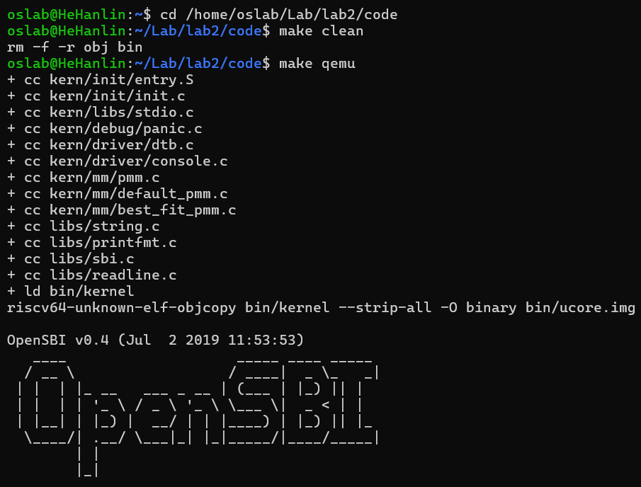

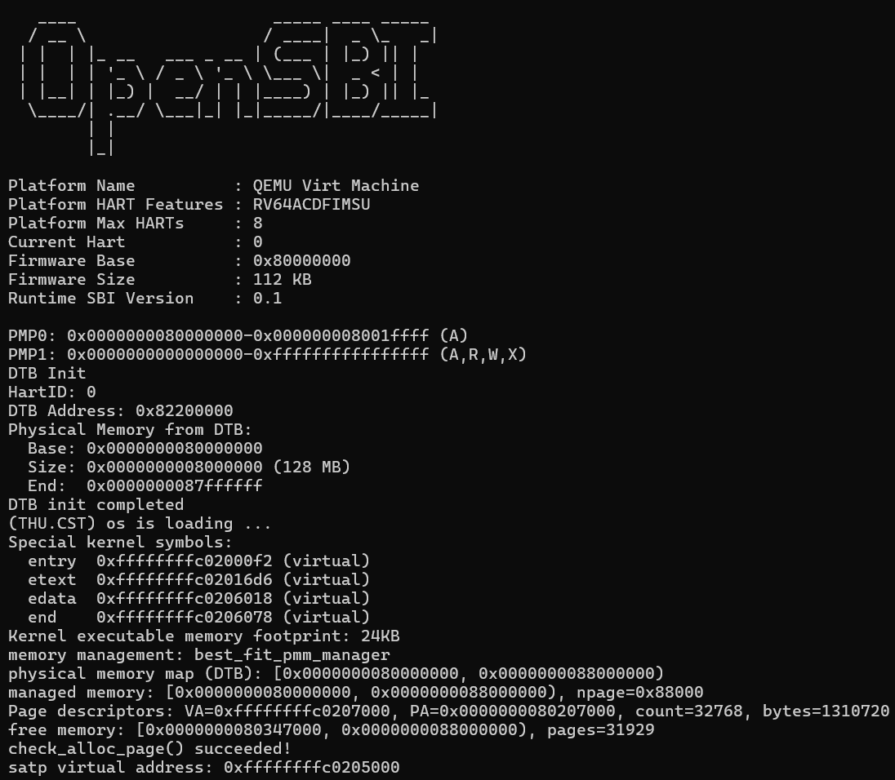

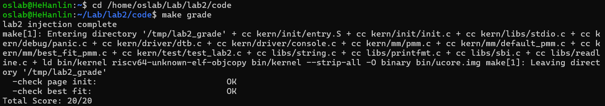

### 5.2 buddy system 
#### 环境和编译运行
在wsl2的ubuntu24.04中使用 QEMU 4.1.1、SiFive GCC-Metal 10.2.0、GNU Make 4.2.1，默认 RAM 为 128 MiB。
在kern/mm/pmm.c的init_pmm_manager()中将pmm_manager切换为 buddy_pmm_manager，运行如下指令：
```bash
make clean
make qemu
```

如果要测试释放时的断言，将kern/mm/buddy_pmm.c中165行的BUDDY_ILLEGAL_FREE_TEST改为1或3，然后同样运行上面的指令来测试，或者不修改文件使用带参数的make DEFS='-DBUDDY_ILLEGAL_FREE_TEST=1' qemu来运行，1或3的具体行为在前面的章节已有说明。

#### 运行结果
**正常运行**  
  
可以看到输出了  
```
...
memory management: buddy_pmm_manager
...
check_alloc_page() succeeded!
...
```
因此，我们的断言都未被触发，预期结果都成立，说明能够验证我们的buddy实现。  
**断言1**  
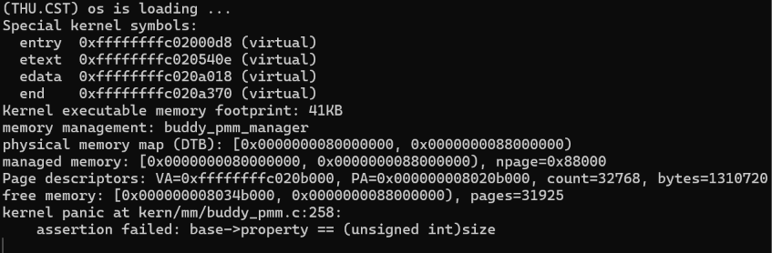  
可以看到输出了  
```
kernel panic at kern/mm/buddy_pmm.c:119:
    assertion failed: base->property == size
```
而119行的代码正是 `assert(base->property == size);`，验证了在我的实现中释放时要求的请求页数取整后要与自身大小相等。  
**断言2**  
  
可以看到输出了  
```
kernel panic at kern/mm/buddy_pmm.c:117:
    assertion failed: (index & (size - 1)) == 0
```
而117行的代码正是 `assert((index & (size - 1)) == 0);`验证了释放时要求的起始页号要与自身大小对齐。

### 5.3 初始化与 MMU 调试的实测输出摘录

```text
LAYOUT_PASS: all 839 reserved pages, 31929 free pages, descriptor array protected
pages_pa=0x80207000 free_start=0x80347000 upper=0x88000000 sizeof(Page)=40
BOUNDARY_PASS zero-size
BOUNDARY_PASS wrong-base
BOUNDARY_PASS overflow
BOUNDARY_PASS no-kernel
BOUNDARY_PASS no-descriptors
upper=0x8020d000 free_start=0x8020d000 free_count=0 init_memmap_calls=[]
BOUNDARY_PASS no-free-page
upper=0x84000000 free_start=0x802a7000 free_count=15705 init_memmap_calls=[15705]
BOUNDARY_PASS partial-tail
upper=0x88000000 free_start=0x80347000 free_count=31929 init_memmap_calls=[31929]
BOUNDARY_PASS clipped-upper
```

其中无完整空闲页的场景输出 `free_count=0 init_memmap_calls=[]`，在分配器自检前结束，只证明初始化不错误登记页面，不代表需要分配页的完整自检能在零内存下通过。

真实访存与地址翻译、软件 TLB 查询的输出摘录：

```text
GUEST_VA_PA_PASS VA=0xffffffffc0206018 root_PA=0x80205000 PTE_PA=0x80205ff8 PTE=0x200000cf PA=0x80206018
HOST_WALK_PASS BARE returned_PA=0x80206000
HOST_WALK_PASS SV39 returned_PA=0x80206000
FULL_PA=0x80206018
TLB_HIT_PASS: skipped refill branch
TLB_HIT_PASS: skipped refill branch
TLB_HIT_PASS: skipped refill branch
HOST_MMU_PASS
```

客户机 GDB 确认数据 VA、根 PTE 和完整 PA；宿主 GDB 在实际调用中观察 Bare/Sv39 路径。三次 `TLB_HIT_PASS` 对应后续取指命中，不是数据写入的再次命中。源码分支、权限判断、页内偏移与软件 TLB 的含义见第四节 GDB 部分。

### 5.5 GDB 调试过程与结果分析

本节结合客户机 GDB 与宿主 GDB，观察内核启动、物理内存初始化、Best-Fit 与 Buddy 两种分配器，以及 QEMU 对实际访存执行地址翻译和软件 TLB 填充的过程。调试在 Windows/WSL Ubuntu 环境中完成，以下分析以图 G1—G21 为实验记录，并结合内核与 QEMU 源码解释状态变化。

#### 5.5.1 实验条件与调试方法

实验中 Best-Fit 采用 `make DEFS="-O0 -fno-inline"` 构建；Buddy 在此基础上增加 `-DLAB2_PMM_BUDDY`。切换配置前执行 `make clean`，以避免复用不同编译参数生成的目标文件。关闭优化和内联便于观察局部变量及函数调用，但也会改变内核布局，因此本节地址与页数仅对应此次构建。

QEMU 配置为 `virt` 机型、128 MiB 内存，通过 `-kernel bin/ucore.img` 加载内核。`gdb-multiarch` 加载同次构建的 `bin/kernel`，连接 QEMU 的客户机调试端口，使用断点、反汇编、寄存器查询及函数返回前后的状态比较完成观察。截图未包含工具版本查询，故不沿用第 5.2 节集成测试的具体版本信息。

客户机调试用于观察内核执行状态、启动页表和物理页分配器；宿主调试用于把客户机的一条实际访存与 QEMU 的地址翻译及软件 TLB 填充调用对应起来。第四节和第 5.4 节保留此前的历史实验记录，本节集中呈现本轮可复现的命令、截图和分析。

为明确不同调试层次，终端职责划分如下。图 G1—G14 记录客户机启动、内存布局和分配器状态；图 G15—G21 记录选定访存及其在宿主 QEMU 中的翻译过程。

| 终端 | 运行对象与职责 | 执行控制的含义 |
| --- | --- | --- |
| 终端一：QEMU | 运行 RISC-V 虚拟机，显示固件、DTB、内存布局和自检输出 | `-S` 使客户机 CPU 在启动时暂停，等待终端二控制 |
| 终端二：客户机 GDB | `gdb-multiarch` 加载内核 ELF，查看客户机指令、寄存器和内核变量 | `continue` 运行客户机至下一断点；`next` 执行源代码行；`finish` 执行至当前函数返回 |
| 终端三：宿主 GDB | 调试带符号的 QEMU 进程，观察地址翻译及软件 TLB 的 C 实现 | 控制 QEMU 宿主进程；宿主断点命中时，客户机 GDB 的请求也可能暂时等待 |

客户机调试部分先使用终端一和终端二。两个终端均在同一构建目录 `lab2/code` 中工作。首先在终端一编译并暂停启动虚拟机：

```bash
make clean
make DEFS="-O0 -fno-inline"
qemu-system-riscv64 \
  -machine virt -m 128M -nographic \
  -bios default -kernel bin/ucore.img \
  -gdb tcp:127.0.0.1:1234 -S
```

随后切换到终端二，启动客户机 GDB：

```bash
gdb-multiarch -q bin/kernel
```

在 `(gdb)` 提示符下逐条输入：

```gdb
set pagination off
set confirm off
set print pretty on
set architecture riscv:rv64
target remote 127.0.0.1:1234
```

此后在终端二设置断点和推进执行，在终端一观察输出。终端切换仅改变输入焦点，不会使暂停的 CPU 自动继续；必须在 GDB 中执行 `continue` 或单步命令。客户机寄存器读数与终端一的串口输出分别反映执行状态和内核打印结果，两者结合用于核对调试结论。以下命令按截图对应的操作顺序整理，供复现使用，不作为独立于截图的新增实测证据。

#### 5.5.2 内核启动与启动映射核算

首先在终端二设置物理入口断点。此时尚未进入高地址映射，使用启动装载地址定位第一条内核指令，能够在参数保存和分页配置前读取初始状态：

```gdb
thbreak *0x80200000
continue
x/12i $pc
info registers pc sp a0 a1
p/x $satp
```

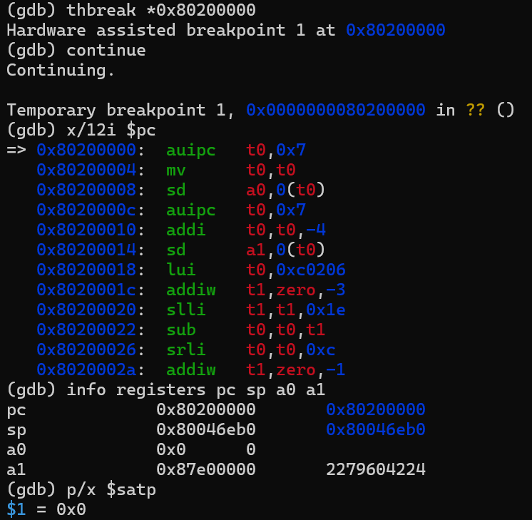

在物理入口 `0x80200000` 设置一次性硬件断点后，读得 `pc=0x80200000`、`satp=0`、`a0=0`、`a1=0x87e00000`。此时地址转换处于 Bare 模式，`a0` 和 `a1` 分别传入启动 hart ID 与 DTB 地址。反汇编中的两条 `sd` 指令用于保存这两个参数；断点位于首条指令，参数保存尚未执行。`sp=0x80046eb0` 表明程序仍沿用此前的栈指针，尚未设置内核启动栈。由于内核 ELF 按高虚拟地址链接，GDB 在该低地址入口未显示函数符号。

接着仍在终端二设置 `paging_enabled` 断点。该位置处于分页配置和高地址转移之后、启动栈设置之前，便于将地址空间转换与栈初始化两个阶段分开观察：

```gdb
thbreak paging_enabled
continue
info registers pc sp
p/x $satp
x/10i $pc
p/x (unsigned long)&boot_page_table_sv39
set $root_pa = ((unsigned long)$satp & 0xfffffffffff) << 12
p/x $root_pa
x/gx (unsigned long)&boot_page_table_sv39 + 511*8
```

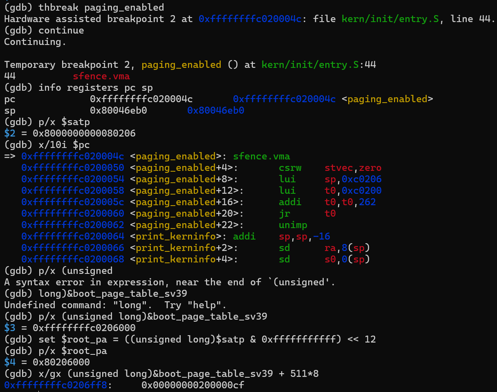

继续运行至 `paging_enabled` 后，PC 变为 `0xffffffffc020004c`，`satp=0x8000000000080206`。其 MODE 字段为 8，对应 Sv39；低 44 位保存根页表物理页号，左移 12 位得到根页表 PA `0x80206000`。根页表符号 VA 为 `0xffffffffc0206000`，与该物理地址相差 `0xffffffff40000000`。

根表第 511 项位于 VA `0xffffffffc0206ff8`，读得 PTE 为 `0x200000cf`。此时程序停在 `sfence.vma`，设置栈指针的 `lui sp,0xc0206` 尚未执行，因此仍可观察到低地址 `sp`。反汇编中 `jr t0` 后显示的 `unimp` 不在该跳转的顺序执行路径上，本图未显示非法指令异常。

随后以 `kern_init` 为断点，检查汇编启动代码是否已转入 C 初始化，并观察函数序言后的栈指针：

```gdb
thbreak kern_init
continue
info registers pc sp
p/x &bootstacktop
list
```

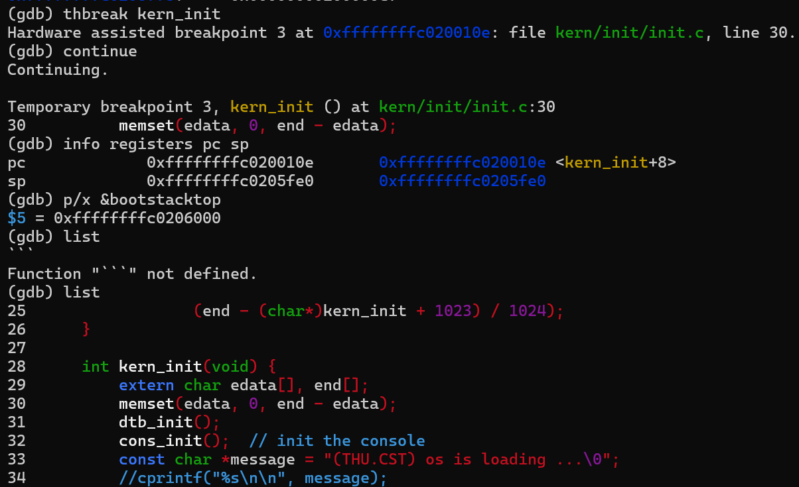

进入 `kern_init` 后，断点位于 `0xffffffffc020010e`，即函数入口后 8 字节，准备执行 BSS 清零。此时 `sp=0xffffffffc0205fe0`，比 `bootstacktop=0xffffffffc0206000` 低 `0x20` 字节，与函数序言分配栈帧的行为一致，说明程序已使用内核高地址栈。

图 G2、G3 中分别保留了表达式被拆行、误输入 Markdown 反引号所产生的命令错误；随后重新输入命令均获得有效输出。这些错误发生在 GDB 命令解析阶段，不影响上述寄存器和页表读数。

保持客户机暂停，在终端二读取根页表并进行两种地址计算。该操作读取已有状态，不调用分配器或地址翻译函数：

```gdb
set $va = (unsigned long)&kern_init
set $vpn2 = ($va >> 30) & 0x1ff
set $root_pte = *(unsigned long *)((unsigned long)&boot_page_table_sv39 + $vpn2*8)
p/x $va
p/d $vpn2
p/x $root_pte
p/x $root_pte & 0xff
set $pa = (($root_pte >> 10) << 12) | ($va & 0x3fffffff)
p/x $pa
p/x $va - 0xffffffff40000000
p $pa == ($va - 0xffffffff40000000)
```

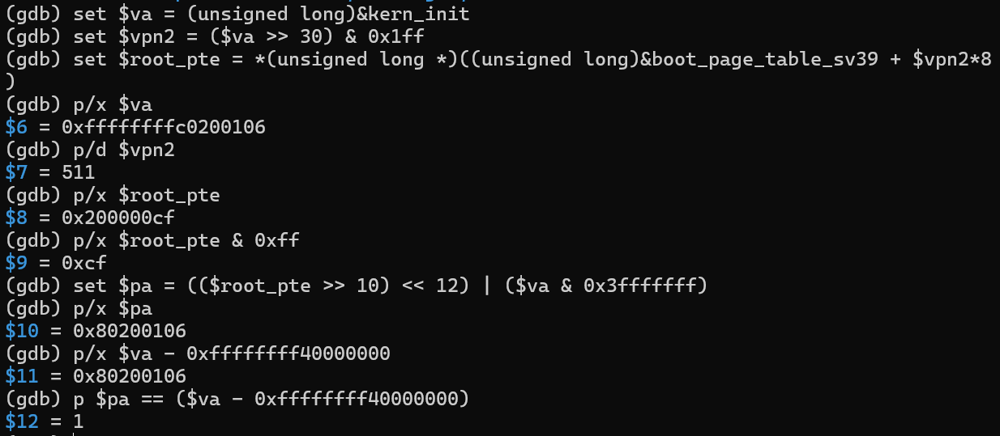

选择函数符号地址 `&kern_init=0xffffffffc0200106` 核算映射。该地址与图 G3 中断点处的 PC 相差 8 字节。根索引为 `(VA >> 30) & 0x1ff = 511`，对应 PTE 的低八位为 `0xcf`，其中 V、R、W、X、A、D 置位，U、G 清零。该项为根级叶子，其物理页号满足超级页对齐要求，对应 1 GiB 映射。

根据根级叶子的地址组成关系：

```text
PA = ((PTE >> 10) << 12) | (VA & 0x3fffffff)
   = 0x80000000 | 0x00200106
   = 0x80200106
```

使用固定偏移计算 `VA - 0xffffffff40000000`，结果同为 `0x80200106`，GDB 等值比较返回 1。两种计算一致，验证了所选函数地址的启动映射关系。该映射在根级叶子处完成解析，本项观察属于客户机页表内容核算，未涉及宿主 MMU 函数或 TLB 查询过程。

#### 5.5.3 物理内存初始化与描述符布局

在终端二依次设置 `pmm_init` 和 `page_init` 断点。前者定位物理内存管理的入口，后者定位布局计算与描述符初始化的实现，使初始化前的输入与返回后的状态可以分别检查：

```gdb
tbreak pmm_init
continue
list
tbreak page_init
continue
list
bt
next
info locals
```

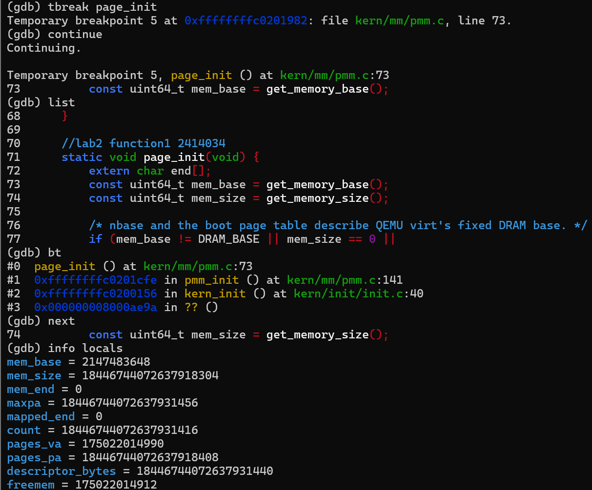

在 `page_init` 设置断点后，调用栈显示 `kern_init → pmm_init → page_init`。单步执行第 73 行后，`mem_base=2147483648`，即 `0x80000000`。此时第 74 行尚未执行，`mem_size` 及后续局部变量尚未初始化，因而不使用这些读数分析内存布局。内存容量由图 G10 的 DTB 输出确认，为 `0x08000000` 字节，即 128 MiB。

完成入口观察后，在终端二执行 `finish`，等待初始化函数返回，再读取已完成赋值的全局状态。使用结构体字段而非源码宏查询空闲页数，避免依赖 GDB 宏调试信息：

```gdb
finish
p pmm_manager->name
p/x nbase
p/x npage
p/d npage - nbase
p sizeof(struct Page)
p/x pages
p/x va_pa_offset
set $desc_pa = (unsigned long)pages - va_pa_offset
set $desc_bytes = (npage - nbase) * sizeof(struct Page)
set $free_pa = ($desc_pa + $desc_bytes + 4095) & ~((unsigned long)4095)
set $first_free = ($free_pa >> 12) - nbase
p/x $desc_pa
p/d $desc_bytes
p/x $free_pa
p/d ((npage << 12) - $free_pa) / 4096
p 'best_fit_pmm.c'::free_area.nr_free
p pages[0]
p pages[$first_free]
```

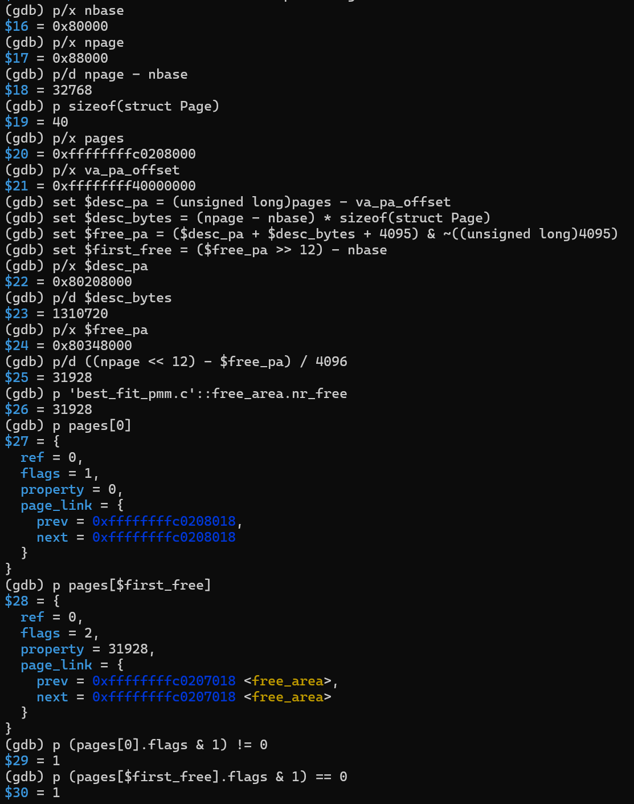

使用 `finish` 等待 `page_init` 返回后，查询全局变量并计算描述符占用及可用区间，结果如下。

| 项目 | 观测或计算结果 |
| --- | --- |
| 物理页号起点 `nbase` | `0x80000` |
| 物理页号上界 `npage` | `0x88000` |
| 描述符数量 | `npage - nbase = 32768` |
| `sizeof(struct Page)` | 40 字节 |
| 描述符数组 VA | `0xffffffffc0208000` |
| 由映射偏移计算的描述符数组 PA | `0x80208000` |
| 描述符占用 | `32768 × 40 = 1310720 = 0x140000` 字节 |
| 数组末端向上按页对齐后的可用起点 | `0x80348000` |
| 由可用区间计算的空闲页数 | `(0x88000000 - 0x80348000) / 4096 = 31928` |
| 分配器记录的空闲页数 | `free_area.nr_free = 31928` |

计算所得页数与分配器计数一致。由总页数减去空闲页数，可得初始保留前缀共 840 页，覆盖固件、内核、描述符数组及对齐占用。

图 G6 还检查了两个描述符：`pages[0]` 的 `flags=1`、`property=0`，表示保留页；首个空闲块首页的 `flags=2`、`property=31928`，表示长度为 31928 页的空闲块。上述结果验证了描述符布局及所检查页面的状态；本轮截图中的状态检查范围为这两个样本。

#### 5.5.4 Best-Fit 分配选择、分裂与回收

为比较分配前后的链表，在终端二定义只读命令 `show_best`，显示空闲页总数及最多 20 个空闲块的首页地址、块长和标志。命令只读取描述符，不改变分配器状态：

```gdb
define show_best
set $bf_head = &'best_fit_pmm.c'::free_area.free_list
set $bf_node = $bf_head->next
set $bf_offset = (unsigned long)&((struct Page *)0)->page_link
set $bf_seen = 0
p 'best_fit_pmm.c'::free_area.nr_free
while $bf_node != $bf_head && $bf_seen < 20
set $bf_page = (struct Page *)((unsigned long)$bf_node - $bf_offset)
printf "head=%p pages=%u flags=%lu\n", $bf_page, $bf_page->property, $bf_page->flags
set $bf_node = $bf_node->next
set $bf_seen = $bf_seen + 1
end
end
```

首先将断点限定为 `n==5`，跳过前面的单页自检，捕获原自检中的连续 5 页申请。`finish` 后立即保存 `a0`，因为 RISC-V ABI 通过该寄存器返回分配得到的指针：

```gdb
tbreak best_fit_alloc_pages if n == 5
continue
bt
p n
show_best
set $bf_before = 'best_fit_pmm.c'::free_area.nr_free
finish
set $bf_allocated = (struct Page *)$a0
p $bf_allocated
p *$bf_allocated
p $bf_before - 'best_fit_pmm.c'::free_area.nr_free
show_best
```

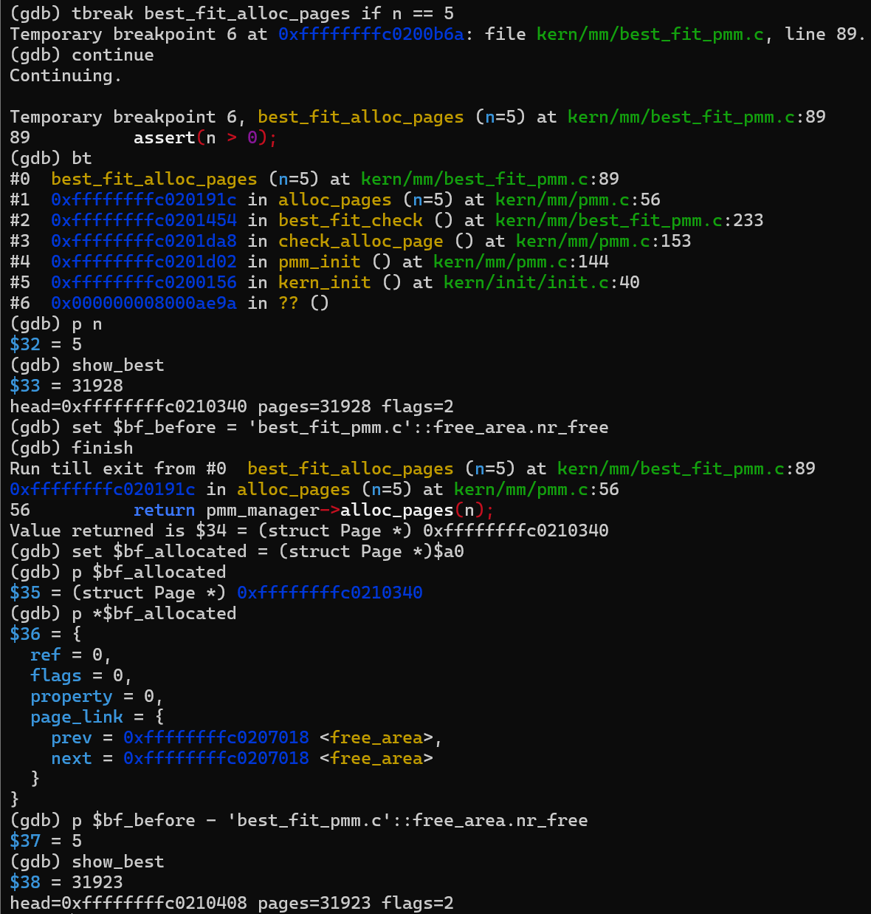

在 `best_fit_alloc_pages(n=5)` 停下时，调用栈显示该请求来自 `best_fit_check → alloc_pages → best_fit_alloc_pages`。分配前，空闲链表中仅有一个首页为 `0xffffffffc0210340`、长度为 31928 页的块。分配返回同一首页，其 `flags` 与 `property` 均清零；剩余空闲块首页变为 `0xffffffffc0210408`，长度为 31923 页，空闲总数恰好减少 5。

两个首页指针相差 `0xc8=200=5×40` 字节，对应 5 个 `Page` 描述符，即分配块占用的 5 个连续物理页。剩余块从原块的第 6 个页面开始，符合分配前部并保留余部的分裂方式。

继续在终端二设置条件断点 `n==1 && nr_free==3`。在当前自检顺序下，该条件定位到包含 2 页块和 1 页块的选择场景；随后用 `show_best` 确认候选集合，才能解释返回地址所体现的策略：

```gdb
tbreak best_fit_alloc_pages if n == 1 && 'best_fit_pmm.c'::free_area.nr_free == 3
continue
p n
show_best
finish
set $bf_chosen = (struct Page *)$a0
p $bf_chosen
show_best
```

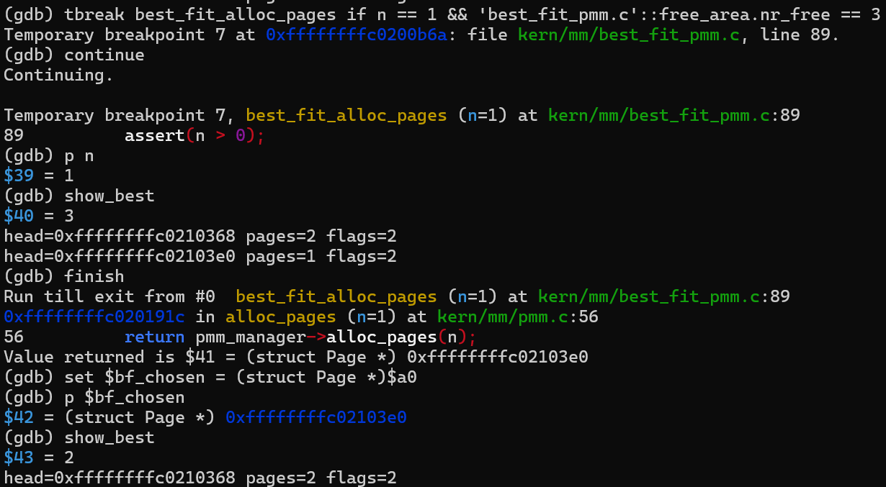

在选择策略测试中，链表按地址顺序包含两个空闲块：`0xffffffffc0210368` 对应 2 页，`0xffffffffc02103e0` 对应 1 页。申请 1 页后，返回后者，剩余链表仅保留 2 页块，空闲总数由 3 变为 2。

地址较低的 2 页块已经能够满足请求，但实际选择了容量恰好匹配的 1 页块，符合 Best-Fit 的最小适合块规则。对于这一候选集合，First-Fit 将选择先遇到的 2 页块，因此该场景能够区分两种策略。

释放阶段选择 `n==5` 且空闲页数大于零的调用，以定位当前自检恢复全局空闲链表后的归还操作；再进入 `best_fit_insert_free_block`，将释放入口、插入前和插入后的状态对应起来：

```gdb
tbreak best_fit_free_pages if n == 5 && 'best_fit_pmm.c'::free_area.nr_free > 0
continue
p base
p n
set $bf_free_before = 'best_fit_pmm.c'::free_area.nr_free
show_best
tbreak best_fit_insert_free_block
continue
p base
p *base
list
finish
show_best
p 'best_fit_pmm.c'::free_area.nr_free - $bf_free_before
```

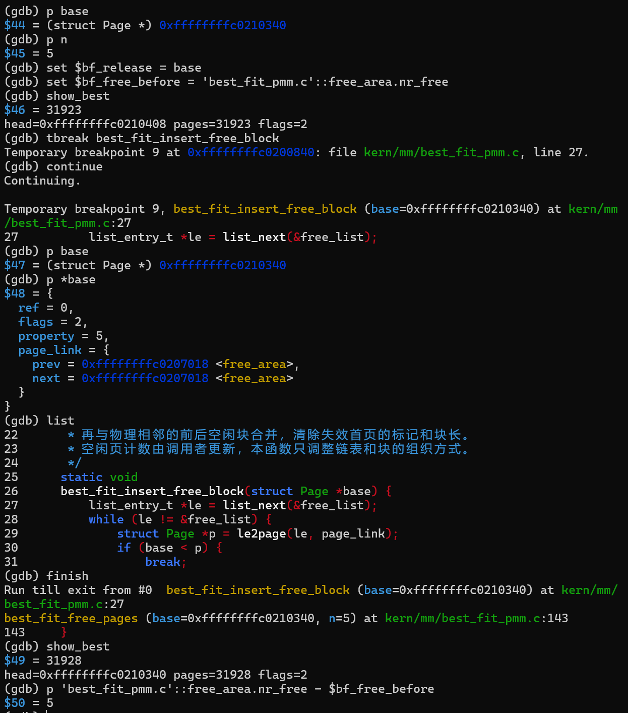

释放时，待归还块首页为 `0xffffffffc0210340`，请求释放 5 页；空闲链表中的后继块首页为 `0xffffffffc0210408`，长度为 31923 页。进入 `best_fit_insert_free_block` 后，归还块已设置 `flags=2`、`property=5`。两首页相差 5 个描述符，满足 `base + base->property == successor`，因此能够合并。

函数返回后，链表恢复为首页 `0xffffffffc0210340`、长度 31928 页的单个块，空闲总数增加 5。该结果与源码中“释放函数更新计数、插入函数调整链表和块长”的分工一致，观察到的后继合并没有造成重复计数。

最后在终端二执行 `continue`，再切换到终端一检查自检输出。此时终端二可能一直显示 `Continuing.`：源码在自检后进入 `while(1)`，不会像普通用户程序那样主动退出。是否正常结束自检，应依据终端一的明确成功信息判断。

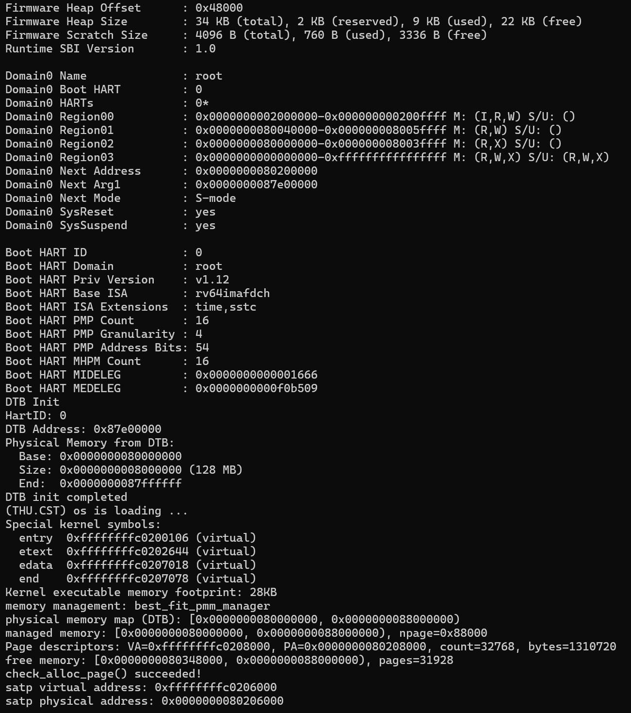

串口显示管理器为 `best_fit_pmm_manager`，并输出 `check_alloc_page() succeeded!`。描述符数组 PA、可用起点和空闲页数分别为 `0x80208000`、`0x80348000` 和 31928，与图 G6—G9 一致。

DTB 输出的 `End=0x87ffffff` 表示最后一个有效字节地址；管理区间 `[0x80000000, 0x88000000)` 使用右开上界，两种表示对应同一内存范围。自检成功信息表明该构建中的检查函数已正常返回，本节不据此报告课程评分结果。

#### 5.5.5 Buddy 容量取整、伙伴关系与受控区恢复

切换配置前，先回到终端二按 Ctrl+C 暂停客户机，输入 `detach`、`quit` 退出 GDB；再切换到终端一，按 Ctrl+A 后按 X 退出 QEMU。这样可以保证后续加载的是 Buddy 构建的镜像与符号文件。

在终端一重新编译并启动：

```bash
make clean
make DEFS="-DLAB2_PMM_BUDDY -O0 -fno-inline"
qemu-system-riscv64 \
  -machine virt -m 128M -nographic \
  -bios default -kernel bin/ucore.img \
  -gdb tcp:127.0.0.1:1234 -S
```

终端二重新执行 `gdb-multiarch -q bin/kernel`，然后输入：

```gdb
set pagination off
set confirm off
set print pretty on
set architecture riscv:rv64
target remote 127.0.0.1:1234
tbreak buddy_alloc_pages if n == 5
continue
p pmm_manager->name
p n
p buddy_max_order
p buddy_nr_free
set $buddy_before = buddy_nr_free
finish
set $buddy_allocated = (struct Page *)$a0
p $buddy_allocated
p *$buddy_allocated
p $buddy_allocated->property
p $buddy_before - buddy_nr_free
p ($buddy_allocated->flags & 2) == 0
```

选择 5 页这一非 2 的幂请求，能够直接观察请求量与实际占用量的区别；条件断点使观察对象来自自检的真实调用。

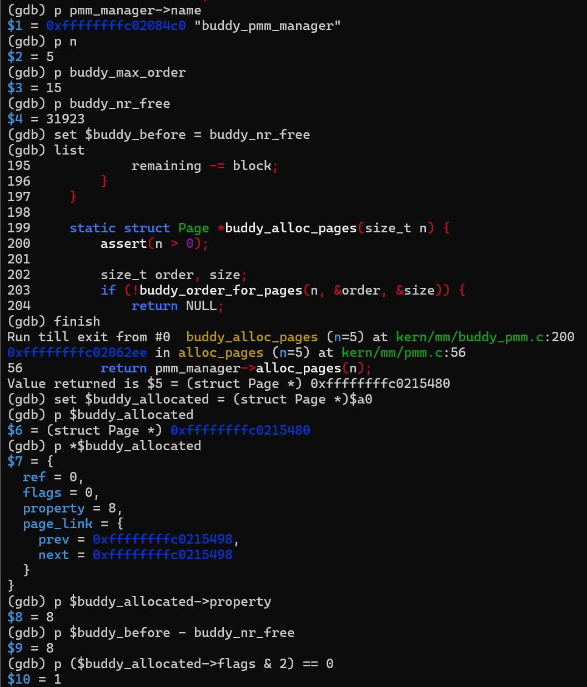

切换至 Buddy 后，管理器名称为 `buddy_pmm_manager`，`buddy_max_order=15`，分配前空闲页数为 31923。申请 5 页返回首页 `0xffffffffc0215480`，其 `flags=0`、`property=8`，空闲总数减少 8。由此计算，分配后剩余 31915 个空闲页。

Buddy 将请求容量向上取整至 2 的幂，此次实际占用 8 页，相对于请求多占用 3 页。已分配块头保留 `property=8`，用于记录回收时应释放的实际容量，而 `PG_property` 位已清除；块长字段与空闲首页标志具有不同职责。`buddy_max_order` 给出允许的阶数上限，并不表示该阶当前存在可用块。

在终端二以刚才返回的指针限定释放断点，保证跟踪的是同一个块。随后在伙伴插入函数停下，读取块阶数并计算伙伴下标：

```gdb
tbreak buddy_free_pages if base == $buddy_allocated
continue
p base
p n
set $buddy_free_before = buddy_nr_free
tbreak buddy_insert_free_block
continue
p page
p order
p page->property
set $block_index = (unsigned long)(page - pages)
set $partner_index = $block_index ^ ((unsigned long)1 << order)
p/d $block_index
p/d $partner_index
p npage - nbase
```

确认伙伴下标位于描述符范围内后，再读取该描述符并运行到函数返回：

```gdb
p pages[$partner_index]
finish
p buddy_nr_free - $buddy_free_before
p buddy_nr_free == $buddy_before
```

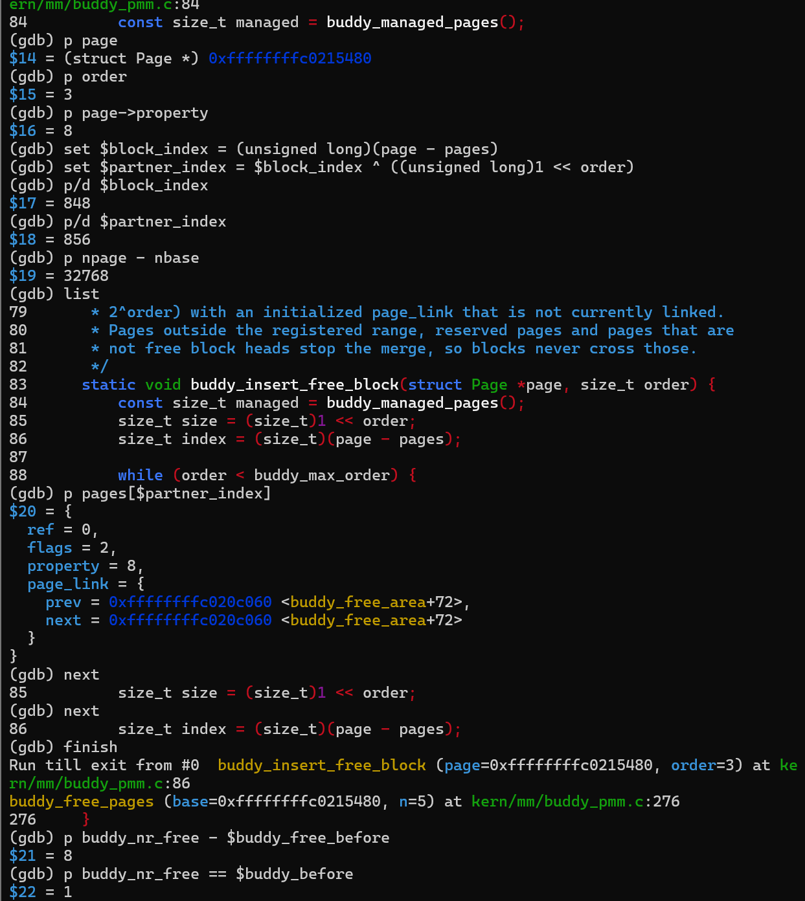

释放上述块时，在 `buddy_insert_free_block` 观察到 `order=3`、块长为 8 页，首页在描述符数组中的下标为 848。按伙伴计算规则：

```text
buddy_index = 848 XOR (1 << 3) = 856
```

伙伴下标位于描述符范围内，其 `flags=2`、`property=8`，符合本次同阶空闲伙伴的状态。函数执行结束后，空闲总数增加 8，与分配前计数的等值比较返回 1，说明本次分配占用的页面已全部归还。图中通过 `finish` 观察函数返回后的结果，未记录每一轮递归合并的中间状态。

受控测试选择 `buddy_split_check`，因为该函数建立单个 16 页的空闲测试区，块位置与阶数确定，适合排除全局空闲链表分布对观察的影响。若复现这一场景，可在终端二按以下顺序定位至最初 4 页块归还后的状态；该定位流程根据源码整理，现存图 G13 仅保留最后五条查询的结果：

```gdb
tbreak buddy_split_check
continue
set $arena_head = arena
tbreak buddy_alloc_pages if n == 4
continue
finish
tbreak buddy_free_pages if base == $arena_head && n == 4
continue
tbreak buddy_insert_free_block
continue
finish
p $arena_head->property
p buddy_nr_free
p buddy_free_area[2].nr_free
p buddy_free_area[3].nr_free
p buddy_free_area[4].nr_free
```

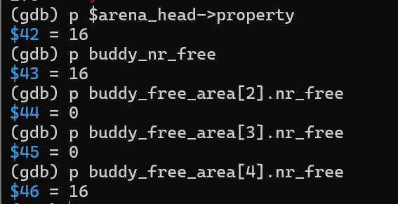

在 16 页隔离测试区内，合并后读得 `arena_head->property=16`、`buddy_nr_free=16`；第 2、3 阶的空闲页数为 0，第 4 阶为空闲 16 页。这些值与测试区恢复为一个 16 页空闲块的预期一致。各阶 `nr_free` 统计的是页数，且此时计数对象为隔离测试区，并非整机全部空闲内存。

图 G13 保存了合并恢复后的终态，未包含从 16 页块分配 4 页并形成 8 页、4 页剩余块的连续中间画面。因此，本图用于核对恢复后的块长与阶计数。

完成状态查询后，在终端二执行以下命令清除剩余观察断点并继续运行，再切换到终端一读取自检结果：

```gdb
delete breakpoints
continue
```

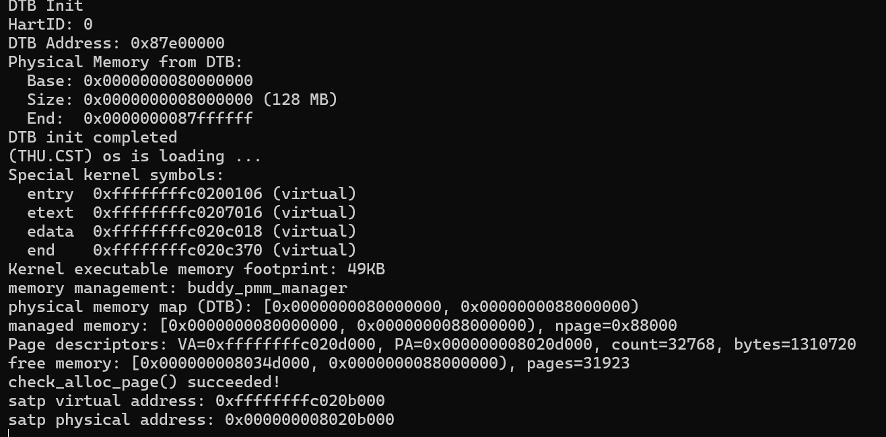

Buddy 串口同样输出 `check_alloc_page() succeeded!`。两种构建的布局对比如下。

| 项目 | 本次 Best-Fit | 本次 Buddy |
| --- | --- | --- |
| 根页表 PA | `0x80206000` | `0x8020b000` |
| 描述符数组 PA | `0x80208000` | `0x8020d000` |
| 描述符数量 / 字节数 | 32768 / 1310720 | 32768 / 1310720 |
| 首个空闲页 PA | `0x80348000` | `0x8034d000` |
| 初始空闲页数 | 31928 | 31923 |
| 由总页数减空闲页数计算的保留页数 | 840 | 845 |

图 G10、G14 分别显示两种构建的内核占用约为 28 KiB、49 KiB，链接符号 `end` 分别为 `0xffffffffc0207078`、`0xffffffffc020c370`。按页对齐后，描述符数组起点相差 `0x5000`；由于数组大小相同，可用区间起点也相差 `0x5000`，即 5 页，恰好解释初始空闲页数的差值。该跨构建差异来自初始布局，各次分配与释放是否恢复计数则在各自运行中判断。

#### 5.5.6 宿主调试的三个终端与执行顺序

宿主调试将客户机的一条实际存储指令与 QEMU 的地址翻译调用对应起来，分别观察 Bare 和 Sv39 两种状态。图 G15—G21 为本次保存的七张截图，其中 G15、G18、G21 来自客户机 GDB，其余来自宿主 GDB。页表遍历的中间变量依据本次调试时逐条保存的命令输出整理，并在下文标明；本节不依赖已删除的日志文件。

终端一运行带调试符号的 QEMU 4.1.1，终端二用 `gdb-multiarch` 调试 RISC-V 内核，终端三用宿主 `gdb` 附加到 QEMU 进程。宿主源码位于 `/mnt/d/操作系统/Lab2-A/lab2/_local/qemu-4.1.1`，可执行文件位于同级的 `qemu-build/riscv64-softmmu/`。它们是本地工具目录，不属于报告附件。内核来自 `/mnt/d/操作系统/OSlab2026G53/lab2/code` 的 Best-Fit 调试构建；以下地址仅适用于截图中的镜像。

下列命令按实际调试流程整理，用于复现各观察点。先结束已有 QEMU 会话，避免复用旧进程或占用 1234 端口。在终端一启动虚拟机：

```bash
cd /mnt/d/操作系统/OSlab2026G53/lab2/code
/mnt/d/操作系统/Lab2-A/lab2/_local/qemu-build/riscv64-softmmu/qemu-system-riscv64 \
  -machine virt -m 128M -nographic \
  -bios default -kernel bin/ucore.img \
  -gdb tcp:127.0.0.1:1234 -S \
  -pidfile /tmp/lab2-qemu-hostdebug.pid
```

终端二加载与镜像配套的符号文件并连接客户机：

```bash
cd /mnt/d/操作系统/OSlab2026G53/lab2/code
gdb-multiarch -q bin/kernel
```

```gdb
set pagination off
set architecture riscv:rv64
target remote 127.0.0.1:1234
thbreak *0x80200008
continue
```

选择 `0x80200008` 是因为本次反汇编在此处显示 `sd a0,0(t0)`，用于保存启动 hart ID。断点停在存储执行前，便于取得实际地址并为宿主设置条件断点。重新构建后，应先在入口停下并反汇编，重新确认指令地址。

终端三附加到终端一对应的进程：

```bash
sudo gdb -q -nx \
  /mnt/d/操作系统/Lab2-A/lab2/_local/qemu-build/riscv64-softmmu/qemu-system-riscv64 \
  -p "$(cat /tmp/lab2-qemu-hostdebug.pid)"
```

本次普通用户执行 `attach` 时受到 `ptrace` 权限限制，改用上述命令后成功附加。附加时停在 `ppoll` 且提示缺少 glibc 源文件，不影响随后在已具备源码和符号的 QEMU 函数中调试。

终端切换只改变输入位置。每次应先在终端三设置宿主断点并执行 `continue`，使 QEMU 进程恢复运行，再在终端二执行 `si` 触发客户机访存。宿主断点命中后，终端二的单步请求可能仍在等待；应在终端三完成观察并继续运行后，再等待终端二返回提示符。只有出现 `(gdb)` 提示符时才输入下一条命令。

#### 5.5.7 Bare 状态下的存储与 TLB 填充

在终端二的存储指令断点处查询：

```gdb
x/i $pc
info registers pc t0 a0
p/x $satp
```

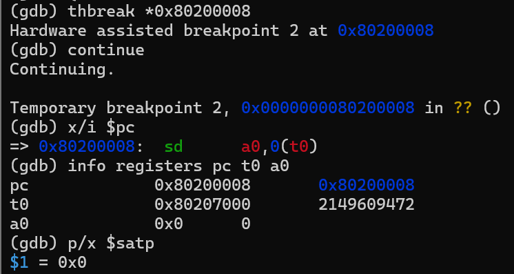

图 G15 显示 `PC=0x80200008`，指令为 `sd a0,0(t0)`，`t0=0x80207000`、`a0=0`、`satp=0`。因此此次操作是向客户机地址 `0x80207000` 写入 8 字节的零值，尚未启用 Sv39。

在终端三设置条件断点并恢复宿主，然后切换到终端二执行一次 `si`：

```gdb
set pagination off
break get_physical_address if addr == 0x80207000 && access_type == 1 && mmu_idx == 1
continue
```

断下后在终端三检查调用栈与参数：

```gdb
bt 7
p/x addr
p/x env->satp
```

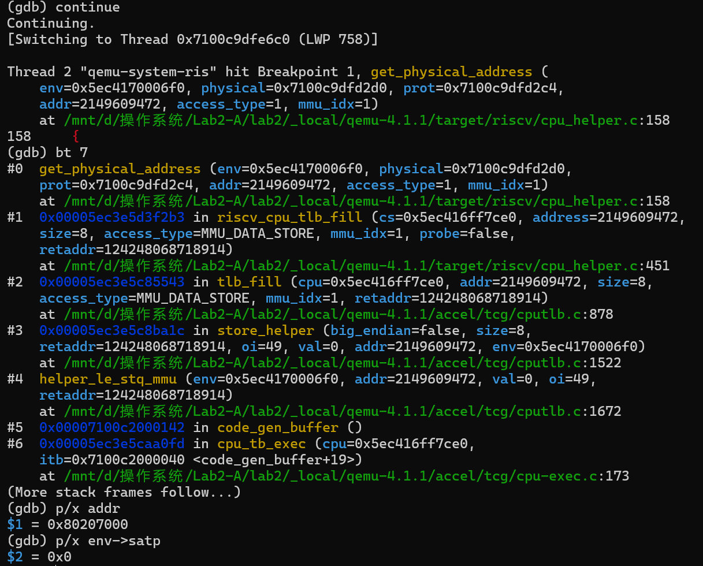

调用栈由 TCG 生成代码进入 `helper_le_stq_mmu → store_helper → tlb_fill → riscv_cpu_tlb_fill → get_physical_address`。`size=8` 与客户机的 `sd` 对应；`access_type=1` 对应 `MMU_DATA_STORE`，`mmu_idx=1` 对应本次 S 模式访问。地址与图 G15 一致，说明该断点来自所选客户机存储。写访问条件也排除了调试器读取内存所产生的读访问。

根据 `cpu_helper.c`，此处 S 模式不会进入 M 模式的直接返回分支，而是在解析 `satp.MODE=0` 后进入 Bare 分支，将输入地址作为物理地址返回。随后在终端三观察填充入口：

```gdb
tbreak tlb_set_page_with_attrs if vaddr == 0x80207000 && mmu_idx == 1
continue
bt 5
p/x vaddr
p/x paddr
p/x size
```

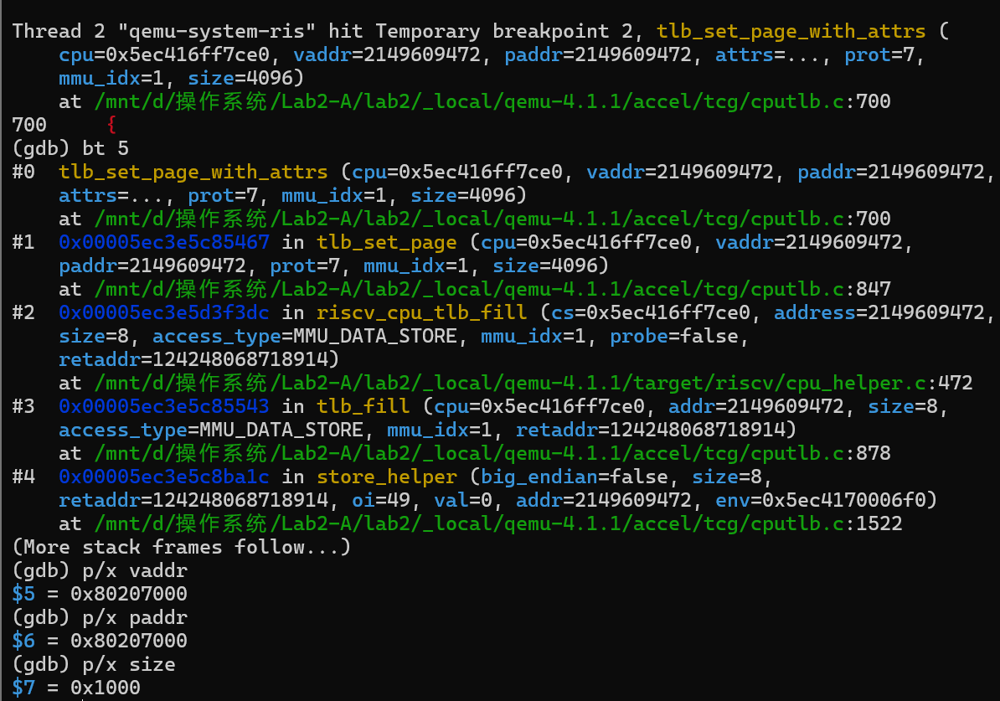

图 G17 中 `vaddr=paddr=0x80207000`，`size=0x1000`，`prot=7`。Bare 不查 Sv39 页表，但 QEMU 仍通过软件 TLB 保存快速访问信息，以便将客户机地址关联到宿主内存。这里的恒等关系仅指客户机虚拟地址与客户机物理地址，不能将其解释为宿主进程中的指针地址。

#### 5.5.8 Sv39 状态下选取 BSS 清零指令

在终端三执行 `continue`，等待终端二的单步返回。终端二随后定位 `memset`：

```gdb
thbreak memset
continue
disassemble /r memset
thbreak *0xffffffffc0202626
continue
x/i $pc
info registers pc a5 a4 satp
p/x &edata
```

本次反汇编显示 `memset+46` 即 `0xffffffffc0202626` 为 `sb a4,0(a5)`。选取循环体中的字节存储，可以将实际写入地址与 `kern_init()` 中的 `memset(edata, 0, end - edata)` 对应起来；函数入口还包含保存寄存器等栈访问，不宜直接当作 BSS 写入现场。

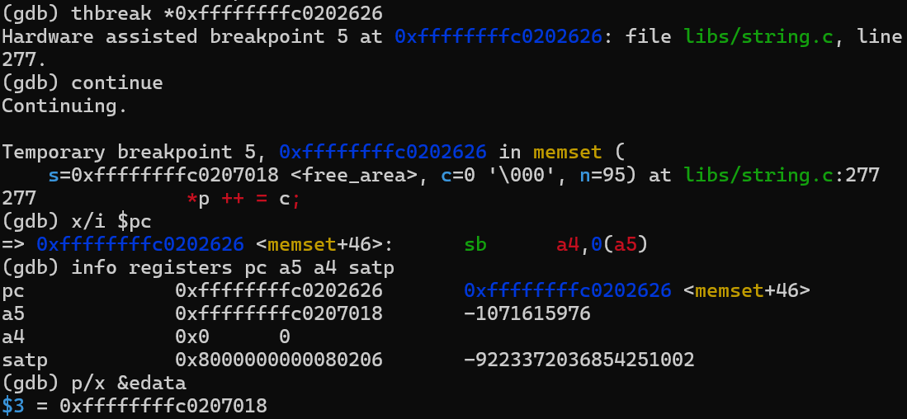

图 G18 显示 `a5=&edata=0xffffffffc0207018`、`a4=0`、`satp=0x8000000000080206`。该存储写入一个零字节，MODE 为 8，即 Sv39。GDB 将 BSS 起点显示为同地址的 `free_area` 符号，不代表此时已进入分配器初始化。图中的局部变量 `n=95` 与原始长度 96 字节并不矛盾：进入第一次循环体前，`while (n-- > 0)` 已对局部计数执行一次递减。

保持终端二停在存储前，在终端三按 Ctrl+C 暂停宿主进程，添加新的条件断点并继续：

```gdb
break get_physical_address if addr == 0xffffffffc0207018 && access_type == 1 && mmu_idx == 1
continue
```

再切换到终端二执行 `si`。宿主命中后，在终端三查询：

```gdb
bt 7
p/x addr
p access_type
p mmu_idx
p/x env->satp
```

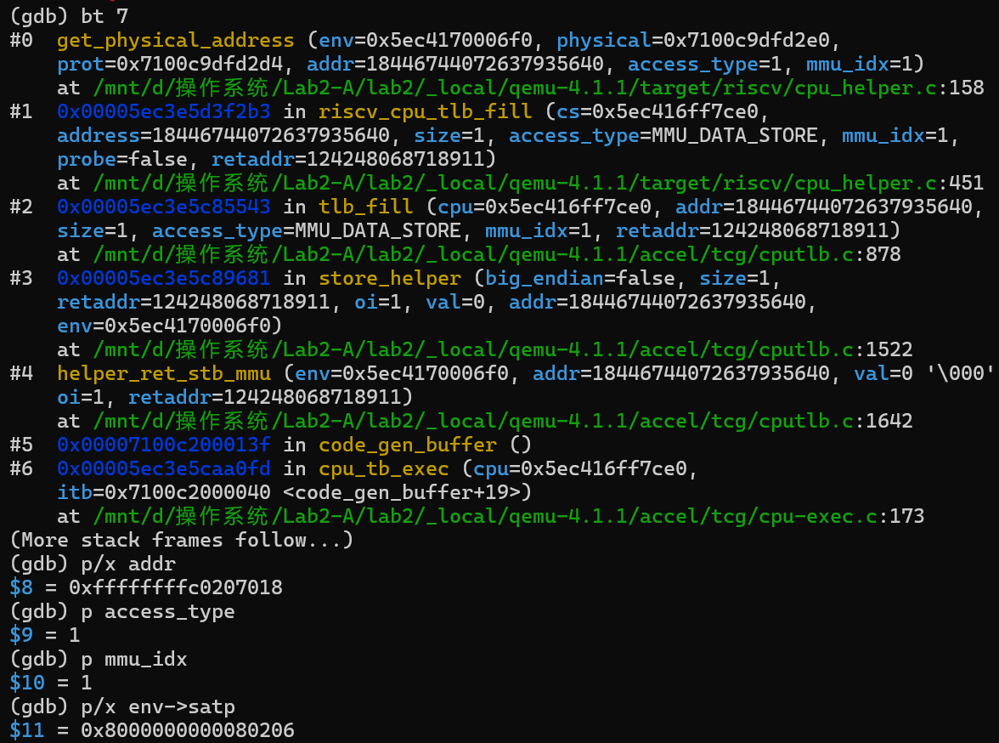

图 G19 的 `helper_ret_stb_mmu`、`size=1` 和 `val=0` 与图 G18 的 `sb` 一致。实际数据访问进入 `tlb_fill` 慢路径后调用地址翻译函数；这不是客户机发生了缺页异常，成功翻译后仍可继续执行原指令。

#### 5.5.9 根级叶子项与物理页基址

在终端三用 `next` 推进到相应赋值语句执行之后，再读取局部变量。本次文字调试记录得到以下数值，七张截图未单独保存这一组中间状态：

| 观察量 | 本次结果 | 含义 |
| --- | --- | --- |
| `mode`、`vm` | 1、8 | S 模式、Sv39 |
| `base` | `0x80206000` | 根页表物理地址，由 satp 的 PPN 左移 12 位得到 |
| `levels`、`ptidxbits`、`ptesize` | 3、9、8 | 最多三级、每级索引 9 位、每项 8 字节 |
| `i`、`ptshift` | 0、18 | 从根级开始；低两级 VPN 共 18 位 |
| `pte_addr` | `0x80206ff8` | 根表第 511 项的物理地址 |
| `pte`、`ppn` | `0x200000cf`、`0x80000` | 读出的页表项及其 PPN |
| `*physical` | `0x80207000` | 翻译函数输出的物理页基址 |

根级索引按 `(addr >> 30) & 0x1ff` 计算为 511，故 PTE 地址为 `0x80206000 + 511 × 8 = 0x80206ff8`。本次在初始化尚未完成时查询 `idx` 曾读到无效旧值，随后宿主指令执行中的 `rax=0x1ff` 与上述计算吻合；已完成赋值的 `pte_addr` 也验证了索引结果。

在本地 QEMU 4.1.1 源码中，可按以下顺序推进到读取和计算完成的位置：

```gdb
until 252
next
p/x pte
next
p/x ppn
p i
until 334
next
p/x *physical
```

第 252 行调用 `ldq_phys(cs->as, pte_addr)`，`next` 后停在第 254 行时，`pte` 已读出，但 `ppn` 尚未赋值。再执行一次 `next` 才能读取 `ppn`。类似地，第 334 行执行之后才能读取 `*physical`。`list` 只显示源码，不推进程序；停在某行通常表示该行的语句即将执行。上述行号适用于本次 QEMU 源文件，换版本后应按语句重新定位。

PTE 低位 `0xcf` 表示 V、R、W、X、A、D 置位，U 未置位。该项在根级已具备读写执行权限，是 1 GiB 叶子映射，不需要继续查下两级页表。`ppn & ((1 << 18) - 1) = 0` 满足超级页对齐要求；本次 S 模式写访问具备权限，且 A/D 已置位，无需进入页表项原子更新分支。

第 334 行的计算为：

```text
vpn = 0xffffffffc0207018 >> 12
vpn & ((1 << 18) - 1) = 0x207
physical_page = (0x80000 | 0x207) << 12 = 0x80207000
page_offset = 0x18
完整客户机物理地址 = 0x80207000 + 0x18 = 0x80207018
```

`*physical` 是该 Sv39 路径返回的页基址；函数本身的整型返回值表示翻译是否成功。完整物理地址也等于客户机 VA 减去固定偏移 `0xffffffff40000000`，与启动汇编建立的映射一致。

#### 5.5.10 TLB 填充参数与客户机恢复执行

在终端三的翻译函数返回前设置填充断点：

```gdb
tbreak tlb_set_page_with_attrs if paddr == 0x80207000 && mmu_idx == 1
continue
info args
```

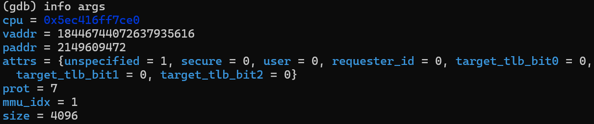

图 G20 的十进制参数转换为十六进制后为：

| 参数 | 本次值 | 解释 |
| --- | --- | --- |
| `vaddr` | `0xffffffffc0207000` | 客户机访问地址向下对齐到 4 KiB |
| `paddr` | `0x80207000` | 本次翻译得到的物理页基址 |
| `prot` | 7 | QEMU 的读、写、执行权限组合 |
| `mmu_idx` | 1 | 本次 S 模式访问使用的 MMU 索引 |
| `size` | 4096 | 本次软件 TLB 填充调用的页粒度 |

`riscv_cpu_tlb_fill()` 在翻译成功后，以 `address & TARGET_PAGE_MASK`、`pa & TARGET_PAGE_MASK` 和 `TARGET_PAGE_SIZE` 调用 `tlb_set_page()`，随后进入图中的函数。因此，根级叶子映射范围为 1 GiB 与该填充调用的 4 KiB 粒度并不矛盾：前者是客户机页表的映射范围，后者是这个 QEMU 实现为当前访问建立软件缓存的粒度。

图 G20 保存的是填充函数入口参数，尚不是读取已写入 TLB 项的截图。在终端三执行 `continue` 后，终端二的单步完成，查询客户机现场：

```gdb
x/8i $pc
info registers pc a0 a1 a2
```

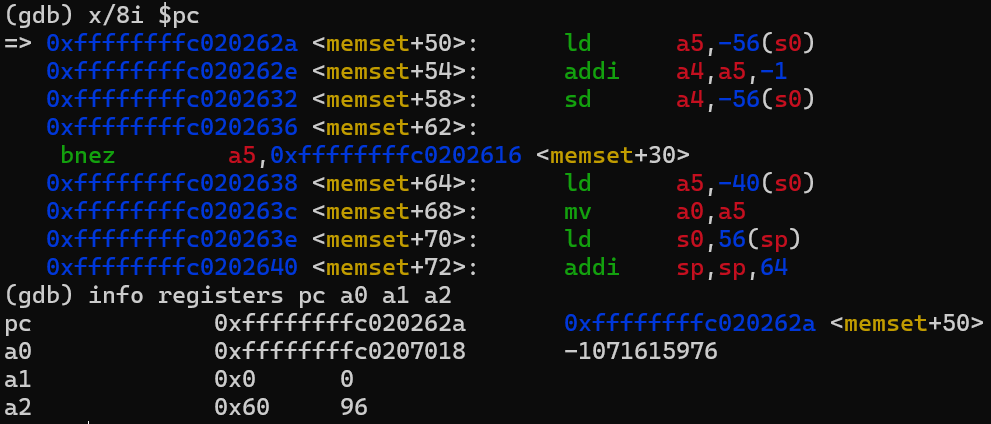

图 G21 中 PC 从存储指令 `0xffffffffc0202626` 推进到 `0xffffffffc020262a`，当前指令为 `ld a5,-56(s0)`，对应下一轮循环条件的计数读取。它与图 G18 构成一次存储前后的执行位置对照。`a0=0xffffffffc0207018`、`a1=0`、`a2=0x60` 与本次 `memset` 的初始参数一致；循环中的剩余计数已保存在栈上，不能把仍为 96 的 `a2` 当作当前剩余字节数。

#### 5.5.11 综合结果与验证范围

本轮截图所记录的地址、块长和页数变化相互一致。启动阶段观察到 Bare 状态向高虚拟地址执行的转换，并核对了所选函数地址的根级页表映射；初始化阶段验证了描述符布局、空闲页计数与两个样本描述符的状态；分配器阶段观察到 Best-Fit 的分裂、最小适合块选择和后继合并，以及 Buddy 的容量取整、伙伴查找、回收计数与受控区恢复终态。两种构建均输出自检成功信息。

宿主调试证据覆盖 Bare 恒等翻译、Sv39 根级叶子解析、物理页基址计算、软件 TLB 填充入口及客户机单步返回。它未直接记录后续访问的 TLB 命中快路径，也未检查本次填充后的内部标签或 `addend` 字段，因此不据此声称“第二次数据写已命中 TLB”。第 5.4 节的历史取指命中记录仍属于另一组实验。本次宿主调试未重新运行课程评分或分配器测试。

## 六、实验总结与收获

### 6.1 对操作系统的理解

| 本实验知识点 | OS 原理对应 | 含义、关系与差异 |
| --- | --- | --- |
| DTB、上界与保留区 | 物理资源发现与保护 | 已知 RAM 不等于全部可分配，还要排除固件、内核和元数据 |
| Page 数组与自举 | 资源元数据管理 | 描述符不是物理页本身，管理内存也会消耗内存 |
| First-Fit／Best-Fit | 动态分区选择与外部碎片 | 本实验以页为单位，选择策略不同；相邻合并不能跨占用页 |
| Buddy 取整、分裂与合并 | 分级分配与内部碎片 | 只有同阶伙伴能合并，请求 5 页占 8 页带来容量浪费 |
| pmm_manager 回调 | 公共接口与分配策略 | 不同策略可接入同一入口，但容量和释放语义仍须明确 |
| Sv39、PTE 和 satp | 虚拟地址翻译与权限 | 最大三级不等于每次查满三级，本例根级叶子形成 1 GiB 映射 |
| 软件 TLB 与 Bare | 缓存及模拟器实现 | QEMU 还需将客户机地址关联宿主内存，不能等同于真实硬件缓存结构 |
| 断言和状态恢复 | 系统不变量验证 | 不只检查返回非空，还需检查范围、计数、关系和测试自身不泄漏资源 |

OS 原理中重要但本实验尚未完整实现的内容包括：进程私有地址空间及切换、按需分页、页面置换和交换、写时复制、多核内存分配同步与 TLB shootdown、完整硬件内存保留表与热插拔，以及任意大小对象分配。

### 6.2 AI 协作开发的经验

1. **先明确规格。** 在提示词中写清接口、修改范围、状态约束和边界情况，帮助 AI 生成符合现有框架的代码。

2. **结合证据调试。** 提供源码、报错和运行状态，逐步定位问题，同时核对实现与测试预期。

3. **独立验证结果。** 通过编译、自检和 GDB 检查 AI 的输出，保留真实日志与截图，区分历史验证和本次结果。

### 6.3 提交内容

```text
lab2/
├── code/                  # 实验实现、Makefile 与课程原有工具
└── report/
    ├── report.md          # 本实验报告
    ├── prompt.md          # 实验提示词汇编
    └── images/            # 测试截图
```

全部提示词见 [prompt.md](prompt.md)。最终代码位于 `../code/`，默认 Best-Fit，Buddy 通过 `LAB2_PMM_BUDDY` 选择。
