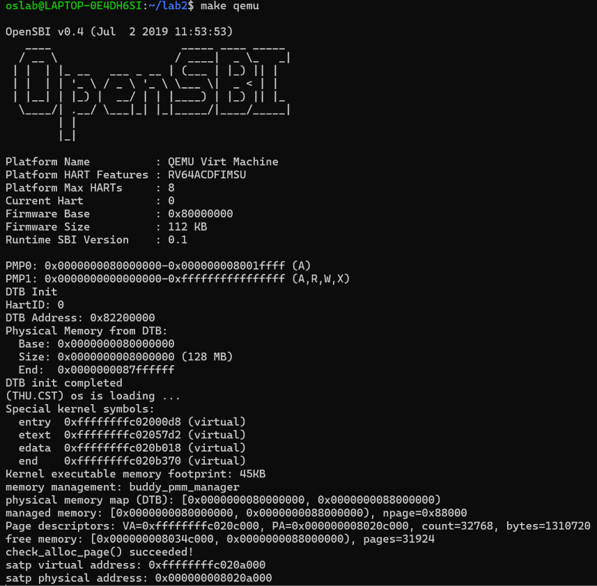
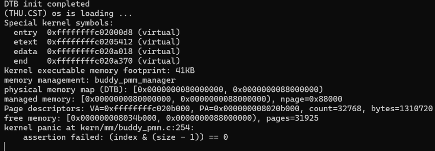

# 操作系统实验报告

## 实验基本信息

| 项目 | 内容 |
| --- | --- |
| **实验名称** | Lab2：物理内存和页表 |
| **小组成员** | 2414034－[待填写姓名]、2412591－[待填写姓名]、2412604－刘泽民 |
| **完成日期** | [待填写最终完成日期]；本次代码集成验证日期为 2026-10-25 |

### 小组分工

| 成员 | 负责的练习/模块 |
| --- | --- |
| A：2414034－[待填写姓名] | 物理内存初始化、未知内存范围获取思考题、QEMU/MMU/TLB 调试及对应报告 |
| B：2412591－[待填写姓名] | First-Fit 分析、Best-Fit 实现、代码集成验证、报告和提示词汇总 |
| C：2412604－刘泽民 | Buddy System 实现、独立测试提示词与测试函数、对应报告 |

报告分工：A、B、C 分别提供本人模块的原理、规格、提示词、实际问题和证据，B 负责按模板统一顺序和术语，汇总测试结果。原始材料保留于 `member-a/`、B 独立报告和 `member-c/`；下文的集成日志来自合并后代码，避免将成员历史验证混为当前构建结果。

## 一、实验目的

1. 理解设备树内存信息、可管理范围、内核保留区和物理页描述符的关系，建立正确的初始空闲页集合。
2. 理解 First-Fit，完成 Best-Fit 的登记、连续页分配、分裂、回收和相邻合并。
3. 实现并测试 Buddy System，理解按阶管理、向上取整、伙伴分裂和递归合并及碎片代价。
4. 通过 QEMU 源码和 GDB 观察 Sv39、根级大页和软件 TLB，将实际访存与 VA→PA 过程对应起来。
5. 学习用明确的接口、前后置条件及边界场景组织提示词，并以源码、断言、日志和截图验证 AI 生成结果。

## 二、实验环境

### 2.1 编译和调试环境

| 用途 | 已知环境 | 说明 |
| --- | --- | --- |
| A 的历史初始化和 MMU 实验 | WSL Ubuntu 24.04；GCC 13.2；QEMU 8.2.2 与独立调试版 4.1.1；GDB/gdb-multiarch 15.1 | 见 [环境日志](member-a/logs/environment.txt)，调试版未安装覆盖日常 QEMU |
| B 的独立运行 | RISC-V ucore、QEMU；截图所示 OpenSBI v0.4 | 其他当时环境信息：[待填写] |
| C 的独立运行 | RISC-V ucore、QEMU；截图所示 OpenSBI v0.4 | 发行版、编译器和 QEMU 具体版本：[待填写] |
| 2026-10-25 集成复测 | QEMU 4.1.1；SiFive GCC-Metal 10.2.0；GNU Make 4.2.1 | 见 [集成环境日志](integration-logs/environment.txt)，默认 128 MiB RAM |

### 2.2 使用的 AI 工具

| 成员 | AI 编程工具 | 底层模型 | 备注 |
| --- | --- | --- | --- |
| 2414034－[待填写姓名] | [待填写] | [待填写] | 原材料记录了实际 AI 协作轨迹，未给出可确认的工具及模型版本 |
| 2412591－[待填写姓名] | [待填写] | [待填写] | 辅助解释代码、编写提示词、核对合并结果及整理报告 |
| 2412604－刘泽民 | Claude Code（VS Code 插件） | DeepSeek-V4.1-Flash | 按 C 原报告填写；由本人确认实际配置 |

工具指具体使用的客户端或插件，底层模型指实际配置的模型及版本，两者分别填写，不互相替代。

## 三、实验整体逻辑分析

### 3.1 本章节的逻辑主线

主线是“发现 RAM → 保护已占用区域 → 登记可用物理页 → 按策略分配和回收 → 验证地址与状态”。启动汇编预置页表并打开 Sv39 后，C 代码才能以高虚拟地址操作内核数据。`dtb_init()` 获取 RAM 起点和长度，`page_init()` 将它们转化为 `Page` 描述符布局与可用区间，再经 `pmm_manager` 交给具体分配策略。

```text
entry.S：配置启动根页表，开启 Sv39 并转入高地址
  → kern_init / dtb_init：初始化并读取 RAM 信息
  → pmm_init / init_pmm_manager：选择分配器并清空其内部状态
  → page_init：建立 Page 数组，保留固件、内核、元数据及对齐占用
  → init_memmap：登记完整空闲页
  → 当前管理器的 check：内部调用 alloc_pages / free_pages 检查状态和算法行为
  → 后续公开分配/释放：选择、分裂、回收、合并
```

页表负责虚拟地址到物理地址的转换，`Page` 数组负责物理页状态；二者都占 RAM，但用途不同。连续物理页分配也不等于进程虚拟地址空间管理。

### 3.2 功能的逐步实现

先用已有 First-Fit 验证初始化，再实现 Best-Fit 并切换运行，避免把错误内存布局与错误选择算法混在一起。Buddy 使用相同接口，但采用二次幂容量和整块释放约定，因此使用自己的检查函数独立验证，不能把 Best-Fit 的部分释放测试直接套给它。MMU 分支则在真实访存上观察地址翻译，补足只看分配代码无法展示的硬件过程。

最终工程默认 Best-Fit，通过 `LAB2_PMM_BUDDY` 编译开关启用 Buddy，避免为了测试反复修改管理器指针。集成只新增 C 的 Buddy 文件并接入选择，未覆盖 A 的初始化和启动修复，未修改 B 的算法或框架测试。

## 四、实验内容与实现

### 功能模块一：物理内存探测与页描述符初始化

**负责人：** 2414034－[待填写姓名]

#### 模块功能与核心函数

```c
static void page_init(void);  // kern/mm/pmm.c
```

`page_init()` 根据设备树给出的 RAM 范围建立物理页管理元数据，保护固件、内核和元数据占用，再将可用的完整页交给当前分配器。调用链为 `kern_init → dtb_init → pmm_init → init_pmm_manager → page_init → init_memmap`。启动汇编已经建立页表并开启 Sv39，本函数不重新创建页表。

这里需要区分三个对象：物理页是 4 KiB 内存，`struct Page` 是记录物理页状态的描述符，PTE 是供 MMU 翻译地址的页表项。描述符和页表本身都占 RAM，但页表决定地址映射，描述符记录物理页归属，不能相互替代。

#### 规格设计与实现说明

规格先明确地址含义，再规定检查和状态转换：

1. 通过 `get_memory_base()`、`get_memory_size()` 获取 RAM。零长度、起点不等于框架的 `DRAM_BASE`、`base + size` 溢出均终止初始化。固定起点来自启动映射和 `nbase` 的约束，不能只替换一个起点变量就声称支持任意布局。
2. 将 `va_pa_offset` 设为 `PHYSICAL_MEMORY_OFFSET`，即 `0xffffffff40000000`。DTB 末端还要受 `PHYSICAL_MEMORY_END` 和 `KERNTOP` 对应物理上界约束，取最小值并向下按页对齐，得到 `maxpa`。
3. 设置 `npage = maxpa / PGSIZE`。`npage` 是绝对物理页号上界，描述符数量为 `npage - nbase`，不是 `npage` 个。
4. 将链接符号 `end` 向上按页对齐，作为 `pages` 的虚拟起点；转换为物理地址后，检查内核和整个描述符数组都能放入管理区间，再写入描述符。使用减法、除法检查容量，避免乘加运算先溢出再判断。
5. 全部描述符先设置 reserved，引用计数和块长清零，链表节点初始化。描述符数组末尾向上按页对齐得到 `freemem`，仅在 `freemem < maxpa` 时登记空闲页。

核心关系可写为：

```c
npage = maxpa / PGSIZE;
// pages 位于 end 之后，描述符覆盖 [nbase, npage)。
// freemem 是描述符数组末尾向上按页对齐后的物理地址。
if (freemem < maxpa) {
    init_memmap(pa2page(freemem), (maxpa - freemem) / PGSIZE);
}
```

先全部保留、再开放可用区，能避免固件、内核、描述符和对齐空隙被提前分配。`init_memmap()` 通过当前管理器的回调登记页面，因此这一初始化可供不同分配策略复用。

地址转换也构成函数的契约：`pages` 是可供内核访问的虚拟地址，传给 `pa2page()` 的必须是物理地址，不能混用。描述符数组的物理起点由 `PADDR(pages)` 得到，其容量检查等价于“描述符个数不超过剩余物理字节数除以结构体大小”。保留数组占用后，实际能分配的页数小于设备树报告的总页数；元数据自举本身也消耗内存。初始化同时输出设备树区间、管理区间和可用区，使集成阶段能够分别核对裁剪和保留是否正确。

#### 最终提示词

下文为成员 A 留存的实现规格与实施提示词，来源和真实协作轨迹见 [规格与协作记录](member-a/spec-and-prompts.md)。原材料不是四段式模板，不将整理后的表述冒充额外发生过的对话。

````markdown
实现 `kern/mm/pmm.c` 的 `static void page_init(void)`，保留 lab2 标记并标注 2414034。只修改初始化部分，保留 First-Fit 选择，不实现 B/C 的分配器。

1. 读取 DTB getter；检查非零长度、base+size 溢出。框架 nbase、启动映射都固定 DRAM_BASE，其他起始地址明确 panic，不能静默套用错误页号关系。
2. 固定 `va_pa_offset=PHYSICAL_MEMORY_OFFSET`；将 DTB 上界裁剪到框架物理上界和 KERNTOP 对应物理上界，再向下对齐。
3. `npage` 是绝对 PPN 上界；描述符数 `npage-nbase`。pages 放在 end 之后、页对齐的虚拟地址。
4. 在写描述符前检查内核地址合法及整个描述符数组能放进可管理 RAM，用减法/除法检查避免先溢出再比较。
5. 初始化全部描述符为 reserved，ref/property 清零、链表节点初始化。只将描述符末尾向上对齐后到管理上界之间的完整页登记为空闲；零页时不调用 init_memmap。
6. 输出 DTB 区间、管理区间、描述符 VA/PA/数量/字节数、空闲页区间，供 B/C 和边界测试复核。
````

#### 实现迭代与历史验证

初次验证时，未实现的 Best-Fit 文件引用了尚未定义的状态，即使选择 First-Fit 仍会被 Makefile 编译。A 在隔离副本中排除该未实现模块，以原 First-Fit 验证初始化，没有修改 B 的测试。

随后串口只显示 OpenSBI。GDB 表明分页开启后，PC 仍位于未映射的低地址，尚未进入 C 初始化。A 先加入临时高地址 `stvec`；旧 QEMU 又暴露已翻译指令块继续执行、提前清空 `stvec` 的差异，最终增加显式高地址跳转及入口对齐。该修正属于启动路径，不是改动内存分配策略。

边界验证还遇到函数名断点在优化后产生两个地址、重复计数的问题。改用精确机器入口断点后通过，未修改初始化代码迁就测试。

A 原始材料记录：QEMU 8.2.2 和独立 QEMU 4.1.1 各运行 64、128、256 MiB，共六次 First-Fit 自检通过；256 MiB 被正确裁剪到框架 128 MiB 管理上限。八类边界覆盖零长度、错误起点、加法溢出、内核空间不足、描述符空间不足、无完整空闲页、尾页对齐和上界裁剪。零空闲页场景在分配器自检前结束，只证明初始化不错误登记页面，不代表需要分配页的完整自检也能通过。

这些边界通过 GDB 在初始化前修改 DTB getter 使用的静态值，仍执行实际 `page_init()`，没有替换算法或改写课程断言。例如 1 MiB 不足以容纳内核，`0x208000` 字节无法放入描述符，`0x20d000` 字节可放描述符却无完整空闲页；`0x400007b` 字节输入应舍弃末尾 123 字节。它们分别检验布局容量和向下对齐，不能仅用默认配置成功代替。

当时默认 128 MiB 构建中，描述符为 32768 个，每个 40 字节，占 `0x140000` 字节；保留 839 页，空闲 31929 页，可用区为 `[0x80347000, 0x88000000)`。[布局日志](member-a/logs/layout.txt) 实际检查了全部描述符，并给出 `LAYOUT_PASS`。这些数值属于 A 当时的构建，不是最终集成后所有构建的固定值；本节引用其历史证据，不声称本轮重跑了全部测试。

### 选做思考：未知硬件可用内存范围如何获取

**负责人：** 2414034－[待填写姓名]

应优先读取平台或固件提供的内存描述。本实验由 QEMU 生成 DTB，固件通过寄存器 `a1` 传入地址，内核解析 `memory` 节点的 `reg`。其他平台可使用 UEFI 内存映射、BIOS E820 或引导协议。

获取范围后仍须区分 RAM、固件保留区、MMIO、内核占用，并处理重叠、溢出和页对齐。真实平台可能存在多个不连续内存区、`reserved-memory` 和设备树保留表，不能将最大地址以下全部当作可用内存。向未知地址试写可能引发总线错误或设备副作用，不能作为通用探测方法。本实验简化解析器只获取一个 RAM 区间，没有实现完整的平台内存管理。

### 功能模块二·任务一：理解 First-Fit 连续物理内存分配

**负责人：** 2412591－[待填写姓名]

#### 模块功能描述与核心函数

本项阅读框架已有实现，不重新生成或修改 First-Fit。相关函数为：

```c
static void default_init(void);
static void default_init_memmap(struct Page *base, size_t n);
static struct Page *default_alloc_pages(size_t n);
static void default_free_pages(struct Page *base, size_t n);
static size_t default_nr_free_pages(void);
```

`free_area_t` 保存按地址递增的空闲块链表及空闲页总数。链表只挂空闲块首页，首页 `PG_property` 标志说明块长有效，`property` 保存连续页数。非首页也可能属于空闲块，所以不能把未设置首页标志等同于已分配。

`default_init()` 建立空循环双向链表并清零计数。`default_init_memmap()` 将上层传入的连续保留页转换为可分配页，重置状态和引用计数，设置首页及长度，增加计数并按地址插入。

`default_alloc_pages(n)` 从头查找，遇到第一个长度不小于 `n` 的块立即停止；摘除后分配前 `n` 页，余下区间以新的首页放回原位置，空闲数减少 `n`。若总量足够但没有足够连续的单块，也会返回 `NULL`。返回的是描述符，不是直接可访问的页内容，且不负责清空物理页数据。

`default_free_pages()` 逐页重置状态，将释放区间有序插回。前驱满足 `p + p->property == base` 才能向前合并，随后以新的块首检查后继。链表相邻不代表物理相邻；合并只是组织变化，不再次增加页数。当前 `default_init_memmap()` 只登记排序，没有额外合并步骤。

#### 原有 First-Fit 是否有进一步改进空间

有。空闲块数为 `k` 时，分配和释放定位最坏均需 O(k) 搜索。可用按地址索引并维护子树最大块长等结构加快“第一个可满足块”的定位，但会增加维护成本。若改为按大小选择，则已改变 First-Fit 的规则。

当前已经合并相邻空闲块，不能将其写成尚未实现的优化。Next-Fit、Best-Fit 等可作策略对照，但不保证普遍减少碎片；仍被占用的页面会阻断合并。该阅读任务无代码生成 prompt，AI 辅助用于理解函数和状态转换，不补造生成记录。

### 功能模块二·任务二：实现 Best-Fit 连续物理内存分配

**负责人：** 2412591－[待填写姓名]

#### 模块功能描述与需要实现的接口

```c
static void best_fit_init(void);
static void best_fit_init_memmap(struct Page *base, size_t n);
static struct Page *best_fit_alloc_pages(size_t n);
static void best_fit_free_pages(struct Page *base, size_t n);
static size_t best_fit_nr_free_pages(void);
static void best_fit_insert_free_block(struct Page *base);
const struct pmm_manager best_fit_pmm_manager;
```

规格从 `pmm_manager` 的回调职责和两个现有测试形成：初始化后链表为空，登记仅开放有效页，成功分配恰好 `n` 个连续页且减少相应计数，失败保持状态，释放后完成可能的相邻合并，查询不改变状态。分配又区分总量不足、无连续候选、精确匹配和分裂；释放区分无邻居、单侧和双侧相邻。

内部保留静态 `free_area_t`，提供测试直接读写的 `free_list`、`nr_free`。链表按地址组织，分配按大小选择所有可用块中的最小者；同长时保留地址最低者，精确匹配可提前结束。关键判断为：

```c
if (p->property >= n &&
    (page == NULL || p->property < page->property)) {
    page = p;
    if (p->property == n) {
        break;
    }
}
```

例如按地址存在 2、7、4 页三个块，申请 3 页时 First-Fit 取 7 页块，Best-Fit 取 4 页块。选中块被摘除，余下部分从 `page + n` 开始重新登记；分出去的首页清除标志和旧块长。初始化登记和释放共同调用 `best_fit_insert_free_block()`，按地址插入、前后合并，计数由调用者只更新一次。

测试会暂时清空链表却尚未清零计数，所以分配仍要依据实际遍历结果返回 `NULL`。测试还允许对分别取得的连续已分配区间一次释放，因此本模块不增加必须匹配单次分配记录的约束。注册结构的 `.check` 绑定原有 `best_fit_check()`，其内部调用 `basic_check()`；两个函数保持不变。

#### 最终提示词

以下完整保留 B 的模块实现提示词，单独来源为 [prompt_best_fit.md](prompt_best_fit.md)。其范围仅为模块生成，后续管理器切换与运行是独立接入步骤，不倒改提示词冒充最初要求。

````markdown
# 任务二：实现 Best-Fit 连续物理内存分配算法

> 下文相对路径均以 `/home/oslab/Lab/lab2` 为根目录。
> 当前范围：任务二中的 Best-Fit 模块实现。

[PROMPT]

**任务**：在 riscv64-ucore Lab2 中实现完整的 Best-Fit 连续物理内存管理模块。先阅读 `code/kern/mm/default_pmm.c`、`best_fit_pmm.c`、`best_fit_pmm.h`、`pmm.h`、`memlayout.h` 和 `code/libs/list.h`，以实际定义和现有测试为准。

目标文件与职责：仅在 `code/kern/mm/best_fit_pmm.c` 的 `//lab2 function2-2 YOUR CODE` 标记位置补全内部状态、管理函数和 `best_fit_pmm_manager` 注册结构。

**操作要求**：进入实现阶段后，必须修改项目实际文件，不能只展示代码片段。保留既有代码，完整保留 `basic_check()`、`best_fit_check()` 的函数体，不删除、改写、绕过断言，不修改评分脚本。仅修改 `best_fit_pmm.c`，不修改 `pmm.c`、First-Fit、公共结构体、接口、Makefile 或其他任务代码；不实现 `page_init()`、Buddy 或 SLUB。

**输出要求**：完成后说明修改位置、核心设计和各函数职责；记录实际发生的 bug 和修复过程，不虚构运行或测试通过结果。本次不要求启动完整内核、执行评分或整合实验报告。算法复杂度不作硬性限制，优先保证语义正确、兼容现有测试且便于理解。

[RELY]

**1. 框架接口**

`code/kern/mm/pmm.h` 定义的接口如下，排版和注释简化，类型与字段保持一致：

```c
struct pmm_manager {
    const char *name;
    void (*init)(void);
    void (*init_memmap)(struct Page *base, size_t n);
    struct Page *(*alloc_pages)(size_t n);
    void (*free_pages)(struct Page *base, size_t n);
    size_t (*nr_free_pages)(void);
    void (*check)(void);
};

struct Page *alloc_pages(size_t n);
void free_pages(struct Page *base, size_t n);
size_t nr_free_pages(void);

#define alloc_page() alloc_pages(1)
#define free_page(page) free_pages(page, 1)
```

公开包装函数通过当前 `pmm_manager` 调用具体分配器。`best_fit_pmm.h` 已有声明：

```c
extern const struct pmm_manager best_fit_pmm_manager;
```

**2. 页描述符与空闲区状态**

`code/kern/mm/memlayout.h` 中相关结构如下，省略注释：

```c
struct Page {
    int ref;
    uint64_t flags;
    unsigned int property;
    list_entry_t page_link;
};

typedef struct {
    list_entry_t free_list;
    unsigned int nr_free;
} free_area_t;
```

- 每个 `Page` 对应一个物理页；描述符数组的先后顺序与物理页顺序一致。`base + n` 是后移 `n` 个描述符，对应后移 `n` 个物理页，不能把描述符指针直接当物理地址。
- `PG_reserved` 表示保留页；`PG_property` 表示空闲块首页。可使用已有的 `PageReserved`、`SetPageReserved`、`ClearPageReserved`、`PageProperty`、`SetPageProperty`、`ClearPageProperty` 宏。
- 空闲块以首页进入链表，首页 `property` 记录块的连续页数；非首页的 `property` 不作为有效块长使用。
- `nr_free` 表示空闲页总数，而非链表节点数。`page_ref()`、`set_page_ref()` 和 `page2pa()` 已由框架提供。

**3. 链表与参考代码**

`list.h` 提供带头节点的循环双向链表：`list_init`、`list_empty`、`list_next`、`list_prev`、`list_add`、`list_add_before`、`list_del`。`list_add(pos, node)` 插入到 `pos` 之后；`le2page(le, page_link)` 将链表节点转换为所属 `Page`。可参考 First-Fit 的状态初始化、分裂、回收和合并处理，但分配选择必须改为 Best-Fit。

**4. 现有测试的状态约定**

- `best_fit_pmm.c` 仅提供 `basic_check()`、`best_fit_check()`，它们直接读写 `free_list` 和 `nr_free`。模块必须提供这两个同文件可见、可赋值的名称；可参考 First-Fit 使用模块静态 `free_area_t` 加宏别名。
- 测试会保存原链表头与计数，清空链表后构造局部场景，最后恢复原状态。不要引入无法随这两个状态一起恢复的必要索引或缓存。
- 测试清空链表与清零计数之间，会调用分配函数；此时可能出现“链表为空但计数仍非零”的临时状态，分配必须返回 `NULL`，不能仅凭计数判断成功，也不能在这里断言二者一致。
- Best-Fit 的关键场景：5 页区间中分别释放偏移 1 起的 2 页块、偏移 4 的 1 页块；申请 1 页时必须优先返回后者，不能因前者地址较低而选择前者。
- 测试可能先分配若干子区间，再一次释放合起来的连续已分配区间；不能要求释放范围必须对应单次分配记录。

[GUARANTEE]

在 `best_fit_pmm.c` 中实现以下内部接口。本提示词选定这些名称便于说明，手册本身不强制内部函数命名：

```c
static void best_fit_init(void);
static void best_fit_init_memmap(struct Page *base, size_t n);
static struct Page *best_fit_alloc_pages(size_t n);
static void best_fit_free_pages(struct Page *base, size_t n);
static size_t best_fit_nr_free_pages(void);
```

还必须：

- 定义 `const struct pmm_manager best_fit_pmm_manager`，名称为 `"best_fit_pmm_manager"`，五个管理接口绑定到上述函数，`.check` 绑定现有 `best_fit_check`；根据定义位置添加所需的静态前置声明，不改变测试函数。
- 提供满足测试约定的 `free_list` 和 `nr_free` 状态。
- 可在模块内部新增 `static` 辅助函数、静态变量和宏，不增加无关公开接口或依赖其他动态内存分配器。

[SPECIFICATION]

## 模块状态约束

- 除测试刻意建立的临时状态外，空闲链表各块长度之和应等于 `nr_free`；各块互不重叠，只登记空闲块首页。
- 本提示词采用按物理地址递增组织空闲块的设计，便于释放时寻找相邻块；分配时仍须按块大小选择最优候选，不能把地址顺序误当作 Best-Fit 选择规则。这是本次设计选择，不是手册额外规定。
- 只有物理相邻的块才可以合并；链表位置相邻本身不能作为合并依据。正常释放后应完成可发生的前后合并。
- 分配与释放仅维护页描述符及管理状态，不要求擦除物理页内容或改变页表。按当前实验框架执行，不引入无关并发机制。

## best_fit_init

**Pre-Condition**：首次建立管理器状态，尚未登记可用页。

**Post-Condition**：空闲链表初始化为空，`nr_free == 0`，状态可用于后续登记操作。

## best_fit_init_memmap

**Pre-Condition**：`n > 0`；`[base, base + n)` 对应有效、连续、尚未登记的物理页，当前均处于保留状态；管理器已初始化。

**Post-Condition**：该范围变为可管理空闲页，引用计数重置为 0，清除保留状态，正确设置块首页标记及长度；地址顺序保持正确，空闲页总数恰增加 `n`。

**Case 1**：链表为空时，登记为首个空闲块。

**Case 2**：链表非空时，在正确地址位置登记，不丢失已有块、不产生重叠。若对相邻登记区间进行合并，须同步更新首页标记和长度；登记不跨越保留页或不可用区间。

**Requirements**：对 `n > 0` 和登记页的保留状态采用与参考实现一致的断言检查。

## best_fit_alloc_pages

**Pre-Condition**：`n > 0`，空闲块元数据有效；允许现有测试临时清空链表而尚未同步计数。

**Post-Condition**：成功则返回连续、恰好 `n` 页的首页描述符，分配区间不再属于空闲链表且其中没有空闲块首页标记，`nr_free` 恰减少 `n`；失败则返回 `NULL`，链表、页状态和计数均不变。

**Case 1**：空闲总页数不足，或链表为空，或虽总页数足够但所有单块长度均小于 `n`，返回 `NULL`。

**Case 2**：存在可用块时，选择所有长度不小于 `n` 的块中最小者。若多个块同样最小，本设计选择地址最低者。精确匹配已经达到最优，可提前结束搜索；不能遇到任意足够大的块就停止。

**Case 3**：最优块长度等于 `n`，整块分配，从空闲链表移除并更新状态和计数。

**Case 4**：最优块长度大于 `n`，分配该块前部 `n` 页，余下连续区间继续作为空闲块，正确设置新的首页标记和长度，并保持地址有序。

**Requirements**：断言 `n > 0`；返回区域引用计数符合现有测试的零值约定；不能因空闲总页数足够就返回不连续页面，不能返回超出请求页数的整个大块。

## best_fit_free_pages

**Pre-Condition**：`n > 0`；`[base, base + n)` 是有效、连续、已分配且允许释放的页，不包含保留页，也不与已有空闲块重叠。允许一次释放由多次分配得到的连续区间；调用者负责保证范围有效。

**Post-Condition**：整个范围回到空闲管理状态，释放页的引用计数重置为 0，`nr_free` 恰增加 `n`；最终空闲块不重叠，首页标记和长度正确，地址顺序保持不变，所有可与本次释放区间相接的空闲块完成合并。

**Case 1**：链表为空，或左右均无物理相邻块，将释放范围登记为独立空闲块。

**Case 2**：仅前方或仅后方有物理相邻块，合并为一个连续块，保留合并后最低地址页作为首页，移除失效首页的链表节点和标记。

**Case 3**：前后均有物理相邻块，最终合并为一个完整大块，不因第一次合并改变首页而漏掉另一侧。

**Requirements**：使用与参考实现一致的 `n > 0`、非保留页及非空闲块首页断言；不宣称这些断言能够检测全部非法释放。合并只调整组织结构，不重复增加空闲页计数。

## best_fit_nr_free_pages

**Pre-Condition**：管理器已初始化。

**Post-Condition**：返回当前 `nr_free`，不改变任何状态。

## best_fit_pmm_manager

**Pre-Condition**：Best-Fit 管理函数及现有测试函数可在注册结构中被引用。

**Post-Condition**：注册结构接口完整、类型匹配，管理器名称和各回调绑定符合 `[GUARANTEE]`，可供后续内核接入使用。本次不修改当前管理器选择。
````

#### 实现迭代与实际结果

现有记录没有 Best-Fit 算法失败后多次修复的日志，不虚构迭代次数。实际过程为：阅读 First-Fit 和测试、形成规格、按提示词补全模块、增加注释、合入 A 的初始化，随后切换管理器并运行验证。

合并时 `pmm.c` 的 `npage` 注释处残留冲突标记，清理后保留 A 对绝对页号上界的说明，并确认 A 的两份源码和 B 的算法分别完整保留。这是合并问题，不是 Best-Fit 算法缺陷。最终默认设置为 `best_fit_pmm_manager`；B 保存的独立截图显示自检通过、现有评分 20/20，本轮集成复测也通过。

#### Best-Fit 是否有进一步改进空间

有。当前分配最坏 O(k)，登记和释放为 O(n+k)，其中 `k` 是空闲块数、`n` 是逐页处理的范围。可用按 `(块长, 地址)` 索引寻找最小可满足块，同时维护地址关系以合并，但要同步分裂、合并和测试恢复所需状态。当前操作辅助空间为 O(1)，全局描述符存储仍随物理页数增长。

Best-Fit 只使当前分配余量尽量小，可能产生许多难利用的小块，不保证总体碎片最少。应结合负载比较分配成功率、搜索代价和最大连续空闲区。若为了减少小余量改为整块分配，将改变当前精确页数和释放约定，不能直接套用而不调整接口契约。

### 功能模块二·任务三：Buddy System 分配算法

**负责人：2412604-刘泽民。** 对应实验任务三中的分配器实现；整合后的源码为 [buddy_pmm.c](../code/kern/mm/buddy_pmm.c) 和 [buddy_pmm.h](../code/kern/mm/buddy_pmm.h)。成员 C 原分支把代码直接放在 `lab2/kern/mm/`，本次整合沿用小组现有的 `lab2/code/` 结构。

#### 模块功能与函数接口

Buddy 把连续物理页组织成 `2^k` 页的块，分配时逐级分裂，释放时合并同阶伙伴，通过既有 `pmm_manager` 接口接入内核。

```c
static void buddy_init(void);
static void buddy_init_memmap(struct Page *base, size_t n);
static struct Page *buddy_alloc_pages(size_t n);
static void buddy_free_pages(struct Page *base, size_t n);
static size_t buddy_nr_free_pages(void);
static void buddy_check(void);
extern const struct pmm_manager buddy_pmm_manager;
```

`buddy_free_area[k]` 是第 k 阶空闲链表，节点代表一个 `2^k` 页的块；该阶 `nr_free` 记录页数，`buddy_nr_free` 记录全部空闲页数。空闲块头设置 `PG_property`，`property` 保存实际容量；已分配块头清除该标志，但仍保留实际容量，内部页的 `property` 为 0。

`buddy_init()` 初始化各阶链表和计数；`buddy_init_memmap()` 按 `base - pages` 的全局下标，把输入区间完整拆成自然对齐的二次幂块，并尝试与此前登记的伙伴合并。`buddy_alloc_pages(n)` 取能够容纳 n 的最小二次幂，寻找最小可用阶，必要时分裂并保存剩余半块。申请 3 页实际占用 4 页，申请 5 页实际占用 8 页，空闲计数按实际容量扣减，内部余量不能另行分配。

`buddy_free_pages(base,n)` 要求 base 是完整分配块的首页，且 n 向上取整后等于块头记录的实际容量。它允许申请 5 页后按 6、7 或 8 页归还同一个 8 页块，拒绝从块内部开始或只归还部分页面。伙伴下标为 `index ^ size`，只有伙伴在管理范围内、已经登记、不是保留页、为空闲块头且容量相同时才合并；合并后继续检查上一阶。物理相邻且大小相同仍不一定属于同一父块，因此不能直接合并。

#### 规格与最终提示词

先从 `pmm.h` 确认统一接口，从 `memlayout.h` 确认页标志与描述符，再结合 First-Fit 和链表库确定登记、分配、释放的状态变化。规格用前置条件约束合法区间、页数和块头，用后置条件要求范围不越界、页面不重复、标志与计数一致，并单列非二次幂请求、非对齐区间、多次登记及分配失败等情况。提示词限定新增 Buddy 文件和必要接入，禁止修改初始化任务、其他算法及公共结构。

````markdown
## [PROMPT]

** 一、任务**
请基于现有 ucore 物理内存管理框架，实现 Buddy System（伙伴系统）分配算法模块，并将其接入内核，作为可以替换 First-Fit 的物理内存分配策略。实验框架没有提供 Buddy System 的代码框架和测试函数，因此需要自己实现该模块。

主要文件及职责：
- `kern/mm/buddy_pmm.c`：新建，负责实现 Buddy System 分配器的内部状态管理、初始化、物理页分配、释放及伙伴合并。
- `kern/mm/buddy_pmm.h`：新建，负责声明 Buddy 物理内存管理器。
- `kern/mm/pmm.c`：修改 `init_pmm_manager()`，将物理内存管理策略切换为 `buddy_pmm_manager`。
- `kern/mm/default_pmm.c`：作为已有 First-Fit 实现的参考，用于理解现有接口和 Page 状态管理约定。
- `kern/mm/pmm.h`、`kern/mm/memlayout.h`、`libs/list.h`：提供已有接口、页面描述符及链表操作。

Buddy System 的功能是：把系统中的可用存储空间划分为存储块(Block)来进行管理, 每个存储块的大小必须是2的n次幂(Pow(2, n)), 即1, 2, 4, 8, 16, 32, 64, 128...，分配时选择能容纳请求块大小的最小阶块，当最小阶块没有时尝试从更大块逐级分裂；释放时在释放块后判断同阶伙伴是否空闲，能够合并时逐级向上合并。
例如：
- 申请 1 页，实际占用 1 页。
- 申请 3 页，实际占用 4 页。
- 申请 5 页，实际占用 8 页。
- 当一个 16 页空闲块需要满足 4 页请求时，应能够拆分出 4 页块，并保留其余页面供后续分配。
- 当两个大小相同、属于同一个父块的伙伴都空闲时，应能够合并为更大的空闲块。
采用多阶空闲链表来实现。

** 二、操作要求**
1. 必须在当前项目中实际创建和修改文件，不得仅输出示例代码、伪代码或补丁描述。
2. 修改前先阅读 `pmm.c`、`pmm.h`、`memlayout.h`、`default_pmm.c`、`default_pmm.h`、`mmu.h`、`libs/list.h` 和 `Makefile`，确认函数接口、地址转换、内存初始化顺序及编译机制。
3. 修改范围限于新增的 `buddy_pmm.c`、`buddy_pmm.h`，以及原有的 `pmm.c` 中接入 Buddy 所必需的 include 和管理器选择代码。
4. 可以自行定义 Buddy 专用的静态管理结构、常量、内部状态和辅助函数，但必须遵循已有内核数据结构和接口。
5. 不允许修改 `struct Page`、`struct pmm_manager`、现有内存布局宏、链表库及其他公共接口的定义。
6. 不得修改 `default_pmm.c` 或 `best_fit_pmm.c` 中的已有实现和测试函数。
7. 不得修改 `page_init()` 有关的物理内存探测逻辑、内核地址映射、设备树处理、启动代码。
8. 不得引用本工程中不存在的头文件、函数或运行库。
9. 在功能完成后检查 Makefile 的源码收集规则，确认新建的 Buddy 源文件被编译。只有在实际需要时才允许对 Makefile 做最小修改。
10. 当前源码中，`pmm.c` 的 `//lab2 function1 2414034` 是物理内存初始化任务的实现位置，`best_fit_pmm.c` 也有未完成部分。这些属于其他人的任务，不应为了完成 Buddy 而擅自实现。

如果它们导致完整工程无法编译或运行，应报告具体阻塞原因，区分 Buddy 本身的问题与其他任务尚未完成的问题。

**三、输出要求**

完成后应满足：

1. `buddy_pmm_manager` 已经按照 `struct pmm_manager` 的接口正确注册，内核能够调用 Buddy 的初始化、分配、释放、空闲页统计，检查函数暂时不实现。
2. 在物理内存初始化和其他前置任务已经完成的情况下，Buddy 能正确管理可用物理页。
3. 在条件允许时make qemu运行内核验证。内核能够运行时输出 `memory management: buddy_pmm_manager`。
4. 没有因为新增 Buddy 而修改其他内存管理算法。

最终说明修改了哪些文件、采用了什么内存块管理数据结构、如何识别伙伴、如何完成分裂和合并，以及编译运行结果。

## [RELY]
以下内容是完成本任务所需的最小工程上下文。
** 1. 物理内存管理器接口**
`kern/mm/pmm.h` 中定义：

``` c
struct pmm_manager {
    const char *name;
    void (*init)(void);
    void (*init_memmap)(struct Page *base, size_t n);
    struct Page *(*alloc_pages)(size_t n);
    void (*free_pages)(struct Page *base, size_t n);
    size_t (*nr_free_pages)(void);
    void (*check)(void);
};
```

`pmm.c` 通过全局 `pmm_manager` 指针调用上述接口。其 `pmm_init()` 流程为：

- `init_pmm_manager()`：选择并初始化具体的分配策略；
- `page_init()`：完成物理内存探测、保留页排除及空闲页登记；
- `check_alloc_page()`：调用当前管理器的 `check()`。

Buddy 必须完整实现上述接口，不能更改接口签名或绕过 `pmm_manager`。

** 2. 物理页描述符**

`kern/mm/memlayout.h` 中定义：

```
struct Page {
    int ref;
    uint64_t flags;
    unsigned int property;
    list_entry_t page_link;
};
```

相关标记：

- `PG_reserved`：表示该物理页被内核保留，不能作为空闲页分配。
- `PG_property`：表示该 `Page` 是一个空闲连续物理块的头页。
- `SetPageReserved`、`ClearPageReserved`、`PageReserved`。
- `SetPageProperty`、`ClearPageProperty`、`PageProperty`。

相关字段约定：

- `ref` 表示页面引用计数。
- `property` 在 First-Fit 中用于保存空闲块大小；Buddy 可以在保持原结构不变的前提下定义适合自身的使用约定。
- `page_link` 可用于把空闲块头页接入双向链表。

** 3. 地址转换**

`kern/mm/pmm.h` 提供：

- `pages`：物理页描述符数组起始地址；
- `npage`：可管理物理内存的物理页号上界；
- `nbase`：DRAM 起始物理页号；
- `page2ppn(page)`：将描述符转换为物理页号；
- `page2pa(page)`：转换为物理地址；
- `pa2page(pa)`：将物理地址转换为描述符。

当前代码的映射关系为：

``` c
page2ppn(page) = page - pages + nbase
```

因此，`pages[0]`对应物理页号`nbase = 0x80000`，可以使用在pages数组中的位置即数组下标来代替物理页号的使用。

**4. 页面大小和空闲链表接口**
`kern/mm/mmu.h` 提供：
``` c
#define PGSIZE 4096
#define PGSHIFT 12
#define PPN(la) (((uintptr_t)(la)) >> PGSHIFT)
```
Buddy 以物理页为最小管理单位，而不是直接以字节管理内存。

`libs/list.h` 提供：

- `list_entry_t`
- `list_init`
- `list_add`
- `list_add_before`
- `list_del`
- `list_del_init`
- `list_empty`
- `list_next`
- `list_prev`

`memlayout.h` 提供 `le2page(le, member)`， 可以将链表节点转换回 `struct Page *`。
另外有
``` c
\\kern/mm/memlayout.h
#define PHYSICAL_MEMORY_END         0x88000000
\\libs/riscv.h
#define DRAM_BASE          0x80000000
```
如果选择多阶空闲链表实现 Buddy，可利用这些接口。

`default_pmm.c` 展示了 `Page` 描述符初始化、空闲块头页标记、链表操作和空闲页计数的工程语义，可以参考其接口使用方式。。

**5. Buddy System 的伙伴关系**

伙伴块必须同时满足：
1. 两个块大小相同，均为 2 的整数次幂。
2. 两个块是同一个更高阶块分裂产生的左右子块。
3. 两个块都处于空闲状态。
4. 合并后的整个范围都属于已注册且可管理的物理页面。

对于大小为 `2^k` 页的块，其起始物理页号必须是 `2^k` 的整数倍，当满足该对齐条件时，其伙伴起始页号可以通过起始页号与 `2^k` 异或得到。但计算出的地址还必须经过范围和状态检查。

## [GUARANTEE]

需要实现以下主要接口：

``` c
static void buddy_init(void);

static void buddy_init_memmap(struct Page *base, size_t n);

static struct Page *buddy_alloc_pages(size_t n);

static void buddy_free_pages(struct Page *base, size_t n);

static size_t buddy_nr_free_pages(void);

static void buddy_check(void);
```

在 `kern/mm/buddy_pmm.c` 中定义：

``` c
const struct pmm_manager buddy_pmm_manager;
```

在 `kern/mm/buddy_pmm.h` 中声明：

``` c
extern const struct pmm_manager buddy_pmm_manager;
```

在 `kern/mm/pmm.c` 的 `init_pmm_manager()` ，使其选用该管理器，并保留原本的初始化及名称输出行为。

允许自行添加辅助函数、模块内部宏定义和必要的静态变量，但不能擅自修改公共接口。
新增内部辅助函数应尽量声明为 `static`，不得无故扩大对外接口。
本次暂不实现的 `buddy_check()`，由后续独立测试任务实现。

## [SPECIFICATION]

### 1. buddy_init()
**Pre-Condition**
- 内核已经选择 Buddy 作为管理器。
- 此时尚未通过 Buddy 登记可用物理页。

**Post-Condition**
- 所有k对应的空闲链表初始化完毕，处于空状态。
- 当前空闲页计数置为 0。

**Case 1：正常初始化**
初始化所需的空闲链表和统计状态，供 `init_memmap()` 注册可用页面。

**Requirements**
根据可用物理内存上限来确定最大k。
此函数只初始化 Buddy 的管理状态。

### 2. buddy_init_memmap(struct Page *base, size_t n)
**Pre-Condition**
- Buddy 内部状态已经初始化。
- `base` 指向一个此前未注册的、连续可用的物理页描述符区间`base`，`[base, base + n)` 代表已经由上层确认可用、尚未登记的连续物理页。
- `n > 0`。
- 输入范围不包括内核镜像、OpenSBI、页描述符数组或其他保留区域。

**Post-Condition**
- 全部 `n` 个物理页被登记为空闲页。
- 该区间被变为一个或多个互不重叠、大小为 2 的幂、按自身大小对齐的空闲块。
- 所有被登记的页`flag`除`PG_property`为0，引用计数为 0。
- 每个空闲块头页具有正确的 `PG_property` 状态及 `property` 值。
- 每个空闲块进入其对应 k 的空闲管理结构。
- 空闲页总数增加 `n`，登记过程中不会丢失页面或重复统计页面。

**Case 1：输入只有一个物理页**
当 `n = 1` 时，应登记一个 k = 0 的空闲块，空闲页数增加 1。

**Case 2：区间长度不是 2 的幂**
必须能够将区间划分为多个 2 的幂大小的合法块，而不是丢弃多余页面。
例如输入包含 13 个连续页。不得丢弃多余页面，应拆为若干合法的二次幂块，最终登记页数之和必须为 13。

**Case 3：传入起始位置未按大块对齐**
必须根据物理页号处理对齐。
例如可用区间的物理页号范围为 `[3,16)` 时，可形成大小为 1、4、8 页的合法块，分别为 `[3,4)`、`[4,8)`、`[8,16)`。

**Case 4：多次登记可用区间**
多次调用可登记不同的、不重叠的可用物理页区间。新的登记不能破坏已存在的空闲块。
对于物理位置相邻、大小相同且满足 Buddy 关系的完整空闲块，允许并应能够最终合并。不能越过保留页或未登记区间合并。

**Case 5: 非法输入**
- `n <= 0`
- 有页不为保留页

**Requirements**
- 不允许注册输入区间以外的页。
- 对重叠或重复登记的非法输入应进行检查，不能把同一页重复加入空闲链表。
- 必须使用 base - pages 取得全局下标，而不能把每次登记区间的起点当作新的下标 0

### 3. buddy_alloc_pages(size_t n)

**Pre-Condition**
- Buddy 已完成初始化及必要的物理页登记。
- `n > 0`。
- 各阶空闲管理结构保持一致。

**Post-Condition**
成功时：
- 返回一个有效的 `struct Page *`，指向实际分配块的起始页。
- 返回块包含至少 `n` 个连续物理页，实际块大小是能够容纳 `n` 的最小合法二次幂， `property`为实际块大小，不记录实际申请的块大小，按自身大小对齐。
- 被分配的块不再作为空闲块留在任何k链表中。
- 空闲页总数减少实际分配块的页数，返回块中的首页应从空闲状态转为已分配状态。

失败时返回 `NULL`，且原分配器状态保持不变。

**Case 1：n为非 2 的幂**
应向上取整为能够容纳请求的最小 2 的幂页数。例如 `n=3` 实际保留 4 页，`n=5` 实际保留 8 页。多出的页面属于当前分配块，不能再拆分分配。空闲页计数应按照实际分配块的容量减少。

**Case 2：存在恰好匹配的空闲块**
例如请求 4 页且存在可用的 4 页伙伴块时，可以直接分配该块。
维护头页标记、分配信息及空闲页计数。

**Case 3：只有更大的空闲块**
- 寻找能够满足请求的更高阶且阶数最小的空闲块，并逐级对半拆分，每次拆分后两个子块大小相等，均为父块的一半；
- 未分配出去的伙伴子块继续保持可用，应纳入相应 k 的空闲管理结构，已被拆分的父块不得继续作为一个完整空闲块出现。例如存在 16 页块而申请 4 页时，应能够保留未分配的 12 页供后续使用，但是已经被拆分成4，8。
- 维护头页标记、分配信息及空闲页计数。

**Case 4：没有可满足请求的连续 Buddy 块**
当不存在足够大小的合法空闲块时返回 `NULL`。
这不仅包括总空闲页数不足，也包括虽然总空闲页数足够，但不存在满足请求大小的连续且可合并空闲块。
失败后空闲块结构、页面状态和空闲页统计必须保持不变。

**Case 5：异常参数**

- `n == 0`：使用 `assert` 拒绝非法调用。
- 当 `n` 过大，无法安全地计算向上取整后的 2 的幂大小或者超过 Buddy 所支持的最大块容量时，应返回 `NULL`

**Requirements**
成功返回块的起始物理页号必须满足实际块容量的对齐要求。
每个成功分配的块只有空闲块大小，不记录实际申请的页数。

### 4. buddy_free_pages(struct Page *base, size_t n)

**Pre-Condition**
- `base` 是此前一次成功分配的起始页，对应的分配块尚未被释放。
- `n > 0`，为该次分配的原始请求页数。
- 调用的请求n向上取 2 的幂后，必须与该块记录的实际分配大小一致。
- 不允许从块内部任意位置开始释放，也不允许对为空闲块重复释放。

**Post-Condition**
- 整个原始分配块变为空闲块。
- 若同阶伙伴块空闲，则能够逐级合并。被合并的两个子块不再作为独立块存在，起始物理页号满足对齐要求。
- 维护头页标记、分配信息及空闲页计数，空闲页只增加本次归还的实际页数。

**Case 1：伙伴不存在、未登记或不空闲**
只释放当前块，不进行合并。

**Case 2：两个同阶伙伴均为空闲**
两个块应合并为一个大小翻倍的空闲块。
若合并后的块仍有符合条件的空闲伙伴，应继续向上合并。直到遇到不可合并的伙伴、管理范围边界或最大k。

**Case 3：相邻块并非同阶伙伴**
即使它们物理连续，也不能错误合并。

**Case 4：非 2 的幂请求释放**
n向上取 2 的最小幂。例如 `alloc_pages(3)` 实际占用 4 页，应允许使用 `free_pages(base, 3)` 释放 4 页。

不能只归还 3 页，遗漏的 1 页也不能变成不可管理的内存。

**Case 5：非法释放**
以下操作非法，应通断言或检查拒绝：
- `base == NULL`或者起始页号不是实际分配块大小的整数倍；
- `n == 0`；
- 释放已空闲的块；
- 从已分配块内部开始释放；
- 释放页数与记录的块大小不匹配；
- 释放保留页或未登记页。

### 5. buddy_nr_free_pages()
**Pre-Condition**
Buddy 已经初始化。

**Post-Condition**
直接返回当前真正处于空闲状态的物理页总数。。

**Requirements**
空闲块计数已在对块的操作中更新了。

### 6. buddy_check()

**Pre-Condition**
管理器已初始化且已有合法可用页区间。

**Post-Condition**
进行基本分配、释放及计数检查，检查结束后所有测试用页面均已归还。

**Requirements**
暂不进行实现。
````

#### 实现迭代过程

以下三次迭代依据[成员 C 原始报告](member-c/成员C_2412604_原始报告.md)整理，原报告中的运行结论属于成员 C 对其开发过程的记录。

1. **接口与修改范围。** 初版需求若只写“实现并接入”，不能约束公共结构和其他任务。补充函数接口、初始化顺序及允许修改的三个文件后，原报告记载生成模块完成接入，编程 AI 报告 `make` 在 `-Wall -Werror` 下通过。
2. **区间登记与全局对齐。** 补充非二次幂长度、非高阶对齐起点和多次登记的规格，要求不能丢页、重复登记或跨未登记区域合并。以 `[3,16)` 分为 1、4、8 页块说明预期；原报告记载编程 AI 报告 22 组区间分解用例及多次登记合并检查通过，此处不将未附原始日志的数量视为本次复测结果。
3. **实际容量与伙伴判断。** 明确块头保存取整后的容量，分配与释放按实际页数更新计数，同时补充分裂余块和合法伙伴的条件。原报告记载 AI 报告取整、释放校验及分裂合并检查通过，QEMU 输出管理器名称和自检成功信息。

### 功能模块二·任务三：Buddy System 测试函数

**负责人：2412604-刘泽民。** 使用独立的第二份提示词实现 `buddy_check()`，注册到 `buddy_pmm_manager.check`，由 `pmm.c` 的 `check_alloc_page()` 调用。测试修改范围限于检查函数和必要辅助函数，不通过改动分配算法适配断言。

#### 测试规格与最终提示词

测试规格从第一份规格逐项推导：对返回结果检查容量、对齐、范围及不重叠；对操作前后检查空闲页数、页标志和各阶链表；对分裂合并检查具体块位置。需要确定布局时，从真实分配器申请 16 页对齐区域，保存真实链表、计数及外部伙伴状态，安装受控状态，结束后完整恢复。取整预期通过独立测试函数计算，减少实现函数与测试共用错误的机会。

````markdown
## [PROMPT]

**一、任务**
请对现有 ucore 物理内存管理框架已经实现的 Buddy System（伙伴系统）物理内存分配模块，设计相应的测试函数，以检验其实现是否正确。
当前工程中的 `kern/mm/buddy_pmm.c` 和 `kern/mm/buddy_pmm.h` 是已经生成的 Buddy System（伙伴系统）物理内存分配模块。采用多阶空闲链表管理不同大小的连续物理页块，每个块的大小为 2 的整数次幂。
Buddy 的初始化、物理页分配、释放、伙伴合并及空闲页统计功能已经由生成源码提供，本次任务的只需要**实现 `buddy_check()` 测试函数**。

主要文件及职责：
- `kern/mm/buddy_pmm.c`：主要修改文件，实现 `buddy_check()` 和必要的内部测试辅助函数。
- `kern/mm/buddy_pmm.h`：用于确认 Buddy 管理器的声明，不需要修改已有接口。
- `kern/mm/pmm.c`：确认当前 `pmm_manager` 选择的是 `buddy_pmm_manager`，并通过 `check_alloc_page()` 调用测试函数。
- `kern/mm/pmm.h`、`kern/mm/memlayout.h`、`libs/list.h`：提供物理内存管理接口、页面描述符、状态宏及链表操作。

测试需要验证以下内容：
1. 分配一个或多个物理页时，返回的 `Page` 指针不为 `NULL`，对应的物理页号在 `[nbase, npage)` 范围内，实际分配块不超过物理内存上界，且不同分配块的物理页范围不能重叠。
2. 申请 n 页时，实际分配块大小为不小于 n 的最小 2 的幂，分配块头页的 `property` 记录实际分配的页数，起始物理页号能够被实际块大小整除。
3. 成功分配后，空闲页总数减少实际分配块的页数；释放后，空闲页总数增加实际释放块的页数。
4. 当目标阶没有空闲块时，能够从更高阶的空闲块分裂，分裂后未分配的部分仍保留在对应 k 的空闲链表中。
5. 当两个同阶伙伴块都为空闲时，能够合并为更高阶的空闲块；如果合并后的块仍有空闲伙伴，应能够继续向上合并。
6. 对于大小不同或者不属于同一个父块的空闲块，即使物理地址相邻，也不能错误合并。
7. 当不存在能够满足请求的空闲块时，分配应返回 `NULL`，并且不改变原有的空闲块管理状态。
8. 测试结束后，所有测试过程中分配的物理页都被归还，空闲页总数与测试前一致，各阶空闲链表保持正确。
9. 检查 `buddy_init_memmap()` 对非 2 的幂长度、非高阶对齐起点，以及多次登记相邻或不相邻区间的处理。
10. 检查 n 不同但向上取整后大小相同的合法释放，以及释放页数不匹配、起始页号未对齐时的断言检查。

**二、操作要求**
1. 必须在当前工程中实际修改代码，不得仅展示测试代码、伪代码或测试方案。
2. 修改前先完整阅读 `kern/mm/buddy_pmm.c`，理解其各阶空闲链表、空闲页计数、Page 标志、`property` 字段及伙伴查找方式，再检查 `pmm.c`、`pmm.h`、`memlayout.h`、`libs/list.h` 中的相关定义。
3. 修改范围仅限于 `buddy_pmm.c` 中的 `buddy_check()` 和必要的测试辅助函数，尽量声明为 `static` 。如果 `.check` 尚未指向 `buddy_check`，应在 `buddy_pmm_manager` 中完成绑定。
4. 不得修改 `buddy_init()`、`buddy_init_memmap()`、`buddy_alloc_pages()`、`buddy_free_pages()` 和 `buddy_nr_free_pages()` 的算法逻辑。
5. 不允许修改 `struct Page`、`struct pmm_manager`、现有内存布局宏、链表库及其他公共接口。
6. 不得修改其他物理内存分配算法和测试函数，不得修改 `page_init()`、内核启动代码及评分脚本。
7. 使用现有的 `assert()` 对测试结果进行检查。测试过程中如果出现不符合预期的情况，应通过断言报告错误，不能为了让测试通过而修改分配算法或删除断言。
8. 测试过程中申请的物理页必须在测试结束前全部释放，不能造成内存泄漏、重复释放或空闲链表损坏。
9. 对于需要特定空闲块大小和伙伴关系的测试，可以自行设计临时的测试状态，但必须保证不会破坏正在使用的物理内存管理状态，并且能够在测试结束后完整恢复。
10. 不得假设某次分配一定返回固定地址。只有在测试已经确定空闲块及其分布的情况下，才可以对分配结果的具体地址作出断言。
11. 不得引用本工程中不存在的测试框架、头文件或函数。
12. 预期触发断言的非法释放测试应能独立启用，默认不影响 `buddy_check()` 的正常执行。

**三、输出要求**
完成后应满足：
1. `buddy_check()` 已实现，并通过 `buddy_pmm_manager.check` 注册到现有物理内存管理框架。
2. 内核执行 `check_alloc_page()` 时能够调用 Buddy 的测试函数。
3. 测试包含对分配结果、物理页号、实际块大小、页面状态、空闲页计数及伙伴分裂和合并结果的断言。
4. 测试前后空闲页总数相等，各阶空闲链表中的块大小和数量保持正确，不存在重复登记或丢失的页面。
5. `buddy_check()` 正常返回后，内核原有的 `check_alloc_page()` 继续输出：`check_alloc_page() succeeded!`
6. 测试代码应能够在当前工程中正常编译。环境允许时，使用 `make qemu` 运行内核。
最终说明修改了哪些文件、编写了哪些测试、各项测试检查了什么条件，以及编译运行结果。如果测试失败，应报告具体失败的断言及原因，不得修改分配算法来让测试通过。如果其他实验任务尚未完成而导致无法编译或运行，应说明具体原因。

## [RELY]
以下为实现测试所需要的最小工程上下文。
**1. 物理内存管理器接口**
`kern/mm/pmm.h` 定义：
```c
struct pmm_manager {
    const char *name;
    void (*init)(void);
    void (*init_memmap)(struct Page *base, size_t n);
    struct Page *(*alloc_pages)(size_t n);
    void (*free_pages)(struct Page *base, size_t n);
    size_t (*nr_free_pages)(void);
    void (*check)(void);
};
```
`pmm.c` 通过全局 `pmm_manager` 指针调用上述接口。

```c
const struct pmm_manager buddy_pmm_manager;
```
其 `.check` 成员绑定 `buddy_check()`。

`pmm.c` 提供统一接口：
```c
struct Page *alloc_pages(size_t n);
void free_pages(struct Page *base, size_t n);
size_t nr_free_pages(void);
```

以及单页接口：
```c
#define alloc_page() alloc_pages(1)
#define free_page(page) free_pages(page, 1)
```

内核初始化流程为：
```
pmm_init() → init_pmm_manager() → page_init() → check_alloc_page()
```
- `init_pmm_manager()`：选择并初始化 Buddy 分配器。
- `page_init()`：完成物理内存探测、保留页排除及空闲页登记。
- `check_alloc_page()`：通过 `pmm_manager->check()` 调用 Buddy 的测试函数。

**2. 物理页描述符**
`kern/mm/memlayout.h` 定义：
```c
struct Page {
    int ref;
    uint64_t flags;
    unsigned int property;
    list_entry_t page_link;
};
```

相关标记：
- `PG_reserved`：表示该物理页被内核保留，不能分配。
- `PG_property`：表示该 `Page` 是一个空闲连续物理块的头页。
- `PageReserved(page)`：检查页面是否被保留。
- `PageProperty(page)`：检查页面是否为空闲块头。
- `page_ref(page)`：获取页面引用计数。

Buddy 中 `property` 的使用约定为：
- 空闲块头的 `property` 保存空闲块实际页数，并设置 `PG_property`。
- 分配成功后，分配块头清除 `PG_property`，但 `property` 仍保存实际分配块的页数，`property` 不保存原始申请页数。
例如申请 3 页：
```c
struct Page *p = alloc_pages(3);
```
如果分配成功，实际占用 4 页，分配块头应满足：
```c
assert(p->property == 4);
assert(!PageProperty(p));
```

**3. 地址转换及物理页范围**
`kern/mm/pmm.h` 提供：
- `pages`：物理页描述符数组起始地址。
- `npage`：物理页号上界。
- `nbase`：DRAM 起始物理页号。
- `page2ppn(page)`：获取物理页号。
- `page2pa(page)`：获取物理地址。
- `pa2page(pa)`：获取物理页描述符。
其中：
```c
page2ppn(page) = page - pages + nbase
```
页面大小为：
```c
#define PGSIZE 4096
#define PGSHIFT 12
```
对于成功分配的 `Page *p`，若实际块大小为 `size` 页，应满足：
- `nbase <= page2ppn(p) < npage`。
- `size <= npage - page2ppn(p)`。
- `page2ppn(p) % size == 0`。
- 分配块中的页不属于保留页。
实际块大小始终是 2 的幂。

**4. 多阶空闲链表**
Buddy 使用多阶空闲链表管理空闲块。
第 `k` 阶链表存放大小为 `2^k` 页的空闲块。
`libs/list.h` 提供：
- `list_entry_t`
- `list_init()`
- `list_empty()`
- `list_next()`
- `list_prev()`
- `list_add()`
- `list_del()`
`memlayout.h` 提供 `le2page(le, member)`，可以将链表节点转换为对应的 `struct Page *`。
测试中可以检查 Buddy 的各阶空闲链表，但具体变量名和最大阶数以当前 `buddy_pmm.c` 为准。

**5. 分配与释放的行为约定**
申请 n 页时，实际分配块大小应向上取整为最小的 2 的幂。
例如：
- `n = 1`，实际分配 1 页。
- `n = 2`，实际分配 2 页。
- `n = 3`，实际分配 4 页。
- `n = 5`，实际分配 8 页。

释放时将 n 向上取整后，与块头 `property` 记录的实际块大小比较；只要取整结果相同，释放时的 n 可以与申请时不同。
例如：
``` c
struct Page *p = alloc_pages(3);
free_pages(p, 3);
```
应归还完整的 4 页块，空闲页总数增加 4。
不允许对一个已分配块进行部分释放，也不允许从分配块中间的物理页开始释放。

**6. 伙伴关系**
只有同时满足以下条件的两个块才能合并：
1. 两个块大小相同，均为 2 的幂。
2. 两个块属于同一个更高阶块的两个子块。
3. 两个块都处于空闲状态。
4. 合并后的全部页面均属于已登记的可用内存。
两个物理地址相邻的空闲块不一定能够合并。

## [GUARANTEE]
必须实现以下测试入口：
```
static void buddy_check(void);
```
确保：
```
const struct pmm_manager buddy_pmm_manager;
```
中的 `.check` 成员指向 `buddy_check`。
允许自行添加必要的 `static` 辅助函数，用于检查不同阶数的空闲链表、分配和释放、分裂与合并，以及测试结束后的状态恢复，辅助函数仅供测试内部调用，不作为新的对外接口。

## [SPECIFICATION]

### 1. buddy_check()
**Pre-Condition**
- Buddy 管理器已经初始化。
- `page_init()` 已经登记合法可用物理页。
- 各阶空闲链表和空闲页计数处于有效状态。

**Post-Condition**
- 对 Buddy 的分配、释放、分裂、合并和空闲页计数完成检查。
- 所有测试分配的物理页已经归还。
- 测试结束时空闲页总数与测试开始时相等。
- 各阶空闲链表中的空闲块大小与链表阶数一致，不存在重复登记或重叠的空闲块。

**Case 1：所有测试通过**
各项断言均成立，测试函数正常返回。

**Case 2：测试失败**
如果分配结果、块大小、伙伴关系、空闲页计数或链表状态不符合要求，应触发相应的 `assert()`，不能继续输出成功信息。

**Requirements**
测试开始时记录当前空闲页总数，结束时检查是否恢复。
可以将不同情况写入独立的测试辅助函数，由 `buddy_check()` 统一调用。

### 2. 基本物理页分配与释放检查
**Pre-Condition**
Buddy 中至少存在 3 个可分配的物理页，并且能够满足 3 次单页请求。

**Post-Condition**
- 三次单页分配均成功，分配的物理页互不相同。
- 每个分配块大小为 1 页，且不属于保留页。
- 分配后空闲页数减少 3。
- 释放后空闲页数恢复。

**Case 1：连续分配 3 个物理页**
连续调用 3 次 `alloc_page()`。
要求返回的 `p0`、`p1`、`p2` 均不为 `NULL`，并满足：
- `p0 != p1 && p0 != p2 && p1 != p2`。
- `page_ref(p0) == 0`，`page_ref(p1) == 0`，`page_ref(p2) == 0`。
- 三个页面都满足 `nbase <= page2ppn(page) < npage`。
- 三个页面均不具有 `PG_reserved` 和 `PG_property` 标志。
- 三个分配块头的 `property` 均为 1。

**Case 2：释放其中一个页面**
使用 `free_page(p1)`，要求空闲页数增加 1。
此时 `p0`、`p2` 仍为已分配状态，不能被错误地加入空闲链表。

**Case 3：再次分配一个物理页**
再次调用 `alloc_page()`，要求返回值不为 `NULL`，且不能等于仍被占用的 `p0` 或 `p2`。

**Case 4：释放全部测试页面**
释放所有尚未释放的页面，要求空闲页总数恢复到本项测试开始前。

**Requirements**
每次成功分配和释放后，空闲页计数应按实际分配块大小变化。
不能因为两个分配结果的起始地址不同，就忽略可能存在的物理页范围重叠问题。

### 3. 不同页数请求的分配检查
**Pre-Condition**
存在能够满足相应请求的空闲块。

**Post-Condition**
- 实际分配块大小是能够容纳 n 的最小 2 的幂。
- 分配块的起始物理页号按实际块大小对齐。
- 块头 `property` 保存实际分配页数。
- 空闲页总数减少实际分配块的页数，释放后恢复。

**Case 1：申请 2 页**
调用 `alloc_pages(2)`。
成功后应满足：
- `property == 2`。
- 起始物理页号能被 2 整除。
- `PageProperty(page)` 为假。
- 空闲页总数减少 2。
使用 `free_pages(page, 2)` 释放后，空闲页总数增加 2。

**Case 2：申请 3 页**
调用 `alloc_pages(3)`。
成功后应满足：
- `property == 4`。
- 起始物理页号能被 4 整除。
- `PageProperty(page)` 为假。
- 空闲页总数减少 4，而不是 3。
使用 `free_pages(page, 3)` 释放后，应归还全部 4 页。

**Case 3：申请 5 页**
调用 `alloc_pages(5)`。
成功后应满足：
- `property == 8`。
- 起始物理页号能被 8 整除。
- 空闲页总数减少 8，而不是 5。
使用 `free_pages(page, 5)` 释放后，应归还全部 8 页。

**Case 4：连续分配不同大小的块**
连续申请 1、2、3、5 页，记录每个成功分配块的起始物理页号及实际块大小。
对于任意两个块，其物理页号区间不能相交。例如申请 3 页的块应按实际占用的 4 页参与重叠检查。

**Case 5：不同 n 向上取整后块大小相同**
例如申请 5 页按 6 页释放，两次 n 向上取整后均为 8，应允许归还完整的 8 页块，空闲页总数恢复。

**Requirements**
不允许使用原始申请页数代替实际块大小计算空闲页变化和物理地址范围。
对于已经确定存在能够满足请求的空闲块的情况，如果分配返回 `NULL`，应触发断言。

### 4. 多阶空闲链表检查
**Pre-Condition**
Buddy 的各阶空闲链表已经初始化，并且管理着已登记的空闲物理页。

**Post-Condition**
各阶链表中的空闲块大小、页面标记和空闲页总数保持一致。

**Case 1：检查各阶空闲块**
遍历每个 k 对应的空闲链表。
第 k 阶链表中的每个块应满足：
- 该空闲块头具有 `PG_property` 标志。
- 头页的 `property == 2^k`。
- 起始物理页号能被 `2^k` 整除。
- 块的起始物理页号不小于 `nbase`。
- 块的结束位置不超过 `npage`。
- 块中不包含 `PG_reserved` 页面。

**Case 2：检查不同空闲块**
各阶链表中的空闲块不能互相重叠。
同一个空闲块头不能同时出现在不同 k 的空闲链表中。

**Case 3：检查空闲页总数**
统计所有 k 链表中空闲块的页数之和，要求：
```
所有空闲块的 property 之和 == nr_free_pages()
```

**Requirements**
此项检查只读取链表和页面信息，不修改分配器的内部状态。
在分裂、合并及多次分配释放之后，也应进行相同的检查。

### 5. 伙伴分裂检查
**Pre-Condition**
存在一个已确定的较高阶空闲块，且目标阶没有可直接分配的空闲块，需要从较高阶块分裂才能满足请求。

**Post-Condition**
- 较高阶块能够逐级分裂成大小相等的两个子块。
- 分配器得到符合请求大小的块。
- 未分配的子块仍保留在对应 k 的空闲链表中。
- 原父块不再作为完整空闲块存在。
- 空闲页总数只减少实际分配出去的页数。

**Case 1：从大块分裂出小块**
例如当前存在一个 16 页空闲块，目标阶没有 4 页或 8 页的空闲块，申请 4 页。
应能够通过分裂得到一个 4 页块，并保留未分配的 4 页和 8 页空闲块。

**Case 2：检查分裂后的链表**
要求：
- 原来的 16 页块不再留在对应阶数的空闲链表中。
- 新产生的 4 页和 8 页空闲块应进入各自对应的 k 链表。
- 新空闲块的 `property` 和 `PG_property` 标志正确。
- 已分配的 4 页块不能同时出现在空闲链表中。
- 分裂后的全部块互不重叠，页数之和没有变化，除去本次分配的 4 页后，其余页面仍为空闲。

**Case 3：再次分配**
在上述分裂后的受控内存区域中继续申请小块，应能够使用未分配的部分。
**Requirements**
必须确认本次分配确实使用了较高阶空闲块，不能仅因为 `alloc_pages(4)` 成功就认为已经检查了分裂。
可以通过比较分裂前后的各阶空闲块状态来判断。

### 6. 伙伴合并检查
**Pre-Condition**
存在两个大小相同、属于同一个父块的合法伙伴块，能够分别对它们进行分配和释放。

**Post-Condition**
- 只有两个伙伴都空闲时才能合并。
- 合并后的块大小为原来块大小的两倍。
- 被合并的子块不再单独保留在低阶空闲链表中。
- 如果合并后的块仍有合法的空闲伙伴，应能够继续向上合并。

**Case 1：只有一个伙伴空闲**
例如两个 4 页块构成一个 8 页父块。
当其中一个 4 页块仍被占用时，释放另一个 4 页块，不能形成一个完整的 8 页空闲块。

**Case 2：两个伙伴均被释放**
释放另一个 4 页块后，应能够合并为一个 8 页空闲块。
要求：
- 合并后的块大小为 8 页。
- 合并块头的 `property == 8`。
- 起始物理页号能被 8 整除。
- 原来的两个 4 页块不再作为两个独立块出现在低阶链表中。
- 空闲页数只按实际释放的页数增加，合并操作本身不增加空闲页数。

**Case 3：递归合并**
如果新形成的 8 页空闲块还有一个大小为 8 页的空闲伙伴，应继续合并为 16 页块。
检查合并后的块大小、头页标志及对应 k 链表，直到无法继续合并或达到最大 k。

**Case 4：两个块不是合法伙伴**
对于大小不同，或者虽然大小相同但不属于同一个父块的相邻空闲块，不能进行合并。
不能形成大小不是 2 的幂的空闲块，也不能把未登记页面或保留页合并进来。
特别检查两个同阶空闲块虽物理地址相邻、但属于不同父块时，不能错误合并。

**Requirements**
必须检查实际合并后的块及各阶链表状态，不能只通过空闲页总数恢复判断伙伴合并正确。

### 7. 分配失败检查
**Pre-Condition**
Buddy 已经初始化，当前空闲页数量能够通过 `nr_free_pages()` 获取。

**Post-Condition**
当不存在能够满足请求的空闲块时返回 `NULL`，空闲页总数及各阶空闲链表状态不变。

**Case 1：申请页数超过空闲页总数**
记录当前空闲页数 `nr_free`。
申请超过 `nr_free` 的页数，要求分配失败并返回 `NULL`。
分配前后的 `nr_free_pages()` 应相等。

**Case 2：总空闲页数足够但没有满足请求的块**
例如当前只有若干个相互分离的 2 页空闲块，空闲页总数不少于 4，但没有 4 页或更高阶的空闲块。
此时申请 4 页应返回 `NULL`。

**Case 3：检查失败后的状态**
分配失败后，各阶链表中的空闲块数量、块头地址、`property` 和空闲页总数应保持不变。
已经分配出去的块不能因为本次分配失败而重新进入空闲链表。

**Requirements**
对于第二种情况，需要先确认测试状态中确实不存在可分裂得到目标块的更高阶空闲块。
不得直接破坏真实内核空闲链表来构造测试场景。
对于 `n == 0`、重复释放、错误起始地址等会触发断言的非法调用，不应放入正常启动时必须成功返回的 `buddy_check()` 中。

### 8. 多次分配释放及最终状态检查
**Pre-Condition**
Buddy 中存在可用于测试的空闲物理页，且各阶链表状态正确。

**Post-Condition**
- 所有测试中分配的页面均已释放。
- 空闲页总数恢复到测试开始前。
- 各阶链表中的空闲块没有丢失、重复登记或重叠。
- 没有已分配页面仍被错误地计为空闲页。

**Case 1：不同顺序释放**
连续分配不同大小的块后，不按照分配顺序释放，而是交错释放。
每次释放后检查 `nr_free_pages()` 增加的数量是否等于对应块的实际大小。
尚未释放的块不能被错误地加入空闲链表。

**Case 2：重复分配和释放**
重复进行若干轮不同大小的分配、释放操作。
每一轮全部释放后，空闲页数应恢复到该轮开始前。

**Case 3：最终空闲页数检查**
记录 `buddy_check()` 开始时的空闲页数 `free_before`。
检查全部完成后，应满足：
```
nr_free_pages() == free_before
```

**Case 4：最终空闲链表检查**
再次遍历各阶链表，检查：
- 第 k 阶空闲块的大小仍为 `2^k`。
- 每个空闲块头的 `PG_property` 和 `property` 正确。
- 空闲块之间不重叠。
- 各阶空闲块的页数之和等于 `nr_free_pages()`。

**Requirements**
所有测试过程中分配的页面都必须归还。
如果为了测试分裂、合并或分配失败而临时修改了 Buddy 的测试状态，应在返回前完整恢复原有的空闲链表、空闲页计数和必要的 Page 信息。
不能只恢复空闲页数量，却留下错误的链表节点或页面状态。


### 9. `buddy_init_memmap()` 登记检查
**Pre-Condition**
- Buddy 已初始化；待登记页面具有 `PG_reserved` 标志，且尚未加入空闲链表。
- 测试不能破坏当前正在使用的物理页。

**Post-Condition**
输入区间内的 n 页全部登记，空闲块按自身大小对齐且互不重叠，空闲页总数增加 n，未登记区域不被加入空闲链表。

**Case 1：区间长度不是 2 的幂，起点未按大块对齐**
例如在 16 页对齐区域中登记偏移 4 页、长度 12 页的区间，应保留一个 4 页块和一个 8 页块，共登记 12 页，不包含前面未登记的 4 页。

**Case 2：多次登记相邻区间**
分次登记的相邻空闲块在满足同阶伙伴条件时应能够合并。检查空闲页数累计正确，合法伙伴最终可以合并成更高阶块。

**Case 3：多次登记不相邻区间**
例如分别登记偏移 0 和偏移 8 处各 4 页，中间 4 页未登记。应保留两个独立的 4 页块，不得跨越未登记区间合并；只有这些空闲页时，申请 8 页应返回 `NULL`。

**Requirements**
检查页面标志、块大小、对齐、各阶空闲链表和空闲页计数。测试结束后恢复原有管理状态，不得重复登记真实空闲页。

### 10. 非法释放检查
**Pre-Condition**
测试对象为已经成功分配且尚未释放的物理页块，已知其实际大小和起始页号。

**Post-Condition**
释放起始位置未对齐，或者 n 向上取整后与块头 `property` 不一致时，应触发相应断言，拒绝非法释放。

**Case 1：n 向上取整后小于实际块大小**
对实际大小为 4 页的分配块以 n = 2 释放，应触发块大小不匹配的断言。

**Case 2：n 向上取整后大于实际块大小**
对实际大小为 4 页且起始页号满足 8 页对齐的分配块以 n = 5 释放，应触发块大小不匹配的断言，而不是对齐断言。

**Case 3：释放起始页号未对齐**
对实际大小为 4 页的分配块，从起始页之后一页开始以 n = 4 释放，应触发起始页号未对齐的断言。

**Requirements**
三个 Case 分别进行预期触发断言的测试，默认不在正常 `buddy_check()` 中执行。应确认触发的是对应断言，不能把任意 panic 当作测试通过。不得修改 `buddy_free_pages()` 的原有逻辑。
````

#### 测试迭代过程

1. **初版与阶数纠正。** 原报告记载把分裂后剩余的 2 页块误判为第 2 阶，导致测试断言失败；正确阶数应为第 1 阶。明确 `2^k` 的含义，引入可恢复受控区域并检查余块位置、标志与计数后，AI 报告编译和正常自检通过。这次修改纠正的是测试预期。
2. **补充两类释放边界。** 增加申请与释放 n 不同、取整容量相同的合法归还，以及四个 4 页块中仅释放中间两块的场景，检验相邻同阶但非伙伴的块保持独立。原报告记载新增检查通过，分配和释放算法未修改。
3. **直接检查区间登记。** 新增 `buddy_init_memmap_check()`，在受控区域准备保留页，再登记偏移 4 页、长度 12 页的区间，以及相邻和带空洞的多段区间。分别检查 4+8 的划分、最终合为 16 页、空洞保持保留及申请 8 页失败；原报告记载正常自检通过。
4. **分离非法释放。** 增加默认关闭的 `BUDDY_ILLEGAL_FREE_TEST`。在对齐区域申请 4 页，模式 1、2 分别按 2、5 页释放，模式 3 从 `page+1` 释放 4 页。前两者用相同对齐起点隔离容量检查，后者专测起点对齐。原报告记载三次均命中预期断言，恢复默认模式后自检正常返回。

#### 测试覆盖与有效性

| 核心行为或边界 | 检查内容及检验依据 |
|---|---|
| 基本分配与取整 | 单页以及 2、3、5 页请求，检查实际容量、页数变化和未释放块不在链表中；同时比较各块完整范围，避免起点不同但范围重叠。 |
| 分裂与递归合并 | 仅含一个 16 页块时申请 4 页，再申请 2 页，检查各阶剩余块地址；逐步归还后检查恢复 16 页，发现余块丢失、阶数错误和重复计数。 |
| 相邻非伙伴 | 中间两个 4 页块虽相邻却属不同父块，释放后应保持独立，直接检验伙伴关系而非仅凭连续地址。 |
| 登记与保留边界 | 检查 12 页区间完整登记、相邻区间合并、未登记空洞不被纳入；验证对齐划分及合并边界。 |
| 分配失败 | 申请 17 页超过受控容量；人工构造仅含 2 页块、没有高阶块的状态后申请 4 页。均检查失败不改变已有状态，后者不作为自然碎片形成的证明。 |
| 全局一致性与恢复 | 检查各阶容量、标志、块不重叠及页数总和；混合申请、乱序归还和重复操作后恢复初始计数，防止测试自身污染真实管理状态。 |
| 非法释放 | 每次单独启动并核对容量或对齐断言；任意 panic 都不能替代命中预期断言的证据。 |

这些测试同时观察外部返回结果与内部不变量。即使空闲页总数没有变化，块进入错误阶、残留父块、重复链接或错误伙伴合并也会被检查。受控区域使预期地址可确定，恢复检查则保证测试完成后仍可使用真实内存；两者共同提高了测试结论的可解释性。

C 的历史截图和本次集成复测分别列于第五节，来源不混用。

### Challenge：任意大小内存对象的 SLUB 分配

本组当前未提交该选做模块的实现、两份提示词和独立测试，因此不列为已完成项目。Buddy 和页级分配不能替代任意字节对象分配。

### 分支任务：GDB 调试 QEMU 页表与 TLB

**负责人：** 2414034－[待填写姓名]

#### 调试方法与最终提示词

A 在 WSL Ubuntu 24.04 环境中独立构建带调试信息的 QEMU 4.1.1，使用宿主 GDB 查看 QEMU 的 C 实现，客户机 `gdb-multiarch` 查看 RISC-V 内核指令与寄存器。先确定真实访存地址，再设置宿主条件断点，附加写访问及 S 模式条件，减少固件访问与调试器读取干扰。两个层面的记录分别采集，没有通过 GDB 人工调用翻译函数，也不声称三个终端同时调试。

````markdown
先运行原 First-Fit 自检，并验证保留区、描述符区不会被分配。设计覆盖无效 DTB、加法溢出、容量不足、尾页对齐、上界裁剪和无完整空闲页的测试，不改课程 Best-Fit 两个检查函数。

在 Lab2 的 `_local` 下单独构建带调试符号的 QEMU 4.1.1，不执行 make install。记录源码与构建版本、宿主 GDB 与客体 GDB 的命令、选定真实访存指令的 VA/PA、satp/PTE 和关键分支；观察 Bare 和 Sv39 的软件 TLB 路径。遇到实际问题再追加解决记录，不把计划写成完成结果。
````

#### 关键调用路径与分支

```text
真实客户机写指令 → store helper → store_helper
  → 主表/victim 查询未命中 → tlb_fill
  → riscv_cpu_tlb_fill → get_physical_address
  → 权限与 PMP 检查 → tlb_set_page
  → tlb_set_page_with_attrs → 返回并执行实际写入
```

重点源码是 `target/riscv/cpu_helper.c` 与 `accel/tcg/cputlb.c`。`get_physical_address()` 先处理特权模式，再按 `satp.MODE` 区分 Bare 和 Sv39。Sv39 检查虚拟地址规范性，然后读取 PTE，判断有效位、叶子或非叶子、权限组合、U/S 访问、超级页对齐及 A/D 位。只有有效的非叶子项才继续下降；翻译或保护失败会产生异常。TLB 未命中还可能先在 victim cache 命中，不能将每次主表未命中都写成立即遍历页表。

选择 S 模式访存还有一个原因：M 模式本身存在直接地址路径并受 MPRV 等状态影响，若直接比较固件访问与内核访问，容易把特权模式差异误判为分页开关差异。条件断点还应约束访问类型，保证观察的是所选的真实写操作，而非取指或调试器读内存。

#### 真实访存的 VA→PA 计算

A 捕获分页前 `sd a0,0(t0)` 向 `0x80206000` 写 hartid，此时 `satp=0`；分页后捕获 `kern_init → memset` 的 `sb a1,-1(a5)`，有效数据 VA 为 `0xffffffffc0206018`。指令地址与指令访问的数据地址是两个对象。

Sv39 时 `satp=0x8000000000080205`，MODE 为 8，根表 PA 为 `0x80205000`。第一轮根索引 `(VA >> 30) & 511 = 511`，PTE 地址为 `0x80205ff8`，读出 `0x200000cf`。其 V/R/W/X/A/D 均置位、U 为零，PPN 为 `0x80000`，是合法根级叶子，映射 1 GiB。故本次第一轮就结束，并没有读取三张页表；“Sv39 三级”表示最大层数。

完整地址按超级页关系得到：

```text
PA = 0x80000000 | (VA & 0x3fffffff)
   = 0x80206018
```

`get_physical_address()` 在该 Sv39 路径的输出参数是 4 KiB 页基址 `0x80206000`，调用者结合原始页内偏移 `0x18` 完成访问；函数的整型返回值才表示成功或失败。[宿主单步日志](member-a/logs/host-mmu.txt) 含 Bare、Sv39 两次 `HOST_WALK_PASS`，具体地址随内核构建变化，不能硬编码到后续复现实验。

#### 软件 TLB、Bare 与真实硬件的区别

Bare 不进行 Sv39 页表转换，但 QEMU 仍可填软件 TLB，将客户机物理地址快速对应到宿主内存。Sv39 则先完成客户机 VA→PA，再建立快速访问信息。QEMU 项中包含读、写、取指标签及 `addend`；普通 RAM 命中时，客户机地址加 `addend` 可定位宿主存储。它不是内核的 `va_pa_offset`，还会随宿主内存布局变化。

真实硬件 TLB 缓存翻译和权限等信息，不需要 QEMU 的宿主指针。不能据模拟器结构推断真实芯片的替换策略。当前页表叶子映射 1 GiB，而 QEMU 4.1.1 此路径按访问对应的 4 KiB 子页填软件 TLB，两者属于不同粒度。

A 还在 `get_page_addr_code` 的 C 层查询处单步：标签匹配后越过 refill 分支，获得三次 `TLB_HIT_PASS`。这是后续内核取指的命中证据，不能写成 BSS 数据写第二次命中。TCG 普通数据命中快路径常直接生成为宿主机器码，并非每次访问都进入 C helper。

#### 实际问题与 AI 协作收获

最有价值的定位是从“固件有输出”继续追问内核是否真正执行，通过客户机 PC、`satp`、`stvec` 和旧版异常日志定位分页入口问题，再用新旧两版启动交叉验证。其他实际问题包括旧 QEMU 缺少 flex/bison、WSL 挂载盘解压慢，以及误读函数输出页基址。

AI 参与规格细化、源码路径检索、条件断点与脚本编写，并根据真实日志协助定位修正。有效的方法是用一条实际访存将指令、寄存器、PTE、物理地址与 TLB 分支串起来，再核对每一步证据；不能把源码分析中未触发的异常分支写成实测。该实验加深了对地址翻译、权限和缓存的理解，尚未涉及进程私有地址空间、缺页换入或多核 TLB shootdown。

## 五、测试与验证

### 5.1 合并范围和可复现入口

集成来源为 C 的 `origin/lab-l`（`94403d6`）。该分支与 `He` 无共同祖先、代码布局不同，且包含 Lab1；合并时保留当前树，仅移植 Buddy `.c/.h` 到 `code/kern/mm/`，提取 C 的报告和三张图。未将它的 Lab1、旧版 Best-Fit 或入口汇编覆盖到当前工程。A 的初始化函数和入口修复、B 的分配器与框架测试均保持原样。

默认 Best-Fit 的运行及评分命令：

```bash
cd /home/oslab/Lab/lab2/code
make clean
make qemu
# 按 Ctrl+A，再按 X 退出 QEMU 后执行：
make grade
```

Buddy 正常测试使用同一源树、独立编译配置：

```bash
make clean
make DEFS=-DLAB2_PMM_BUDDY qemu
```

非法释放每次单独启动，预期在对应断言处停止；每次改变参数前都清理，避免重用不同编译配置的目标文件：

```bash
make clean
make DEFS='-DLAB2_PMM_BUDDY -DBUDDY_ILLEGAL_FREE_TEST=1' qemu
# 退出后，清理并分别将模式改为 2、3 重跑。
```

完成 Buddy 验证后执行 `make clean`，恢复普通 `make qemu` 即回到默认 Best-Fit。课程评分假定 Best-Fit，不在 Buddy 模式下拿其结果作为 Buddy 的全面验收。

### 5.2 本次集成复测结果（2026-10-25）

测试在 `lab2/_local/integration-20261025/` 的源代码副本执行，每种配置单独构建，避免改动正在使用的源树和默认选择。评分调用原有 `make grade`，只将临时工作目录设在 Lab2 内，没有修改注入器或评分脚本。日志保存在 `integration-logs/`，源码摘要见 [source-sha256.json](integration-logs/source-sha256.json)。

| 配置 | 实际结果 | 原始日志 |
| --- | --- | --- |
| 默认 Best-Fit 编译、启动、自检 | 管理器名称正确，`check_alloc_page() succeeded!` | [构建](integration-logs/best-fit-build.txt)、[运行](integration-logs/best-fit-qemu.txt) |
| 默认课程评分 | 初始化与 Best-Fit 两项 OK，20/20 | [评分](integration-logs/best-fit-grade.txt) |
| Buddy 编译、启动、自检 | 管理器名称正确，正常检查返回 | [构建](integration-logs/buddy-build.txt)、[运行](integration-logs/buddy-qemu.txt) |
| Buddy 非法释放模式 1：4 页块按 2 页释放 | 预期触发块长断言 | [运行](integration-logs/buddy-illegal-1-qemu.txt) |
| Buddy 非法释放模式 2：4 页块按 5 页释放 | 预期触发块长断言 | [运行](integration-logs/buddy-illegal-2-qemu.txt) |
| Buddy 非法释放模式 3：从块内偏移 1 页处释放 | 预期触发对齐断言 | [运行](integration-logs/buddy-illegal-3-qemu.txt) |

模式 1、2 均准确出现 `assertion failed: base->property == (unsigned int)size`；模式 3 准确出现 `assertion failed: (index & (size - 1)) == 0`，且这些启动都没有打印自检成功。故它们是预期拒绝非法输入的结果，不是正常配置崩溃，也不能拿任意 panic 代替正确断言。

本轮默认 Best-Fit 空闲页为 31929，Buddy 正常模式为 31924，非法测试配置为 31925。不同配置保留的代码和数据改变内核大小及描述符起点，导致可用页略有差异；各自运行内的计数恢复由检查函数验证，不能把跨构建的差值误判为内存泄漏。

评分的 `test_best_fit()` 主要确认管理器身份，算法性质由之前执行的 `best_fit_check()` 和 `basic_check()` 检验；20/20 仅表示现有两项评分通过，不涵盖 Buddy 或 GDB 的所有要求。Buddy 自检还检查受控分裂、递归合并、不重叠、各阶计数、非伙伴不合并、分次登记与失败后状态保持。A 的历史 MMU/边界检查在本轮未全部重跑，依据随附原始日志保留其结论。

### 5.3 成员历史截图和调试证据

以下为成员提交的真实截图，保留历史构建身份；本次集成新增结果以上节日志为准。







A 的关键证据为 [布局检查](member-a/logs/layout.txt)、[八类边界示例](member-a/logs/boundary-zero-size.txt)、[客户机真实指令](member-a/logs/guest-memory-qemu411.txt) 和 [宿主页表/TLB 单步](member-a/logs/host-mmu.txt)。完整日志保留于 `member-a/logs/`。最终报告未使用 C 原报告不存在的 `images/test_result.png` 占位图，也未沿用其“未提供图片”的过时说明。

## 六、实验总结与收获

### 6.1 对操作系统的理解

| 本实验知识点 | OS 原理对应 | 含义、关系与差异 |
| --- | --- | --- |
| DTB、上界与保留区 | 物理资源发现与保护 | 已知 RAM 不等于全部可分配，还要排除固件、内核和元数据 |
| Page 数组与自举 | 资源元数据管理 | 描述符不是物理页本身，管理内存也会消耗内存 |
| First-Fit／Best-Fit | 动态分区选择与外部碎片 | 本实验以页为单位，选择策略不同；相邻合并不能跨占用页 |
| Buddy 取整、分裂与合并 | 分级分配与内部碎片 | 只有同阶伙伴能合并，请求 5 页占 8 页带来容量浪费 |
| pmm_manager 回调 | 公共接口与分配策略 | 不同策略可接入同一入口，但容量和释放语义仍须明确 |
| Sv39、PTE 和 satp | 虚拟地址翻译与权限 | 最大三级不等于每次查满三级，本例根级叶子形成 1 GiB 映射 |
| 软件 TLB 与 Bare | 缓存及模拟器实现 | QEMU 还需将客户机地址关联宿主内存，不能等同于真实硬件缓存结构 |
| 断言和状态恢复 | 系统不变量验证 | 不只检查返回非空，还需检查范围、计数、关系和测试自身不泄漏资源 |

OS 原理中重要但本实验尚未完整实现的内容包括：进程私有地址空间及切换、按需分页、页面置换和交换、写时复制、多核内存分配同步与 TLB shootdown、完整硬件内存保留表与热插拔，以及任意大小对象分配。页表与 TLB 已在 A 分支观察，不能因为 C 的 Buddy 模块不涉及它们就写成全实验完全没有涉及。

### 6.2 AI 协作开发的经验

明确真实接口比只描述算法名更重要。A 先区分 VA、PA、PPN 和描述符并规定初始化布局；B 将测试直接操作的链表状态写入规格；C 将算法和测试分成两份提示词，明确实际容量、伙伴关系和恢复条件。它们共同减少了“代码看起来合理但违反框架约定”的风险。

调试时应让结果与证据对应：A 用真实指令、PTE 和分支解释翻译，不以固件输出代替内核运行；C 把错误阶数预期识别为测试问题，没有为让断言通过而修改分配算法；B 区分模块生成、管理器切换和最终集成，不编造算法失败次数。三种非法释放也必须核对具体断言，不能把内核任意停止算作通过。

原提示词、成员自述与本次复测是不同来源。最终报告在相应位置标明来源，留存原始日志，不将计划、AI 自述或历史截图自动升级为本次实测。身份信息、未知工具模型和最终日期由组员补齐；当前代码和已验证结论不依赖这些待填项。

### 6.3 材料与代码入口

- 统一提示词：[prompt.md](prompt.md)，保留 A 的实施规格、B 的完整原提示词、C 的算法与测试两份原提示词。
- 原始章节：[A 初始化](member-a/初始化报告.md)、[A MMU](member-a/MMU调试报告.md)、[B 报告](成员B_2412591_First-Fit与Best-Fit报告.md)、[C 原始报告](member-c/成员C_2412604_原始报告.md)。
- 最终代码：`../code/`；默认 Best-Fit，Buddy 通过 `LAB2_PMM_BUDDY` 选择。
- 当前独立报告中保留的“其他成员尚未完成”等表述是形成时的历史状态，最终完成情况以本文及集成日志为准。
