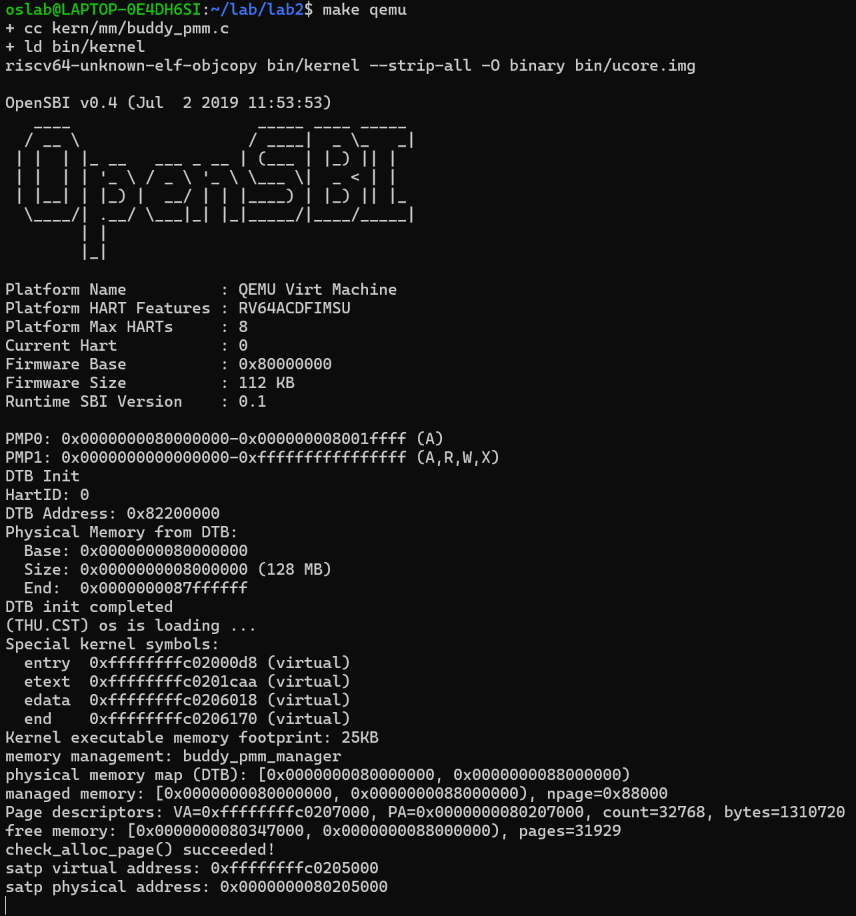
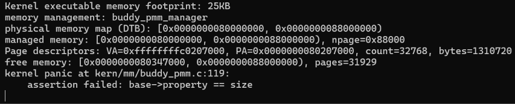
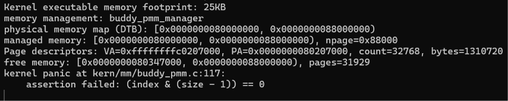

# 操作系统实验报告

## 实验基本信息

| 项目 | 内容 |
|---|---|
| **实验名称** | Lab 2：物理内存管理——Buddy System 分配算法与测试 |
| **小组成员** | 2412604-刘泽民；其他成员信息待小组合并填写 |
| **完成日期** | 2026-10-26 |

### 小组分工

| 成员 | 负责的练习/模块 | 报告分工 |
|---|---|---|
| 2412604-刘泽民 | 功能模块二任务三：Buddy System 分配算法及其测试 | Buddy 核心函数、两份提示词、实现迭代、测试与总结 |

本报告记录本人负责的 Buddy 模块。物理内存初始化、First-Fit 思考题、Best-Fit 及其他成员的分工，由小组在总报告中合并补充。

---

## 一、实验目的

1. 理解物理内存管理的基本流程，以及 `Page` 描述符、空闲链表和 `pmm_manager` 接口的作用。
2. 实现按二次幂大小管理物理页的 Buddy 分配器，掌握分配时的分裂和释放时的伙伴合并。
3. 根据现有框架设计算法提示词和测试提示词，明确页面状态、接口约定和可检验的结果。
4. 通过少量具有代表性的案例验证核心行为和边界情况，能够说明每组断言检查了什么、为什么有效。

---

## 二、实验环境

### 使用的 AI 工具

| 成员 | AI 编程工具 | 底层模型 | 备注 |
|---|---|---|---|
| 2412604-刘泽民 | Claude Code（VS Code 插件） | DeepSeek-V4.1-Flash |  |

---

## 三、实验整体逻辑分析

### 3.1 本章节的逻辑主线

Lab 2 围绕物理内存的发现、初始化和分配展开。内核先选择并初始化物理内存管理器，再由 `page_init()` 根据设备树确定内存范围，建立 `Page` 描述符，排除 OpenSBI、内核镜像和描述符数组占用的页面，将剩余完整页面交给当前管理器。

First-Fit、Best-Fit 和 Buddy 都通过 `struct pmm_manager` 接入这一流程。它们处理的是同一类物理页资源，区别在于如何组织空闲块、选择分配块以及回收合并。Buddy 用多阶链表管理 `2^k` 页块，分配时逐级分裂，释放时只与同阶伙伴合并。

当前工程的调用关系为：

```text
pmm_init()
  ├─ init_pmm_manager() → 选择 buddy_pmm_manager，调用 buddy_init()
  ├─ page_init() → 确定可用区间，调用 buddy_init_memmap()
  └─ check_alloc_page() → 调用 buddy_check()

alloc_pages()/free_pages() → 转发给当前管理器的分配、释放函数
```

### 3.2 功能的逐步实现

1. 先阅读 `pmm.h`、`memlayout.h`、`pmm.c`、`libs/list.h` 和已有分配器，确定接口和页状态约定。
2. 实现多阶空闲链表、区间登记、按阶分裂分配、伙伴合并释放和总页数统计，通过 `buddy_pmm_manager` 接入内核。
3. 参考 First-Fit、Best-Fit 的保存与恢复测试状态的方法，借用一个16页区域，构造地址和阶数确定的测试状态。
4. 用基础分配、四块综合合并和两个初始化案例覆盖核心行为，另外独立验证错误释放确实会触发目标断言。
5. 重新编译并在 QEMU 中运行正常配置和两种非法释放配置，保存日志，最后恢复默认构建。

---

## 四、实验内容与实现

### 功能模块：Buddy System 分配算法的实现

**负责人：** 2412604-刘泽民

#### 模块功能描述

**核心函数：**

```c
static void buddy_init(void);
static void buddy_init_memmap(struct Page *base, size_t n);
static struct Page *buddy_alloc_pages(size_t n);
static void buddy_free_pages(struct Page *base, size_t n);
static size_t buddy_nr_free_pages(void);
```

在`kern/mm/buddy_pmm.c` 中实现算法， 在`buddy_pmm.h` 声明，在 `pmm.c` 中选择 `buddy_pmm_manager`来调用。

使用 `free_list[k]` 保存第 k 阶空闲块，只维护一个总空闲页计数 `nr_free`。由于内存管理上限为128 MiB、页大小为4 KiB，因此正常最高阶为15，即`#define  BUDDY_MAX_ORDER 15`，而`max_order` 来控制最大阶数，在测试时将`max_order`限制为4，即`#define BUDDY_TEST_ORDER 4`。

| 页面状态 | `PG_property` | `property` |
|---|---|---|
| 空闲块头 | 1 | 块页数 `2^k` |
| 已分配块头 | 0 | 分配页数 `2^k` |
| 块内其他页 | 0 | 0 |

**对齐条件**：  
块的对齐我们使用 **`page - pages`的全局下标`index`**， $index \% size=0$来判断。其实通过 $page2ppn(page)$ 来得到物理页号进行判断$ppn \& (size - 1)$或者$ppn \% size$更加通用，因为就是定义，也更加简单，不用想这么多，但是我在实现的过程中首先使用了全局下标，目前就接着使用。  
因为 $PPN=nbase+index$ ，只要满足 $nbase\bmod size=0$ ，就有 $PPN\bmod size=(nbase+index)\bmod size=index\bmod size$ ，而 DRAM 的起始物理页号 `nbase`为 $0x80000 = 2^{19}$ ，Page描述符数组长度为 $npage-nbase=0x8000=32768$ ，因此在目前较小阶数范围内 $nbase\bmod size=0$ 是一定被满足的。

**伙伴块的寻找**：  
我们使用全局下标`index`与自身块大小`size`进行异或**index ^ size**得到伙伴的下标。这个要求数组起点对应的物理页号 nbase 要对齐。同样使用物理页号 **ppn ^ size** 也更加通用和简单，也没有要求物理内存区域最初的起点要对齐。

#### 核心函数实现思路

##### 1. `buddy_init()`：初始化管理状态

遍历各阶链表，将链表头初始化为空；设置正常最高阶，并将 `nr_free` 清零。初始化分配器。

##### 2. `buddy_init_memmap(base, n)`：登记可用区间

- 先检查输入非空、页数大于0，且 `[base, base+n)` 没有超过描述符范围。  
- 随后逐页遍历，检查是否为保留页（flags的PG_reserved位=1），清理标志、块大小、引用计数和链表节点，将输入的 n 页计入 `nr_free`。
- 划分区间时，从 `base - pages` 的全局下标开始，每次选择同时满足两个条件的最大二次幂块：
   - 块大小不超过剩余页数
   - 块起点按自身大小对齐。

- 即每次从`order=0`开始判断上面两个条件，直到不满足条件就跳出循环，这样就找到符合条件的最大阶，然后设置块首标志和大小将它挂入对应阶空闲链表后，向后移动起始下标 `index`，继续处理剩余页。

例如全局下标区间 `[3,16)` 共13页，应划分为：

```text
[3,4)    1页 → 第0阶
[4,8)    4页 → 第2阶
[8,16)   8页 → 第3阶
```

目前 `page_init()` 实现不会对两次调用但是登记区间相邻且为伙伴的块进行合并。

##### 3. `buddy_alloc_pages(n)`：从最小可用阶分裂分配

- 首先将 n 向上取整，得到能够容纳请求的目标阶。例如申请3页，目标为第2阶，实际分配4页。
- 然后从目标阶向上寻找第一条非空链表（取该阶链表的第一个空闲块，后面的插入和取出都是从链表头部操作），保证优先使用最小的可用块；超过最高阶仍未找到时返回 `NULL`。
- 找到块后，将它摘下并清除空闲块头标志。  
如果阶数高于目标阶，就逐级对半分裂，每次保留前半块，将后半块挂入对应阶链表，直到前半块大小等于对应大小。例如用16页块[0,16)满足4页请求，最终最左边的块[0,4)被分配出去，块[4,8)和[8,16)分别位于第2、3阶空闲链表。
- 最后在分配块首页记录实际分配的页数，并从 `nr_free` 扣除这个大小。

##### 4. `buddy_free_pages(base, n)`：检查并逐级合并

- 释放时按与分配相同的规则将 n 向上取整
- 检查范围、首页对齐、页面状态和块头记录的实际大小。例如申请3页实际占4页，按3页释放时仍应归还4页。注意这里为了简化，我的实现是要求**块的首页物理页号对齐，并且申请页的大小向上取整要等于块大小**，小于或大于都不行。
- 通过检查后，遍历判断是否不为保留页且不为空闲块，再重置flags和property和ref，将本次释放的实际页数加到 `nr_free`。
- 之后利用：

```c
buddy_index = index ^ size;
```

寻找同阶伙伴。
- 只有伙伴在有效范围内、不是保留页、带空闲块头标志且大小相同时，才能从对应链表摘下它并合并。   
合并后选择地址较低的一半作为新块头，块大小翻倍、阶数加一，继续寻找更高阶伙伴。

- 直到遇到已分配伙伴、不同大小的块、范围边界或最高阶时停止，将最终块插入对应链表头部。在合并的时候被合并的那个伙伴块首页的标志和大小清零。  
合并过程不再增加 `nr_free`，因为伙伴的页数原本已经计入空闲页总数。

##### 5. `buddy_nr_free_pages()`：返回总空闲页数

直接返回维护好的 `nr_free`。  
前面登记时增加输入页数，成功分配时扣除实际占用页数，释放时增加实际归还页数；分裂和合并只改变空闲物理页的组织方式。

##### 6. 辅助函数与管理器注册

`buddy_order(n)` 计算容纳 n 页的最小阶，最多计算到当前最高阶；请求过大时返回 `max_order + 1`，避免溢出。  

`buddy_add_block(page, order)` 负责设置空闲块头并挂链，不修改页数计数。

`buddy_pmm_manager` 提供buudy的初始化、登记、分配、释放、统计和check()函数接口。

在`pmm.c`中选用buddy。

#### 最终提示词

以下是经过迭代优化后，最终成功实现该功能的提示词：

````markdown
## [PROMPT]

**一、任务**
完成 Buddy System 物理页分配模块：

- `kern/mm/buddy_pmm.c`：实现初始化、登记可用页、分配、释放、伙伴合并和空闲页统计。
- `kern/mm/buddy_pmm.h`：声明 `buddy_pmm_manager`。
- `kern/mm/pmm.c`：选择 `buddy_pmm_manager`，使内核能够通过原有接口调用 Buddy。

块大小为二次幂，采用多阶空闲链表，只维护一个总空闲页计数。

**二、操作要求**
1. 必须在项目中修改实际文件。先阅读相关源文件、`pmm.h`、`memlayout.h`、`mmu.h`、`libs/list.h`、`default_pmm.c` 和 `Makefile`，以工程中的接口为准。

2. 修改范围为 Buddy 文件和 `pmm.c` 中管理器接入的部分。公共结构、内存布局、`page_init()`、启动代码、其他分配算法和已有测试保持原样。

3. 函数开头说明实现思路，函数体注释关键过程，详略适当。

**三、输出要求**
按照下面的上下文、接口和行为要求完成修改，说明修改了哪些文件，以及实际编译运行结果。内核应输出 `memory management: buddy_pmm_manager`。

## [RELY]

**1. 管理器接口**
`kern/mm/pmm.h` 中定义：

```c
struct pmm_manager {
    const char *name;
    void (*init)(void);
    void (*init_memmap)(struct Page *base, size_t n);
    struct Page *(*alloc_pages)(size_t n);
    void (*free_pages)(struct Page *base, size_t n);
    size_t (*nr_free_pages)(void);
    void (*check)(void);
};
```

内核选择并初始化管理器后，`page_init()` 登记可用页，`check_alloc_page()` 调用管理器的 `check()`。当前 `page_init()` 登记一次连续可用区间，输入页均带保留标志。

**2. 页面描述符和状态**
`kern/mm/memlayout.h` 中定义：

```c
struct Page {
    int ref;
    uint64_t flags;
    unsigned int property;
    list_entry_t page_link;
};
```

我们使用以下状态约定：

| 页面状态 | `PG_property` | `property` |
|---|---|---|
| 空闲块首页 | 1 | 实际块大小 `2^k` |
| 已分配块首页 | 0 | 实际块大小 `2^k` |
| 块内其他页 | 0 | 0 |

`PageReserved`、`PageProperty` 及其设置、清除宏用于页面标志；`page_ref()`、`set_page_ref()` 用于引用计数。

**3. 页面范围和伙伴关系**
```c
extern struct Page *pages;
extern size_t npage;
extern const size_t nbase;

static inline ppn_t page2ppn(struct Page *page) {
    return page - pages + nbase;
}
```

`npage` 为物理页号上界，Page 数组长度为 `npage - nbase`。有效物理页号为 `[nbase, npage)`。

块的对齐我们使用 `page - pages` 的全局下标 `index`，条件为 `index % size == 0`；伙伴下标为 `index ^ size`。当前 `nbase = 0x80000 = 2^19`，页大小4 KiB，内存管理上限128 MiB，最高阶15，全局下标的对齐与物理页号对齐等价。

当前 `max_order` 表示可调整的最高阶，正常为15。

**4. 可用接口**
`libs/list.h` 提供 `list_entry_t`、`list_init()`、`list_add()`、`list_del_init()`、`list_empty()`、`list_next()` 等接口；`le2page(le, page_link)` 得到节点对应的 Page。

非法调用使用 `assert()` 拒绝，合法请求因资源不足而失败时返回 `NULL`。

## [GUARANTEE]

实现以下主要接口：

```c
static void buddy_init(void);
static void buddy_init_memmap(struct Page *base, size_t n);
static struct Page *buddy_alloc_pages(size_t n);
static void buddy_free_pages(struct Page *base, size_t n);
static size_t buddy_nr_free_pages(void);
```

在 `buddy_pmm.c` 中定义并初始化 `const struct pmm_manager buddy_pmm_manager`，各成员对应 buddy 接口；在 `buddy_pmm.h` 中声明：

```c
extern const struct pmm_manager buddy_pmm_manager;
```

`pmm.c` 中涉及的接入函数为：

```c
static void init_pmm_manager(void);
```

可以添加必要的 `static` 辅助函数，作用域限于本模块。对链表插入和删除都是从头插入和删除。

## [SPECIFICATION]

### 1. `buddy_init(void)`

**Pre-Condition**
- 内核已选择 buddy。

**Post-Condition**
- 各阶链表为空，总空闲页数为0，最高阶为15，可以登记可用页。

### 2. `buddy_init_memmap(struct Page *base, size_t n)`

**Pre-Condition**
- 管理器已初始化，`n > 0`，`[base, base+n)` 在描述符范围内，输入页均为尚未登记的可用保留页。

**Post-Condition**
- 输入的 `n` 页全部登记为空闲页，各块互不重叠，大小为二次幂，首页按自身大小对齐，挂在对应阶链表。
- 引用计数为0，页面状态符合前面的约定，空闲页数增加 `n`。

**Case 1：区间符合完整块要求**
起点对齐、长度为二次幂且在支持范围内时，登记为对应阶的完整块。

**Case 2：起点或长度需要划分**
区间登记为多个符合大小、对齐和范围要求的块。例如在按16页对齐的 `base` 上登记 `[base+3, base+16)`，应得到 `[3,4)`、`[4,8)`、`[8,16)` 的1、4、8页块，合计13页。

**Case 3：输入非法**
空指针、零页数、范围越界或者输入页已登记时，触发断言。

### 3. `buddy_alloc_pages(size_t n)`

**Pre-Condition**
- 管理器已初始化，`n > 0`，各阶链表和计数正确。

**Post-Condition**
- 成功时返回分配块首页，实际大小为容纳 `n` 的最小二次幂，首页按实际大小对齐。
- 分配块已从空闲链表移除，首页空闲标志清除，`property` 记录实际大小，总空闲页数减少实际分配页数。
- 各分配块互不重叠。

- 失败时返回 `NULL`，空闲块、页面状态和计数保持不变。

**Case 1：目标阶有空闲块**
实际分配大小等于目标阶大小。

**Case 2：只有更高阶空闲块**
使用能够满足请求的最小可用阶。递归对半拆分，分出来的空闲块，挂在对应阶链表。

**Case 3：没有满足请求的块**
无空闲页、总空闲页数不足，或者总数足够但没有合法大块时，返回 `NULL`。

**Case 4：请求超过上限或输入非法**
请求超过当前最高阶容量，包括 `(size_t)-1` 等超大值时，返回 `NULL`，计算和访问保持在有效范围内。`n == 0` 触发断言。

### 4. `buddy_free_pages(struct Page *base, size_t n)`

**Pre-Condition**
- `base` 是尚未释放的分配块首页，`n > 0`，`n` 向上取整后的大小与首页记录的实际大小相等。

**Post-Condition**
- 整个实际分配块变为空闲页，引用计数和块内描述符的数据清零，最终块头的标志、大小和所属阶正确。
- 空闲页数只增加本次实际归还的页数，合并不重复计数，其他已分配块保持原样。

**Case 1：存在可合并伙伴**
两个同阶空闲伙伴形成更大的空闲块；更高阶仍有合法空闲伙伴时继续合并，直到达最高阶。合并块以最低地址为首页，链表上原来的低阶节点已经移除，其余块块首标志和大小清零。

**Case 2：伙伴条件不满足**
伙伴越界、为保留页、已被分配或者大小不同时，不做操作。两个块相邻时，也要满足同阶伙伴关系才能合并。

**Case 3：原始申请页数不是二次幂**
向上取二次幂整。例如申请3页实际占4页，按3页释放应完整归还4页。

**Case 4：释放调用非法**
空指针、零页数、请求超过支持阶、范围越界、首页不对齐、释放保留页、重复释放或者取整大小与记录大小不相等时，触发断言。

### 5. `buddy_nr_free_pages(void)`

**Pre-Condition**
- 管理器已初始化。

**Post-Condition**
- 返回总空闲物理页数。
````

#### 实现迭代过程

本模块的实现经历了 2 次迭代，过程如下：

##### 第一次迭代：简化

**遇到的问题：** 原实现同时维护各阶页数和总页数，并且测试和辅助状态较多，理解起来困难。讨论考虑单链表以简化代码，但它会把复杂度转移到块查找和伙伴匹配。

**问题解决策略：** 在提示词中保留多阶链表，去掉重复的每阶计数，只统计总空闲块数。最高阶按当前实验上限确定。

**最终结果：** 减少了很多的复杂的辅助函数，减少了需要同步维护的状态，实现逻辑也简化了。


##### 第二次迭代：调整注释

**遇到的问题：** 简短注释不足以说明函数思路，逐行罗列又与代码重复。

**问题解决策略：** 函数开头用一两句概括实现思路，函数体内说明查找、分裂、校验、合并等关键过程。

**最终结果：** 修改了注释。

---

### 功能模块：Buddy System 测试函数的实现

**负责人：** 2412604-刘泽民

#### 模块功能描述

**涉及的函数：**

```c
static void buddy_basic_check(struct Page *base);
static void buddy_check(void);
```

`buddy_check()` 是测试主函数，`buddy_basic_check()` 完成一组连续分配与释放；`buddy_check_block()` 检查块头标志、大小及该块是否在对应阶的空闲链表里；`buddy_prepare_memmap()` 将块中的每页恢复为保留页状态，供测试`init_memmap()`时使用。

#### 测试区域的准备与恢复

先分配一个16页块，记作 `base`，保存分配后的所有空闲链表头和总计数，再清空当前链表，构建独立测试区域。

Buddy 合并时判断伙伴是否空闲，并不是只看空闲链表，还会使用伙伴对应的Page描述符中的标志位和 property。仅清空链表不能隔离区域外的空闲伙伴。因此在测试时把 `max_order` 设为4，使16页块不能再向外合并。

结束时清除标记成保留页等的状态，恢复成最初的 16 页块，恢复原链表、计数和最高阶，再归还16页块，最后检查空闲链表、页面描述符和空闲页计数是否恢复正常。

#### 测试案例、覆盖内容与检验依据

##### 1. 16页初始化

将16页通过`buddy_prepare_memmap()`变为保留页，调用 `buddy_init_memmap(base, 16)`，检查第4阶链表存在 `base` 开始的16页块、低阶链表为空、空闲总数为16。

验证对齐的二次幂区间能够直接登记成一个大块，能够加入对应阶的空闲链表。此后直接在这个区域上进行测试。

##### 2. 分配、分裂余块和释放

| 操作 | 预期 | 覆盖内容 | 有效性 |
|---|---|---|---|
| `a = alloc_pages(3)` | 返回 `base`，实际大小4，空闲块标志正确，空闲12页；<br>剩下的空闲块块为[4,8),[8,16) | **分配操作** <br> `向上取整`、`逐级分裂`、余块进入正确阶空闲链表、按分配大小减少计数 | 实际分配的块大小为4，验证向上取整；<br> 分配块[0,4)，空闲块[5,8),[8,16)，分别在第2，3阶空闲链表，验证了16→8→4的逐级分裂，并且剩下的空闲块进入了正确的空闲链表 <br> 空闲页数为12验证按分配块大小减少空闲块计数 |
| `small = alloc_page()` | 返回 `base+4`，大小1，引用计数0 | **分配操作** <br> `分配优先从最小的可用阶空闲链表拿取分配` | 此时4页和8页块都可用，而返回 `base+4`证明优先拆开较小的4页块，从最小可用阶分配；同时，返回`base+4`，没有与 a 重叠，验证分配多个块彼此不重叠；另外，我们还要增加对分配的块地址对齐的检查。 |
| `free_page(small)`；<br> `b = alloc_pages(4)` | small 释放后，`[4,5)` 与 `[5,6)`、`[6,8)` 逐级合并回 `[4,8)`，但是这里没有检查合并操作，在后面检查，其实在这里加个buddy_check_block(small释放得到的Page*,2)检查是否在2阶链表理由才充分；<br>随后返回 `base+4`，实际大小4 | **释放和分配操作**<br>`申请页数等于块大小不需拆分，直接分配` | 我们先释放刚申请的1页，再申请4页，实际重新取得 `[4,8)`，验证申请页数等于块大小不需拆分，直接分配
| 按最初分配请求的页数释放3页块 a，再释放另一个4页块 | 恢复完整16页区间 | **释放操作**<br>`按实际块大小释放` | 应该在后面加上a的property检查，才能证明按实际块大小释放

`buddy_check_block()` 不仅检查 `property` 和 `PG_property`，还确认节点确实位于对应阶链表，能发现页面标志正确但块未在对应阶数链表上的错误。

##### 3. 分配失败、停止合并与递归合并

把16页全部分配成四个4页块，地址布局为：

```text
偏移：   0         4         8        12        16
         ┌─────────┬─────────┬─────────┬─────────┐
         │    A    │    B    │    C    │    D    │
         └─────────┴─────────┴─────────┴─────────┘
           A、B是伙伴          C、D是伙伴
```

我们将 `[0,16)` 分成 A、B、C、D 四个4页块，分别对应 `block[0]`～`block[3]`。A、B为一对伙伴，C、D为一对伙伴，然后按 B→C→A→D 的顺序释放。

| 操作 | 预期 | 覆盖内容 | 有效性 |
|---|---|---|---|
| 连续四次 `alloc_pages(4)` | 第 i 次返回 `base+4*i`，空闲页数为0 | **分配操作**<br>`空闲页计数` | 16页全部被分配后空闲页数为0，验证分配计数。<br>空闲页数为0，验证四次申请后的计数。<br>此外，分配的地址符合预期，后面的测试在此基础上开展 |
| 四块全部分配后调用 `alloc_page()` | 返回 `NULL` | **分配边界**<br>`无空闲页返回NULL` | 前面已经检查空闲页数为0，再申请1页返回 `NULL`，验证无空闲页时分配失败。 |
| 释放 B、C；<br>调用 `alloc_pages(8)`、`alloc_pages(16)`；<br>检查释放和申请分配调用后的状态 | 两次申请均返回 `NULL`；空闲页数仍为8 <br>B、C均带空闲标志，大小4，挂在第2阶 <br>第3、4阶链表有两个块，第3、4阶链表为空 | **释放操作中的合并和分配失败**<br>`伙伴仍被占用时停止合并`、`相邻但非伙伴不合并`、`空闲页数足够却没有合法块时分配失败`、`总空闲页数不足分配失败`、`分配失败后不修改状态计数` | 释放后B，C块大小为4且都在2阶链表上，B,C的伙伴都被分配出去了，验证伙伴仍被占用时停止合并，并且B,C相邻，仍为4页，验证相邻但非伙伴不合并<br>空闲页数有8页，申请8页返回 `NULL`，第3、4阶链表为空，验证空闲页数足够却没有合法块时分配失败，申请16页返回 `NULL`，总空闲页数不足分配失败；<br>这些布局、块头和计数条件在失败调用后检查，分配失败后不修改状态计数 |
| `free_pages(block[0], 4)` | `base` 处有8页空闲块挂在第3阶；<br>C仍为4页空闲块，挂在第2阶；<br>B的块首页空闲标志和 `property` 清零 | **释放的合并**<br>`同阶伙伴合并`、`遇到不同大小的块时停止`、`合并右块空闲状态置零和页数清零` | A释放后在`base` 处有8页空闲块挂在第3阶，验证A,B合并，同阶伙伴合并；<br>对C的检查验证它仍是第2阶4页块，验证遇到不同大小的块时停止；<br>B的块首页空闲标志和 `property` 清零验证合并右块空闲状态置零和页数清零 |
| `free_pages(block[3], 4)` | `base` 处有16页空闲块挂在第4阶，空闲16页；<br>第0～3阶链表为空；<br>B、C、D块首页空闲标志和大小清零 | **释放的合并**<br>`递归合并`、`合并不修改页数` | 释放前已经检查到 `base` 处8页块和C处4页块；释放D后，先与低地址的C合并，再与低地址的A+B继续合并，最终得到16页块，并且第0～3阶链表为空，验证递归合并；<br>空闲页数为16，可以推断释放D前空闲页数为12，并且为[0-8),[8,12)，因此只增加了释放的页数，可以验证合并不修改页数。 |

##### 4. 请求上界

在16页块空闲状态下，申请17页和 `(size_t)-1` 页都应返回 `NULL`。随后仍能申请到从 `base` 开始的完整16页块，空闲页数归零。

**分配边界**
目前测试的最多页数设置为16页，申请17页返回`NULL`，验证`申请页数超过最大页数分配失败`。  
`(size_t)-1` 是一个极大的正整数，调用后返回 `NULL`，验证`目标阶计算遇到超大请求时能够按上限退出`，避免继续移位溢出。  
最后一次成功分配同时验证失败前面的合并结果确实可用。

##### 5. 未对齐起点

1. 通过`buddy_prepare_memmap()`重置保留位，调用 `buddy_init_memmap(base+3, 13)`。预期布局为：

| 区间 | 预期状态 |
|---|---|
| `[base, base+3)` | 仍为保留页，不进入空闲链表 |
| `[base+3, base+4)` | 1页块，第0阶 |
| `[base+4, base+8)` | 4页块，第2阶 |
| `[base+8, base+16)` | 8页块，第3阶 |

检查空闲页总数为13，并检查三个块的实际在0，2，3空闲链表，前面的 `[0,3)` 仍为保留页。各块大小之和为13，且前面的 `[0,3)` 仍为保留页验证输入页全部被正确登记了，base+3、base+4、base+8三个块的实际在0，2，3空闲链表，验证`长度不是二次幂的块会被拆分登记`

2. 再依次申请1、4、8页，分别返回 `base+3`、`base+4`、`base+8`，空闲页数为0；验证非二次幂的块登记后可正常使用。

3. 之后申请1页失败，所有链表为空。验证实际可分配范围与登记的13页一致。

这个案例验证非二次幂长度页数会被拆分登记，并且可以正常使用。

##### 6. 释放非法参数的断言测试

这两项测试的目标是确认错误调用真的被拒绝。先在已知16页区域起点申请4页，得到 p，如果验证修改`BUDDY_ILLEGAL_FREE_TEST`宏（默认为0，不启用）为下面的1，3数值来验证：

| 模式 | 错误调用 | 应触发的断言 | 为什么能检验 |
|---|---|---|---|
| 1 | `free_pages(p, 2)` | `base->property == size` | 释放页数2取整后为2，与实际页数不一致记录，应触发断言或者直接返回，同样大于也应该触发断言，这是为了简化，不然可能还要涉及到拆分合并操作。 |
| 3 | `free_pages(p+1, 4)` | `(index & (size - 1)) == 0` | 释放的起始页号与自身大小不对齐，应该拒绝，所以应该设置断言或者直接返回。 |

上面验证了`释放的边界条件：起始页号不对齐、请求页数与自身大小不一致`，由于错误断言触发会使uCore停止运行，因此设置了如上的测试方式。或者我们直接返回不进行任何操作，然后在前面的buddy_check(）前面进行检查验证，

##### 7. 状态恢复与全局检查

到这里，所有测试结束。

退出前统一遍历一次全局链表，检查空闲块头标志、大小为 `2^k`、首页对齐和整个块的有效范围。累计页数必须等于 `nr_free_pages()`，也必须等于测试开始前的总数。这能发现计数与链表不一致、测试页面没有全部归还等问题。

#### 测试覆盖了哪些核心行为和边界情况以及这些测试为什么能够有效检验生成的 Buddy System 实现

**核心行为**

- **初始化 `buddy_init_memmap()`**：对齐的二次幂区间能够直接登记成一个大块，加入对应阶的空闲链表；长度不是二次幂的块会被拆分登记，并且可以正常使用。
- **分配 `buddy_alloc_pages()`**：向上取整、逐级分裂、余块进入正确阶空闲链表、分配优先从最小的可用阶空闲链表拿取分配。
- **释放 `buddy_free_pages()`**：按最初分配请求的分配页数释放、释放后可以正常使用、同阶伙伴合并、递归合并、合并后旧块首页空闲标志和页数清零。
- **计数 `buddy_nr_free_pages()`**：按分配块大小减少空闲页计数。

**边界条件**

- **初始化 `buddy_init_memmap()`**：长度不是二次幂的块会被拆分登记、前面的页仍为保留页。
- **分配 `buddy_alloc_pages()`**：无空闲页返回 `NULL`、总空闲页数不足分配失败、空闲页数足够却没有合法块时分配失败、申请页数超过最大页数分配失败、超大请求返回 `NULL`、分配失败后的状态和计数保持不变、多次分配不重叠。
- **释放 `buddy_free_pages()`**：伙伴仍被占用时停止合并、相邻但非伙伴不合并、遇到不同大小的块时停止；起始页号不对齐、请求页数向上取整后与自身大小不一致。

**测试为什么能够有效检验生成的 Buddy System 实现**

我们根据 Buddy 的二次幂大小、对齐要求和伙伴关系，确定测试的预期结果，并实际运行是否会触发断言，预期值独立于被测实现，因此能够发现一些实现错误。  
并且测试覆盖了核心行为和大多数比较重要的边界条件，对于预估会有什么现象，有这些现象可以验证什么，可以从上面的详细讲解测试过程的表格和文字了解。  
因此，make qemu执行成功，输出`check_alloc_page() succeeded!`，说明断言未被触发，预期都成立，测试是能够有效检验生成的 Buddy System 实现。

#### 最终提示词

以下是经过迭代优化后，最终成功实现该功能的提示词：

````markdown
## [PROMPT]

**一、任务**
在 `kern/mm/buddy_pmm.c` 中实现 buddy 测试，验证初始化、分配、释放、分裂、合并、计数和关键边界。

参考 First-Fit 和 Best-Fit 的 check，使用16页区域检查。同一性质适当验证，核心行为和重要的边界条件都要有对应的检查条件。

**二、操作要求**
1. 必须在项目中修改实际文件，不要阅读buddy的实现，了解相关接口就行，按照buddy的行为设计测试，先阅读相关头文件和已有 check。修改范围为check()函数、必要的静态测试辅助函数和 `.check` 绑定，分配算法和其他模块保持原样。发现问题时说明具体断言和原因。

2. 使用框架中的 `assert()` 检查预期。测试范围为实际借出的16页。测试中最高阶设定为4，测试完成后恢复原样。

3. 函数开头写实现思路，函数体说明几个步骤或者一组操作检查了什么，详略适当。

**三、输出要求**
按照下面的上下文、接口和行为要求修改，说明测试覆盖了哪些核心行为和边界，以及预期为什么能够验证这些行为，并记录实际编译运行结果。

正常模式应输出 `check_alloc_page() succeeded!`；两种非法释放模式应分别触发目标断言。

## [RELY]

**1. 当前 Buddy 状态**
```c
#define BUDDY_MAX_ORDER 15
static list_entry_t free_list[BUDDY_MAX_ORDER + 1];
static size_t nr_free;
static unsigned int max_order;
```

`free_list[k]` 保存第 `k` 阶空闲块，大小为 `2^k`；`nr_free` 是总空闲页数，`max_order` 是当前最高阶，正常为15。

空闲块首页的 `PG_property` 为1，`property` 为实际大小；已分配块首页的标志为0，property为分配大小；块内其他页的 `property` 为0。当前从一个大块分裂分配时，分配结果在低地址部分，余块在高地址部分。

释放要求首页按自身大小对齐，释放请求取整后与自身大小相等。伙伴关系使用全局下标，合并条件涉及伙伴 Page 的标志和大小。

**2. 描述符和可用接口**
```c
struct Page {
    int ref;
    uint64_t flags;
    unsigned int property;
    list_entry_t page_link;
};

struct Page *alloc_pages(size_t n);
void free_pages(struct Page *base, size_t n);
size_t nr_free_pages(void);

#define alloc_page() alloc_pages(1)
#define free_page(page) free_pages(page, 1)
```

`pages` 指向描述符数组，长度为 `npage - nbase`，`page2ppn(page) = page - pages + nbase`。当前 `nbase = 0x80000`，满足支持块大小的对齐要求。

可以使用页面标志、引用计数和链表接口。`buddy_init_memmap()` 要求输入页尚未登记且带保留标志。

**3. 测试调用**
`check_alloc_page()` 通过 `pmm_manager->check()` 调用测试，正常返回后输出成功信息。断言失败会停止内核，因此两项错误调用分别启动验证。

测试通过 `BUDDY_ILLEGAL_FREE_TEST` 选择模式：0为正常测试，1为释放大小不匹配，3为释放首页未对齐。可以通过 Makefile 的 `DEFS` 选择。

## [GUARANTEE]

实现以下测试函数：

```c
static void buddy_basic_check(struct Page *base);
static void buddy_check(void);
```

`buddy_pmm_manager.check` 对应 `buddy_check()`。可以添加必要的 `static` 测试辅助函数，作用域限于本模块。

## [SPECIFICATION]

### 1. `buddy_basic_check(struct Page *base)`

**Pre-Condition**
- 测试区域为按16页对齐的完整16页空闲块，当前最高阶为4，总空闲页数为16。

**Post-Condition**
- 基础分配和释放检查成立，16页全部归还。

**Case 1：非二次幂请求和分裂**
申请3页，验证向上取整、逐级分裂、余块所属阶和实际页数计数。

**Case 2：最小可用阶和直接分配**
继续申请1页，验证优先使用较小的4页块，并且与前面的分配块不重叠。

释放这1页后再申请4页，验证释放后复用和同阶直接分配。

**Case 3：按原始申请页数释放**
按3页释放第一个块，再释放另一个4页块，实际应归还8页。

### 2. `buddy_check(void)`

**Pre-Condition**
- Buddy 已初始化并登记可用页，真实链表和计数正确，能够取得一个16页块用于测试。
- 测试在内核初始化检查阶段执行。

**Post-Condition**
- 正常模式下，各项预期成立，测试页全部归还，真实链表和最高阶恢复，空闲页总数等于测试开始前，测试函数正常返回。

- 非法释放模式下，正常案例完成后，错误调用触发对应断言。

**Case 1：正常测试**
我们在16页区域中检查以下情况，区域内的合并以16页为边界，不考虑测试外的已分配页。

**完整块初始化**
输入为 `base` 开始的16个可用保留页。登记后，第4阶有完整16页块，第0～3阶为空，总空闲页数为16，基础测试的预期成立。

**四个4页块与伙伴合并**
四次4页申请分别得到 A、B、C、D，地址为 `base`、`base+4`、`base+8`、`base+12`，四块互不重叠，空闲页数为0，再申请1页返回 `NULL`。

释放顺序为 B→C→A→D：

| 操作  | 覆盖内容及检验依据 |
|---|---|
| 释放B、C，申请8页和16页 | B、C相邻但非伙伴，验证伙伴占用时停止、相邻非伙伴保持分开；申请8页验证总数足够却无合法块，申请16页验证总数不足；失败后布局和计数保持不变。 |
| 释放A | 验证同阶伙伴合并、大小不同停止和旧块头清理。 |
| 释放D  | 验证递归合并和链表上的低阶节点被移除；结合释放A验证不同的方向的伙伴合并；空闲页数验证合并不重复计数。 |

**请求上界**
在完整16页空闲时，申请17页和 `(size_t)-1` 页。验证当前容量上限、超大请求，以及失败后合并得到的大块仍可使用。

**初始化边界**
输入为 `base+3` 开始的13个可用保留页。
接下来申请1、4、8页，再申请1页。

验证未对齐起点、非二次幂长度、最小1页块，以及输入页全部登记并可正常使用。前3页仍为保留页，实际分配范围与输入的13页一致。

**最终状态**
正常模式结束后，测试页已回到实际的分配器，能够按正常最高阶参与伙伴合并。最后统一检查一次各阶空闲块：
验证块头、大小、对齐和范围正确，链表与计数一致，测试页全部归还。

**Case 2：释放大小不匹配**
模式1在已知16页区域起点申请4页。再释放两页验证实际大小校验会拒绝错误调用。

**Case 3：释放首页未对齐**
模式3同样在区域起点申请4页。在申请在首页偏移1页处释放4页，应触发对齐条件断言。
````

#### 实现迭代过程

##### 第一次迭代：从重复测试进行简化

**遇到的问题：** 原测试包含多轮分配释放、多个取整参数、各阶重复计数和反复全局扫描，测试代码较长，理解起来十分困难。并只增加用例数量不能说明是否覆盖了新的核心行为。

**问题解决策略：** 根据buddy算法的核心行为进行简化

**最终结果：** 基础测试只保留基本的分配和释放操作，辅助函数只承担局部块检查及页面准备。

##### 第二次迭代：合并重复案例

**遇到的问题：** 申请8页（2、2、2、2）的测试案例来验证合并的边界问题（相邻但是非伙伴的块也无法合并...），与后面的合并测试案例有重叠。

**问题解决策略：** 合入后面的案例，16页分配为四块的案例，调整释放顺序为B→C→A→D，在中间检查总空闲8页却无法申请8页，再完成递归合并。

**最终结果：** 减少了重复测试案例。

##### 第三次迭代：设置独立错误调用验证并完成实测

**遇到的问题：** 仅保留释放函数中的断言，不能证明测试确实触发过这些拒绝路径；预期断言又会停止内核。

**问题解决策略：** 使用现有宏保留模式1、3，各选一个针对性错误输入，分别编译运行。

**最终结果：** 正常模式通过；模式1触发大小不匹配断言，模式3触发未对齐断言。

---
## 五、测试与验证

### 环境和编译运行
在wsl2的ubuntu24.04中使用 QEMU 4.1.1、SiFive GCC-Metal 10.2.0、GNU Make 4.2.1，默认 RAM 为 128 MiB。
在kern/mm/pmm.c的init_pmm_manager()中将pmm_manager切换为 buddy_pmm_manager，运行如下指令：
```bash
make clean
make qemu
```

如果要测试释放时的断言，将kern/mm/buddy_pmm.c中165行的BUDDY_ILLEGAL_FREE_TEST改为1或3，然后同样运行上面的指令来测试，或者不修改文件使用带参数的make DEFS='-DBUDDY_ILLEGAL_FREE_TEST=1' qemu来运行，1或3的具体行为在前面的章节已有说明。

### 运行结果
**正常运行**  
  
可以看到输出了  
```
...
memory management: buddy_pmm_manager
...
check_alloc_page() succeeded!
...
```
因此，我们的断言都未被触发，预期结果都成立，说明能够验证我们的buddy实现。  
**断言1**  
  
可以看到输出了  
```
kernel panic at kern/mm/buddy_pmm.c:119:
    assertion failed: base->property == size
```
而119行的代码正是 `assert(base->property == size);`，验证了在我的实现中释放时要求的请求页数取整后要与自身大小相等。  
**断言2**  
  
可以看到输出了  
```
kernel panic at kern/mm/buddy_pmm.c:117:
    assertion failed: (index & (size - 1)) == 0
```
而117行的代码正是 `assert((index & (size - 1)) == 0);`验证了释放时要求的起始页号要与自身大小对齐。
---

## 六、实验总结与收获

### 对操作系统的理解

1. **物理页描述符与物理内存。** `Page` 是内核维护的元数据，不是物理页内容本身。物理页号、物理地址、内核虚拟地址和描述符指针需要通过框架约定转换，初始化范围错误会把保留内存交给分配器。
2. **伙伴系统与一般连续分配。** Buddy 用阶数和对齐限制可管理的块，分裂和合并规则比一般相邻区间更明确。两个块相邻不等于属于同一父块，只有同阶空闲伙伴才能合并。
3. **内部碎片与可分配性。** 请求3页实际占4页，多出的1页属于同一分配块，体现向上取整产生的内部碎片。B、C空闲时虽然共有8页且地址相邻，却不是一个合法8页块，说明总空闲页数不足以判断 Buddy 请求能否成功。
4. **状态一致性。** 块头大小、空闲标志、链表位置和页数计数描述的是同一份资源状态。测试需要在关键位置互相核对，单看返回指针或最终总数都不充分。

### AI 协作开发的经验

提示词先明确工程接口和修改范围，再写可检验的状态约定，能够减少生成代码与现有内核不兼容的问题。算法与测试分别整理成两份提示词，也便于检查测试预期是否独立于实现。

简化应减少重复状态和重复案例，同时保留直观的多阶链表结构。把代码行数作为唯一目标，可能反而让块查找、伙伴判断和测试恢复更难解释。

测试设计需要回答“这组操作新增验证了什么”。本次用B→C→A→D把非伙伴不合并、分配失败和递归合并结合起来；用一个13页区间同时覆盖多个初始化边界，避免重复枚举。

最终注释也应服务于理解：函数头说明实现思路，函数体标注关键过程，测试部分结合具体案例说明检查目的。

---
