# 操作系统实验报告

## 实验基本信息

| 项目 | 内容 |
|------|------|
| **实验名称** | Lab 3: 中断处理机制 |
| **小组成员** | 2412591-贺翰林、2412604-刘泽民、2414034-丁欣怡 |
| **完成日期** | 2026-11-06 |

### 小组分工

练习及模块分工如下，按“Lab2 基础代码迁移 → Trap 入口与恢复 → 中断和异常处理 → 整合验证”的依赖关系推进。

| 成员 | 负责的练习/模块 |
|------|----------------|
| 2412591-贺翰林 | 复用此前 Lab2 已生成的物理内存管理实现，完成代码迁移与依赖适配，补全本实验标有 `lab2` 的位置；整合两个 Lab3 模块，完成完整实验复现、测试验证及提交检查 |
| 2412604-刘泽民 | 功能模块一：Trap 上下文恢复与 Trap 入口功能；负责 `kern/trap/trapentry.S` 中的 `RESTORE_ALL`、`__alltraps`，分析保存布局、调用约定及返回流程 |
| 2414034-丁欣怡 | 功能模块二：中断与异常处理功能；负责 `kern/trap/trap.c` 中的 `interrupt_handler()`、`exception_handler()`，覆盖时钟、其他中断、非法指令、断点与兜底处理 |

报告分工：

贺翰林负责公共章节、第四部分的 Lab2 迁移与整合说明，以及第五部分的最终测试截图和结果；

刘泽民、丁欣怡分别在第四部分补全各自模块的功能分析、核心接口、spec 设计、最终提示词、实际迭代记录和问题解决过程。

---

## 一、实验目的

本实验围绕 RISC-V 的中断处理机制，建立从 Trap 发生到返回原执行流的完整认识，主要目标如下：

1. 理解 RISC-V 中断与异常的区别，以及 `stvec`、`scause`、`sepc`、`sstatus` 等寄存器在 Trap 入口、原因识别和返回过程中的作用。
2. 掌握上下文保存与恢复的对应关系，理解 `SAVE_ALL`、`struct trapframe` 与 `RESTORE_ALL` 的布局约束，特别是原始栈指针的保存及恢复顺序。
3. 建立汇编入口与 C 语言处理函数之间的调用关系，将 Trap frame 按调用约定传给 `trap()`，并通过 `__trapret` 和 `sret` 恢复执行。
4. 实现持续的时钟中断处理，包括设置下一次事件、计数、周期性输出和达到规定条件后关机；识别其他中断并提供必要的诊断输出。
5. 理解非法指令和断点异常的处理方法，根据指令长度调整返回位置，避免重复触发同一异常；认识未实现异常的诊断输出与实际恢复能力之间的区别。
6. 在 Lab2 物理内存管理基础上理解临界区的中断保护，并练习以真实源码为依据编写模块级 spec 和提示词，通过编译、运行与评分验证 AI 生成代码。

---

## 二、实验环境

各成员使用的 AI 工具如下，尚未填写的信息由本人据实补充。

| 成员 | AI 编程工具 | 底层模型 | 备注 |
|------|------------|---------|------|
| 2412591-贺翰林 | Codex | GPT-6 Astra |  |
| 2412604-刘泽民 | Claude Code（VS Code插件） | DeepSeek-V4.1-Flash |  |
| 2414034-丁欣怡 | Codex | GPT-6 Astra |  |

---

## 三、实验整体逻辑分析

### 3.1 本章节的逻辑主线

本章解决的问题是：内核执行过程中发生中断或异常时，如何保留被打断的状态，转入正确的处理函数，并在处理完成后继续执行。核心主线是“Trap 上下文保存与恢复 → Trap 入口与返回 → 中断与异常处理”。前两者提供统一的底层机制，后者决定不同事件的具体行为。

Trap 发生时，硬件记录返回位置、原因和相关状态，并转向 `stvec` 指定的入口；通用寄存器的保存则由软件完成。已有的 `SAVE_ALL` 在当前内核栈上构造 Trap frame，`__alltraps` 将其地址传给 C 层 `trap()`，再由 `trap_dispatch()` 根据 `scause` 的最高位区分中断与异常。处理函数通过这一数据结构读取现场，必要时修改返回地址。随后 `RESTORE_ALL` 恢复上下文，`sret` 完成特权级和执行位置的返回。

整体执行关系为：

```text
内核初始化：设置 stvec → 初始化时钟并设置首次事件 → 开启中断
                                   ↓
Trap 发生 → __alltraps / SAVE_ALL → trap(tf) → trap_dispatch(tf)
                                                ├─ interrupt_handler(tf)
                                                └─ exception_handler(tf)
                                   ↓
                  __trapret / RESTORE_ALL → sret → 恢复执行
```

这里的“恢复执行”取决于事件类型。时钟中断通常继续被打断的执行流，不应无条件推进 `epc`；本实验要求处理的非法指令和断点异常则需要根据对应指令长度推进 `tf->epc`。因此，保存、处理和恢复必须围绕同一个 Trap frame 保持一致，不能分别孤立实现。

### 3.2 功能的逐步实现

1. **准备 Lab2 基础代码。** 手册明确要求复用此前设计的提示词，在本实验标有 `lab2` 的位置生成并填入代码。当前对应位置位于 `kern/mm/pmm.c` 和 `kern/mm/best_fit_pmm.c`。内核初始化仍依赖物理内存管理，因此应先完成这一前置任务，避免把基础模块缺失造成的启动问题误判为 Trap 错误。

2. **理解框架已有的初始化、保存与分发机制。** `idt_init()` 将 `__alltraps` 地址写入 `stvec`；`clock_init()` 设置时钟中断使能和首次事件；`intr_enable()` 打开 S 态全局中断。已有 `SAVE_ALL` 与 `struct trapframe` 规定了 32 个通用寄存器槽及 `status`、`epc`、`badvaddr`、`cause` 的顺序，共 36 个寄存器宽度的存储槽。它们是后续实现必须遵守的接口约束。

3. **完成模块一，打通入口和返回。** `__alltraps` 应按 RISC-V 调用约定传递 Trap frame 指针，调用 `trap()` 后仍能定位原 Trap frame。`RESTORE_ALL` 必须与 `SAVE_ALL` 对应，恢复返回所需的状态寄存器及通用寄存器；原始 `sp` 的恢复不能破坏其余现场的读取。这里既要遵守 C 调用约定，又要满足 Trap 对被打断现场的保存要求。模块不得改动已有 `SAVE_ALL`、`struct trapframe` 或 `trap()` 签名。

4. **完成模块二的中断处理。** 时钟分支每次设置下一次事件并将 `ticks` 增加一次，在 `TICK_NUM` 的整数倍输出统计信息，累计输出达到 `SHUTDOWN_AFTER` 时通过框架的关机接口退出。其他中断需要区分类型并提示，未知中断输出完整 Trap frame。由于 OpenSBI 的定时接口一次只安排一个事件，重新设置下一次事件是形成持续时钟的必要条件。

5. **完成模块二的异常处理。** 根据原因识别非法指令和断点，按要求输出信息，再结合指令编码和长度更新 `tf->epc`。RISC-V 存在不同长度的指令，不能对所有异常统一使用相同偏移量。其余未要求恢复的异常交由 `print_trapframe(tf)` 诊断，不应将打印现场等同于已经解决异常。两个处理函数的签名及 `trap.c` 中规定之外的函数保持不变。

6. **整合并验证完整闭环。** 检查 Lab2 基础、汇编入口、C 层处理和返回路径之间的接口是否一致，再在第五部分记录实际编译、运行及评分结果。当前 `tools/grade.sh` 分别检查上下文和断点返回、非法指令返回、持续时钟三个测试组；除评分结果外，还需对照手册确认关机条件、各类输出和修改范围。

**手册与当前源码的核对事项：** 初始源码已有 `TICK_NUM = 100` 及 `sbi_shutdown()`，但未定义手册提及的 `SHUTDOWN_AFTER`，练习页也未说明该阈值的数值。本次模块二采用 10 次作为实现约定，取值依据与限制见第四部分，不能把自行选定的数值表述为手册规定。当前评分脚本检查 `Illegal instruction at`、`Breakpoint at` 等输出片段，完整输出要求应结合手册与测试代码核对。源码注释还保留了 `iret`、8253 等历史描述，本报告按实际 RISC-V 的 `sret` 和 OpenSBI 时钟机制分析。

---

## 四、实验内容与实现

### 前置任务：Lab2 代码迁移与整合

**负责人：** 2412591-贺翰林

#### 模块功能描述

本次复用 Lab2 已完成的物理内存初始化与 Best-Fit 实现，将对应代码复制到 Lab3 的 `lab2` 标记位置，并补齐其依赖的地址宏。

| 文件 | 迁移及适配内容 |
|------|------|
| `kern/mm/pmm.c` | 迁移完整 `page_init()`；将 `init_pmm_manager()` 选择的管理器由 `default_pmm_manager` 改为 `best_fit_pmm_manager` |
| `kern/mm/best_fit_pmm.c` | 迁移分配器状态、五个管理接口、空闲块插入合并辅助函数及 `best_fit_pmm_manager` 注册结构 |
| `kern/mm/memlayout.h` | 补充 `PHYSICAL_MEMORY_END` 和 `KERNEL_BEGIN_PADDR` 两个地址宏 |

**涉及的主要函数：**

```c
static void page_init(void);
static void init_pmm_manager(void);
static void best_fit_init(void);
static void best_fit_insert_free_block(struct Page *base);
static void best_fit_init_memmap(struct Page *base, size_t n);
static struct Page *best_fit_alloc_pages(size_t n);
static void best_fit_free_pages(struct Page *base, size_t n);
static size_t best_fit_nr_free_pages(void);
```

`page_init()` 读取 DTB 内存信息，检查地址范围并确定可管理的物理页号上界；在内核镜像之后布置 `Page` 描述符数组，将已占用区域保留，再把剩余完整页面交给 `init_memmap()`。

Best-Fit 通过按地址排列的空闲块链表管理连续物理页。分配时选择满足请求的最小空闲块，必要时拆分；释放时插入空闲块并合并相邻区间，同时维护首页标志、块长度及空闲页计数。`best_fit_pmm_manager` 将这些接口绑定到统一的物理内存管理框架。

#### 实现迭代过程

本次经历初次迁移检查和补齐依赖后的复查两个阶段。

##### 第一次检查：定位未保存内容与缺失依赖

**遇到的问题：** 初次检查时，Lab2 的初始化实现引用 `PHYSICAL_MEMORY_END` 和 `KERNEL_BEGIN_PADDR`，Lab3 初始头文件未定义这两个宏。

使用交叉编译器进行 `-fsyntax-only` 检查时，出现两个地址宏未声明的错误。

**问题解决策略：** 重新对照手册内存布局、Lab3 的 Makefile、链接脚本与现有地址宏，确认当前布局仍满足：

```text
KERNBASE - PHYSICAL_MEMORY_OFFSET = 0x80200000
KERNTOP  - PHYSICAL_MEMORY_OFFSET = 0x88000000
```

据此在 Lab3 的 `memlayout.h` 中补充：

```c
#define PHYSICAL_MEMORY_END  0x88000000
#define KERNEL_BEGIN_PADDR   0x80200000
```

前者是当前实现的物理内存管理上限，不包含上界地址，实际范围还受 DTB 报告的内存末端限制；后者是内核镜像物理起点，用于初始化时检查内存是否覆盖内核起点。补充宏名称不改变现有加载地址或页表映射，真正的空闲页仍从内核镜像与描述符数组之后开始登记。

##### 第二次检查：确认迁移完整性与独立编译

**复查结果：**

- `page_init()` 与 Lab2 实现逐字一致；`pmm.c` 相对 Lab3 初始框架仅增加该函数并切换管理器。
- Best-Fit 状态、函数及管理器注册结构完整迁入，Lab3 原有 `basic_check()`、`best_fit_check()` 保持不变。
- 两个缺失宏均已补充；中断保护及页面标志原子操作保留。
- 在前置迁移检查阶段，`trap.c`、`trapentry.S`、`sync.h` 保持 Lab3 初始内容；随后两个 Trap 模块分别由对应负责人补全。
- 两个内存管理源文件通过语法检查，并使用交叉编译器分别生成目标文件，两个编译命令均以状态码 `0` 退出，没有诊断输出。

**关键收获：** 复用已有代码时，应同时核对函数实现、依赖宏、管理器绑定及新框架的同步保护。遇到缺失地址宏，需要通过实际加载配置和地址转换关系确认取值，不能仅为消除编译错误随意补常量。

---

### 功能模块一：Trap 上下文恢复与 Trap 入口功能

**负责人：** 2412604-刘泽民

**说明：** 原分支源码根目录为 `lab3/`，本地对应 `lab3/code/`；下列原始提示词中的 `kern/` 路径均相对于源码根目录。

#### 模块功能描述

我需要补全 `kern/trap/trapentry.S` 中的 `RESTORE_ALL` 宏和 `__alltraps` 入口。汇编部分调用的 C 函数在 `kern/trap/trap.c` 中，接口如下。

```c
void trap(struct trapframe *tf);
```

中断和异常都从 `__alltraps` 进入。原有的 `SAVE_ALL` 先把现场存到栈上，接下来由 `__alltraps` 把这个地址传给 `trap()`。返回后进入 `__trapret`，用 `RESTORE_ALL` 读出栈上的值，再用 `sret` 回到原来的执行流。

#### 核心代码实现思路

##### 1. 对照 `SAVE_ALL` 和 `struct trapframe`

我先看了 `SAVE_ALL` 中每条 `STORE` 的偏移，再和 `kern/trap/trap.h` 中的结构体对应起来。RV64 中 `REGBYTES` 是 8，前面 32 项按 `x0` 到 `x31` 排列，后面 4 项保存 CSR，一共占 `36 × 8 = 288` 字节。

| 字段 | 保存的值 | 相对 `trapframe` 起点的字节偏移 |
|---|---|---|
| `gpr` | `x0` 到 `x31` | 0 到 248，每项 8 字节 |
| `status` | `sstatus` | 256 |
| `epc` | `sepc` | 264 |
| `badvaddr` | `sbadaddr` | 272 |
| `cause` | `scause` | 280 |

`x2` 就是 `sp`。分配这 288 字节前，`SAVE_ALL` 先把原来的 `sp` 写入 `sscratch`。分配后用 `csrrw` 把原值读到 `s0`，再存到偏移 `2*REGBYTES` 的位置，这就是 `gpr.sp`。

##### 2. 在 `__alltraps` 中调用 `trap()`

```asm
mv a0, sp
jal trap
```

执行完 `SAVE_ALL` 后，此时的 `sp` 就是 `trapframe` 的地址。RISC-V 调用约定用 `a0` 传第一个参数，所以把 `sp` 复制给 `a0` 就能调用 `trap()`。288 字节是 16 的倍数，原栈的 16 字节对齐在分配后仍然成立。`trap()` 返回时把 `sp` 恢复到调用前的位置，`jal` 的返回地址就是后面的 `__trapret`。

##### 3. 在 `RESTORE_ALL` 中恢复现场

先从当前 `trapframe` 取出 `status` 和 `epc`，借用 `s1` 和 `s2` 写回对应的 CSR。

```asm
LOAD s1, 32*REGBYTES(sp)
LOAD s2, 33*REGBYTES(sp)
csrw sstatus, s1
csrw sepc, s2
```

这里取的是 `trap()` 处理后的值。例如断点处理更新了 `tf->epc`，这里写回的就是更新后的返回地址。随后按保存时的偏移恢复 `x1`、`x3` 到 `x31`，包括刚才用到的 `s1` 和 `s2`。`x0` 的值固定为 0。

最后执行 `LOAD x2, 2*REGBYTES(sp)`。前面的加载都要用当前的 `sp` 找到 `trapframe`，所以要等它们读完再换回原来的 `sp`。接着 `__trapret` 执行 `sret`，处理器按 `sstatus.SPP` 确定返回的特权级，把 `SPIE` 的值恢复到 `SIE`，并从 `sepc` 指定的地址继续执行。

#### 最终提示词

下面是我发给编程 AI 的最终提示词。

````markdown
# 功能模块 1：Trap 上下文恢复与入口实现

[PROMPT]

**任务**：修改 `kern/trap/trapentry.S`，补全 `RESTORE_ALL` 和 `__alltraps` 中的待实现代码，实现功能模块一：Trap 上下文恢复与 Trap 入口功能，使 Trap 处理程序能够正确调用 C 函数，并在处理结束后恢复执行现场。

**操作要求**：直接修改实际文件，即 `kern/trap/trapentry.S`中的`#lab3 function1 YOUR CODE`下，仅修改指定的待实现部分，其他已有代码不进行修改。

[RELY]

1. **SAVE_ALL**

已有的上下文保存宏，将通用寄存器及相关 CSR 保存到当前栈上的 `struct trapframe`。

2. **struct trapframe：**

``` c
struct trapframe {
    struct pushregs gpr;
    uintptr_t status;
    uintptr_t epc;
    uintptr_t badvaddr;
    uintptr_t cause;
};

void trap(struct trapframe *tf);
```
   - `gpr` 按照 x0～x31 的顺序保存通用寄存器对应的值。
   - `status`、`epc`、`badvaddr`、`cause` 分别对应 `sstatus`、`sepc`、异常附加信息和 `scause`。
   - `trapframe`占据36个`uintptr_t`的空间，总大小为 288 字节。

3. **trap(struct trapframe *tf)**：

   C 语言 Trap 处理函数，接收当前 trapframe 的指针。定义于 `kern/trap/trap.c`，负责中断和异常的分发与处理。

4. **__trapret：**
   已有的 Trap 返回入口，通过 `RESTORE_ALL` 恢复上下文，并使用 `sret` 完成 Trap 返回 。

5. **REGBYTES`、`LOAD`、`STORE：**
   `riscv.h`已有的汇编宏。

[GUARANTEE]

在 `kern/trap/trapentry.S` 中实现：

1. `RESTORE_ALL`：与已有的 `SAVE_ALL` 对应，恢复 trapframe 中保存的通用寄存器、`sstatus`、`sepc` 和原始栈指针。

2. `__alltraps`：在 `SAVE_ALL` 后，将当前 trapframe 指针传给 `trap()`，函数返回后进入 `__trapret`。

[SPECIFICATION]

**1. RESTORE_ALL**

- Pre-Condition：`SAVE_ALL` 已完成上下文保存，当前 `sp` 指向 trapframe。
- Post-Condition：恢复通用寄存器、`sstatus`、`sepc` 和原始栈指针，使程序能够通过 `sret` 返回正确的地址继续执行。
- Requirements：
  - 寄存器恢复顺序及偏移必须与 `SAVE_ALL` 的保存顺序和 `trapframe` 的布局对应。
  - 注意 `SAVE_ALL` 对 `x2(sp)` 的特殊处理，恢复时不能破坏后续访问 trapframe 所需的栈指针。
  - `sepc` 和 `sstatus` 应使用 trapframe 中的当前值，以保留 `trap()` 中可能进行的修改。

**2. __alltraps**

- Pre-Condition：Trap 已进入 `__alltraps`，能够通过已有的 `SAVE_ALL` 保存上下文。
- Post-Condition：将保存后的 trapframe 作为 `struct trapframe *` 传递给 `trap()`，在 `trap()` 返回后进入 `__trapret`，完成上下文恢复并通过 `sret` 返回原执行流。
- Requirements：
  - 通过 `a0` 传递 trapframe 指针。
  - 调用 `trap()` 时保持栈对齐，返回后 `sp` 应与调用前一致。
  - `trap()` 返回后进入已有的 `__trapret`。

请先阅读相关源码，按照已有的寄存器布局和汇编约定完成实现，并使用make qemu检查结果。由于`kern/trap/trap.c`中还有代码未实现，可能运行不了。
````

#### 实现迭代过程

下面记录最终提示词发出后的一轮实现。

##### 第一次迭代

**提示词的写法**

我在 `[PROMPT]` 里把改动范围写到文件名和两处 `#lab3 function1 YOUR CODE`，然后在 `[RELY]` 里给出 `SAVE_ALL`、结构体布局、`trap()` 接口和现成的返回入口。`[GUARANTEE]` 写清楚两处代码各自要完成什么。

写 `[SPECIFICATION]` 时，入口的条件是 `SAVE_ALL` 已保存现场，接着要把当前 `sp` 放到 `a0`，并保证调用返回后的 `sp` 仍指向同一个栈帧。恢复部分则要按原来的偏移取值，保留 C 函数对 `tf->status` 和 `tf->epc` 的修改，并注意原始 `sp` 的恢复顺序。

**最终结果**

 AI 在指定的两处补上了代码。


#### 验证

用 LLVM 生成 RV64 目标文件，再核对反汇编。下面是其中几条指令。

```text
0004: addi sp, sp, -288
0062: mv a0, sp
0064: jal 0
0068: ld s1, 256(sp)
006a: ld s2, 264(sp)
006c: csrw sstatus, s1
0070: csrw sepc, s2
00b0: ld sp, 16(sp)
00b2: sret
```

可以看到栈帧分配了 288 字节，`status` 和 `epc` 的读取偏移分别是 256 和 264，和结构体的布局一致。`0064` 处的 `R_RISCV_JAL` 重定位项指向 `trap`，返回地址 `0068` 对应 `__trapret`。最后先从偏移 16 恢复原来的 `sp`，再执行 `sret`。

##### 原分支构建限制与联调计划

在原分支尚未包含模块二时，根据其编程 AI 返回的检查结果，`make qemu` 在编译 `kern/trap/trap.c` 时停在第 89 和第 92 行，分别是对 `interrupt_handler(tf)` 和 `exception_handler(tf)` 的调用。

小组联调时，`make qemu` 可以用来查看时钟中断的 `100 ticks` 输出。`make grade` 的第一项会先给一组寄存器赋固定值，再用 `ebreak` 触发断点异常，返回后比较这些寄存器的值。这个测试也会检查断点处理的输出，因此需要入口、异常处理和返回这几步一起工作。

---

### 功能模块二：中断与异常处理功能

**负责人：** 2414034-丁欣怡

#### 模块功能描述

**需要实现/修改的函数：**

```c
void interrupt_handler(struct trapframe *tf);
void exception_handler(struct trapframe *tf);
```

实现位于 `kern/trap/trap.c`，新增 `<sbi.h>`、关机阈值 `SHUTDOWN_AFTER`、累计输出次数 `print_count` 和内部辅助函数 `insn_length()`。已有初始化、分发、打印及汇编入口保持不变，两个处理函数保留外部可见性，供框架及测试调用。

**功能说明：**

本模块接收模块一保存的现场，负责决定事件的处理行为。模块一完成参数传递和现场恢复，模块二识别原因、处理事件并在需要时修改 `tf->epc`。因此可以独立编写两个 handler，但真实 Trap 返回和持续时钟需要两个模块共同验证。

`interrupt_handler()` 用 `(tf->cause << 1) >> 1` 去掉最高中断标志。这里 `cause` 为 RV64 的无符号寄存器宽度类型，移位得到用于分类的局部原因码，不覆盖原始现场。时钟分支先安排下一次事件，再递增 `ticks`；计数到达 100 的整数倍时调用 `print_ticks()`，随后更新累计输出次数，达到阈值后调用 `sbi_shutdown()`。其他已知中断只输出类型提示；未知中断输出原因并打印 Trap frame。所有中断分支保留返回地址，不主动重新开启全局中断。

`exception_handler()` 对非法指令和断点先打印原异常地址，再调用 `insn_length()` 决定 `epc` 的增量。辅助函数读取首个 16 位半字，在本实验限定的 16/32 位范围内，根据最低两位区分长度，避免直接读取可能仅按 2 字节对齐的整字。非法指令测试 `.word 0x0000007b` 对应 4 字节；断点需要兼容压缩和普通编码。其他异常只打印现场，不跳过指令；诊断输出不等于故障恢复。

该长度判断仅针对当前实验的 16/32 位指令，不能推广为所有 RISC-V 编码低两位为 `11` 都是 32 位。当前未知中断提示还将原因转换为 `int`，测试原因码 15 可正常表达，超出该范围的原因可能截断，完整原始原因仍保存在 Trap frame 中；这属于当前诊断实现的边界。

**关机参数的依据：** 初始框架未定义 `SHUTDOWN_AFTER`，指导书也未给出数值。当前代码采用 10，含义是第 10 次统计输出后关机；从零计数时对应 1000 次时钟中断。这是本次实现约定，不是课程规定值。

**Spec 设计思路：**

先确定“读取现场、处理事件、准备返回状态”的职责，再按事件分类描述结果。规格不仅约束应该改变的状态，也约束不能改变的状态：

| 情况 | 要求的状态变化与输出 | 保持不变的状态 |
| --- | --- | --- |
| S 模式时钟中断 | 安排下一次事件；ticks 恰好加 1；边界输出；到阈值关机 | Trap frame 的所有字段 |
| 其他已知中断 | 对应类型提示 | ticks、统计次数及 Trap frame |
| 未知中断 | 原因提示与完整现场 | ticks、统计次数及 Trap frame |
| 非法指令、断点 | 原异常地址提示；epc 按指令长度推进 | 其他现场字段及计数状态 |
| 其他异常 | 完整现场诊断 | epc、其他现场字段及计数状态 |

前置条件说明 `tf` 有效，且需要读取编码的异常地址可读；后置条件说明计数、返回位置和现场保持关系；Case 分别覆盖正常事件与兜底情况；Requirements 限定修改范围、指令长度和中断使能行为。这样可以把“正确处理”转化为可检查的条件，而不是直接指定一套代码步骤。

#### 最终提示词


````markdown
## [PROMPT]

**任务：** 在 `lab3/code/kern/trap/trap.c` 中实现功能模块二：中断与异常处理。接收入口保存的 Trap frame，根据原因处理事件，必要时调整异常返回位置，与已有的上下文恢复流程衔接。

**操作要求：**

1. 先阅读相关源码，以实际接口、宏和数据结构为准；必须修改实际文件，在 `lab3 function2` 标记处补全实现。
2. 实现 `interrupt_handler()` 和 `exception_handler()`，保持签名和外部可见性不变。可以增加必要的头文件、模块内部常量、静态状态和静态辅助函数。
3. 不修改 `struct trapframe`、`trap_dispatch()`、`trap()`、`print_ticks()`、`print_trapframe()` 及模块一的汇编代码，不修改官方测试和判分条件。
4. 注释说明函数职责及原因码、计数边界、指令长度等关键约束。不增加系统调用、缺页恢复或设备驱动等无关功能。
5. 若构建或运行依赖尚未完成，应指出具体限制，不把编译通过等同于功能通过。

**输出要求：** 说明修改位置、实现依据、实际验证结果及未解决的问题；未执行的测试不得写成通过。

## [RELY]

相关文件（以下相对于 `lab3/code`）：

- `kern/trap/trap.c`、`trap.h`、`trapentry.S`。
- `kern/driver/clock.c`、`clock.h`。
- `libs/riscv.h`、`libs/sbi.h`。
- `tools/grade.sh`、`tools/test_lab3.c`、`tools/test_lab3_context.S`。

已有调用关系：`__alltraps → SAVE_ALL → trap(tf) → trap_dispatch(tf) → 对应处理函数 → RESTORE_ALL → sret`。`trap_dispatch()` 已按原因最高位区分中断与异常；模块二不负责保存和恢复通用寄存器，也不直接执行 `sret`。

`struct trapframe` 中的 `cause` 保存原因，`epc` 保存恢复执行位置，`gpr`、`status` 等字段用于恢复现场。RV64 下 `uintptr_t` 为 64 位无符号类型。具体布局以头文件为准。

已有定义和接口：

```c
/* clock.h 中的计数器及事件接口 */
extern volatile size_t ticks;
void clock_set_next_event(void);

/* sbi.h 中的关机接口 */
void sbi_shutdown(void);
```

可使用 `IRQ_S_TIMER` 等中断原因宏、`CAUSE_ILLEGAL_INSTRUCTION`、`CAUSE_BREAKPOINT`、`cprintf()`、`print_ticks()` 和 `print_trapframe(tf)`。`TICK_NUM` 当前为 100，`clock_init()` 初始化 `ticks`。

**关机阈值约定：** 初始框架未定义手册提及的 `SHUTDOWN_AFTER`，手册也未给出其数值。当前实现采用 `SHUTDOWN_AFTER = 10`，表示输出 10 次统计信息后关机，即正常从零计数时达到 1000 ticks。这是本次实现约定，不是已确认的课程要求；若课程补充数值，应同步调整代码和本文。

本次指令长度处理范围为实验使用的 16/32 位编码，不要求支持更长编码。官方非法指令测试使用 `.word 0x0000007b`，长度为 4 字节。断点需考虑压缩和普通两种编码。

## [GUARANTEE]

必须实现：

```c
void interrupt_handler(struct trapframe *tf);
void exception_handler(struct trapframe *tf);
```

实现应完成原因识别、持续时钟、计数和关机、异常地址更新及兜底诊断。正常返回时必须保留与本次处理无关的现场，供模块一恢复执行。

## [SPECIFICATION]

### 1. interrupt_handler(struct trapframe *tf)

**Pre-Condition：**

- `tf` 指向有效、可读取的 Trap frame。
- 正常中断原因含最高位中断标志；也允许测试直接传入未知原因码。
- 真实时钟路径中，时钟模块已经初始化；本次启动的计数和统计状态从零开始。

**Post-Condition：**

- 按去除最高中断标志后的原因码完成处理。
- 正常返回后，Trap frame 的所有字段保持不变，包括 `epc`、`cause`、通用寄存器及状态。
- 只有 S 模式时钟中断更新时钟计数与统计状态。

**Case 1：S 模式时钟中断。** 原因为 `IRQ_S_TIMER` 时，安排下一次事件，使时钟能够持续触发；`ticks` 相比进入时恰好增加 1。更新后的计数为 `TICK_NUM` 的整数倍时，调用已有 `print_ticks()` 一次；其他时刻不打印统计信息。每次统计输出使累计输出次数增加 1，第 10 次输出完成后调用 `sbi_shutdown()`。

**Case 2：其他已知中断。** 按框架中的类型区分并打印提示，不改变时钟计数、统计状态或 Trap frame。S 模式软件中断输出包含 `Supervisor software interrupt`，不附加本实验未要求的设备处理。

**Case 3：未知中断。** 输出去除标志后的原因码，再调用 `print_trapframe(tf)`，保留原始 `tf->cause`。测试原因码 15 的输出包含 `Unknown interrupt: cause 15`。不改变时钟计数、统计状态和 Trap frame。当前实现的原因码提示按 `int` 输出，完整原始原因仍由 Trap frame 诊断保留；对超出 `int` 范围原因码的无损提示不是本版已验证能力。

**Requirements：** 原因码提取按寄存器位宽进行无符号运算；不能只计数而遗漏下次事件设置；不推进 `epc`，不在处理函数中主动开启全局中断。正常关机验证不启用会让 `print_ticks()` 提前 panic 的 `DEBUG_GRADE`。

### 2. exception_handler(struct trapframe *tf)

**Pre-Condition：**

- `tf` 指向有效、可读写的 Trap frame，`cause` 表示异常原因。
- 对要求恢复的非法指令和断点异常，`epc` 指向可读取的内核指令，属于当前实验的 16/32 位编码范围。

**Post-Condition：**

- 完成异常分类及对应输出。
- 非法指令或断点的 `epc` 恰好推进到该指令之后；其他异常保持原地址。
- 除上述 `epc` 更新外，其他 Trap frame 字段、`ticks` 和时钟统计状态保持不变。

**Case 1：非法指令。** 原因为 `CAUSE_ILLEGAL_INSTRUCTION` 时，输出 `Illegal instruction at` 及原异常地址，然后按实际指令长度更新 `epc`。对 `.word 0x0000007b`，地址增加 4，避免再次执行同一非法指令。

**Case 2：断点。** 原因为 `CAUSE_BREAKPOINT` 时，输出 `Breakpoint at` 及原断点地址；对 2 字节压缩断点增加 2，对 4 字节普通断点增加 4。返回位置是下一条指令，不重复触发断点，也不跳过下一条指令。

**Case 3：其他异常。** 调用 `print_trapframe(tf)`，不修改 `epc` 或其他字段。此分支只诊断，不保证实际故障恢复。

**Requirements：** 输出原异常地址，不对所有异常使用固定增量，也不把断点都当作压缩指令。读取编码时考虑 2 字节对齐，不无条件把 `badvaddr` 当作指令编码。修改保存于 Trap frame 的返回位置，由汇编恢复流程完成返回；不在处理函数中直接操作返回流程。

### 3. 验证要求

先检查修改范围并编译。模块一及启动路径就绪后运行官方评分，验证寄存器和断点返回、非法指令返回与诊断、持续时钟至 `ticks=200`。

补充测试覆盖显式的 16/32 位断点、99→100 和 199→200 的计数边界、非时钟事件不改变计数、中断不改变 `epc`，以及第 10 次输出后的正常关机。区分正常关机与外部超时终止。

补充测试在独立副本或可移除入口中进行，不污染正式启动流程。分别报告编译、独立逻辑测试和集成验证，不将预期结果记为实测结果。
````

#### 实现迭代过程

##### 第一次迭代

**规格设计与实现：**

对照源码确认时钟计数、原因宏、Trap frame 和 SBI 接口，将中断处理和异常处理组织为同一份模块级提示词。重点约束是时钟必须重新设置事件、中断不能推进返回地址、异常按指令长度推进地址、其他现场字段保持不变。

根据上述规格实现两个处理函数和指令长度辅助函数，补充 `<sbi.h>`，并将关机阈值 10 次注明为实现约定。功能实现已保存为提交 `1bdaee6`，模块二源码标记现已更新为 `//lab3 function2 2414034`。

**编译验证：**

**编译结果：** `trap.c` 单独编译成功，完整工程也完成链接并生成 `bin/kernel`、`bin/ucore.img`。

构建曾报告文件时间戳超前的 `Clock skew detected` 警告；执行 `make clean` 后重新构建仍能成功，但警告未完全消失，因此不能声称已经修复宿主机与 WSL 的时间差。编译成功只说明语法、接口及链接通过，不证明 Trap 行为正确。

**测试检查：**

**遇到的问题：** 首次执行 `make grade` 时，脚本报出 `\r: not found` 和 `set: Illegal option`，尚未进入评分测试。

**定位与处理：** `tools/grade.sh` 使用 Windows 的 CRLF 换行。只将本地脚本换行转换为 LF，未修改测试逻辑和判分条件，随后三个评分测试能够启动。

**合并前的实际结果：** 三项评分分别为 `0/35`、`0/25`、`0/40`，总分 `0/100`。串口输出只观察到 OpenSBI 启动信息，没有内核测试通过标记。此时模块一的 `RESTORE_ALL` 和汇编调用入口仍未实现；此外启动路径尚需进一步定位，不能将所有失败都归因于模块一，也不能据此判定模块二的具体逻辑错误。

**后续验证：** 模块一合并后已重新完成官方评分和普通运行，结果见第五部分。显式区分两种长度断点、逐项检查计数边界等补充验证仍未单独执行。

**关键收获：** 脚本格式错误与内核错误、编译通过与运行通过。规格中的状态约束帮助审查代码，而最终正确性仍需真实的入口、处理和返回闭环验证。

---

## 五、测试与验证

### 模块一GDB 调试
**负责人：** 2412604-刘泽民。

我在 `__alltraps`、`trap()` 和 `__trapret` 设置断点，跟踪一次 S 模式时钟中断。先记录进入时的寄存器，再检查栈上的 `trapframe`，最后对照恢复后的寄存器和返回地址。

#### 1. 启动 QEMU 和 GDB，设置断点

先在第一个终端进入代码目录，启动调试。

```bash
cd ~/labs/lab3/code
make debug
```

再在第二个终端连接 GDB。

```bash
cd ~/labs/lab3/code
make gdb
```

在 GDB 中设置三个断点，然后继续执行。断点名前加 `*`，使程序停在对应入口的第一条机器指令。

```gdb
break *__alltraps
break *trap
break *__trapret
c
```

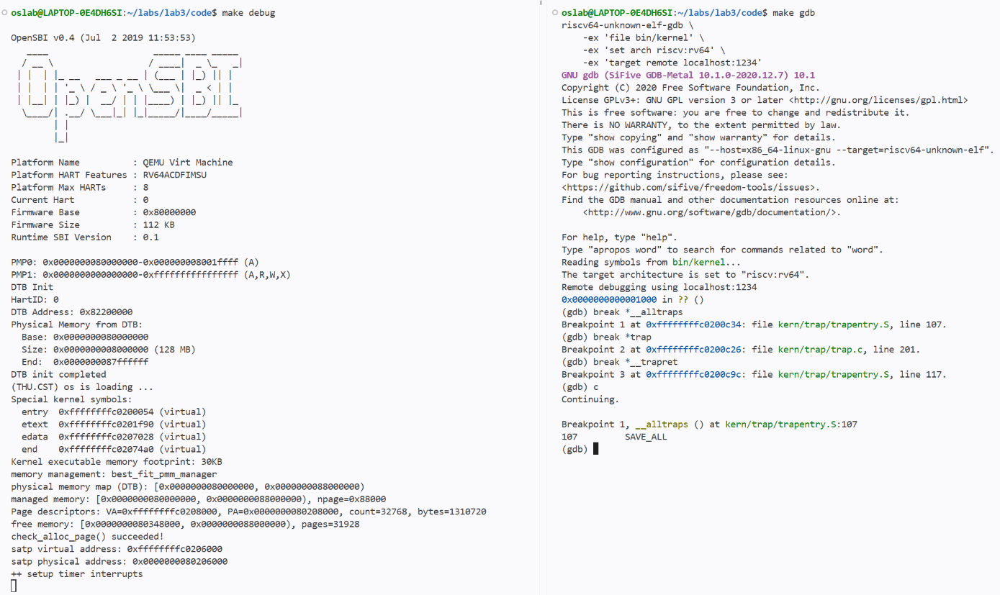

程序停在 `__alltraps` 的 `SAVE_ALL` 处，此时入口地址为 `0xffffffffc0200c34`。

#### 2. 记录进入时的寄存器

先查看通用寄存器和几个相关 CSR，再把原来的 `sp` 存到 GDB 变量 `$oldsp` 中，供后面比较。

```gdb
i r
i r sepc sstatus stval scause
set $oldsp = $sp
```

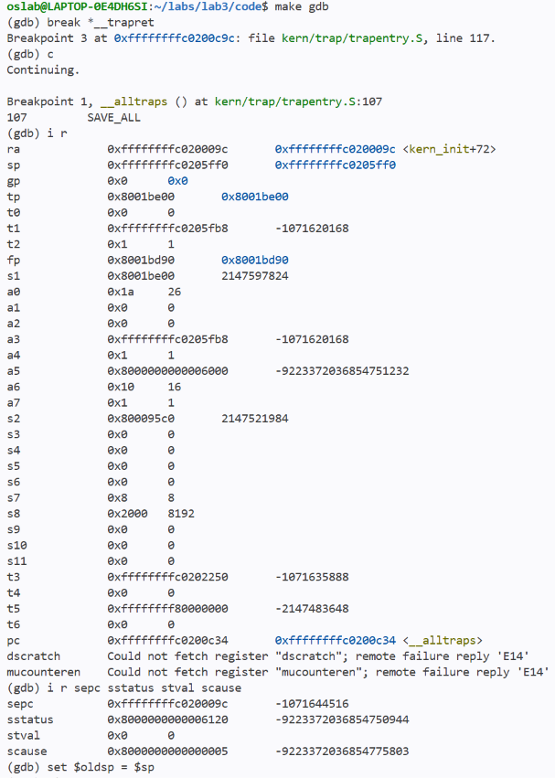

| 寄存器 | 此时的值 | 含义 |
|---|---|---|
| `sp` | `0xffffffffc0205ff0` | 保存现场前的栈指针 |
| `sepc` | `0xffffffffc020009c` | 被打断的位置，对应 `kern_init+72` |
| `sstatus` | `0x8000000000006120` | 进入 Trap 后的状态 |
| `stval` | `0x0` | 源码中 `sbadaddr` 对应的寄存器值 |
| `scause` | `0x8000000000000005` | 最高位为 1，原因码为 5，表示 S 模式时钟中断 |

#### 3. 执行 `SAVE_ALL`，检查栈上的 `trapframe`

本次代码的 `SAVE_ALL` 展开后有 43 条指令，因此执行 `si 43` 后正好停在 `mv a0, sp`。

```gdb
si 43
set $tf = (struct trapframe *)$sp
p sizeof(*$tf)
p/x {$tf->gpr.sp, $oldsp}
i r sp
x/36gx $sp
```

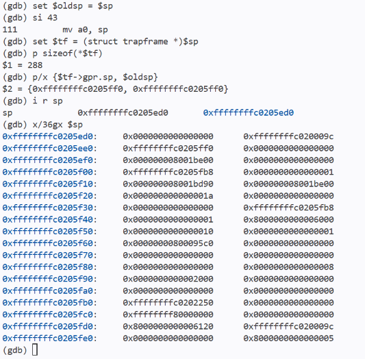

可以看到 `sizeof(*$tf)` 为 288，此时 `sp` 为 `0xffffffffc0205ed0`。和原来的 `0xffffffffc0205ff0` 相差 `0x120`，也就是 288 字节，正好是一个 `trapframe` 的大小。

`p/x {$tf->gpr.sp, $oldsp}` 输出的两个值都是 `0xffffffffc0205ff0`，说明 `gpr.sp` 保存的是分配栈帧之前的栈指针。再把内存前 32 项和上一张图中的通用寄存器对照，保存的值一致。最后 4 项依次为 `sstatus`、`sepc`、`stval` 和 `scause`，也和进入时记录的值对应。

#### 4. 进入 `trap()`，检查参数传递

继续执行到第二个断点，查看 `a0` 和 `sp`。

```gdb
c
i r a0 sp
```

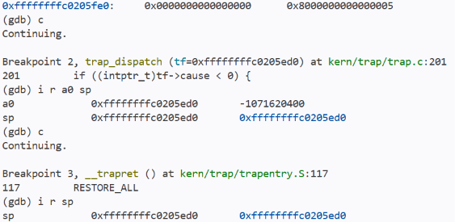

这里 `trap_dispatch()` 被内联到 `trap()`，GDB 显示停在 `trap_dispatch(tf=0xffffffffc0205ed0)`。此时 `a0` 和 `sp` 都为 `0xffffffffc0205ed0`，和刚才的栈帧起点相同，说明 `mv a0, sp` 把 `trapframe` 的地址传给了 C 函数。

#### 5. 执行 `RESTORE_ALL`，对照恢复后的寄存器

继续执行到 `__trapret`，先查看 C 函数返回后的栈指针，再单步执行恢复宏。本次代码的 `RESTORE_ALL` 有 35 条指令，执行后停在 `sret`。

```gdb
c
i r sp
si 35
i r
i r sepc sstatus
```

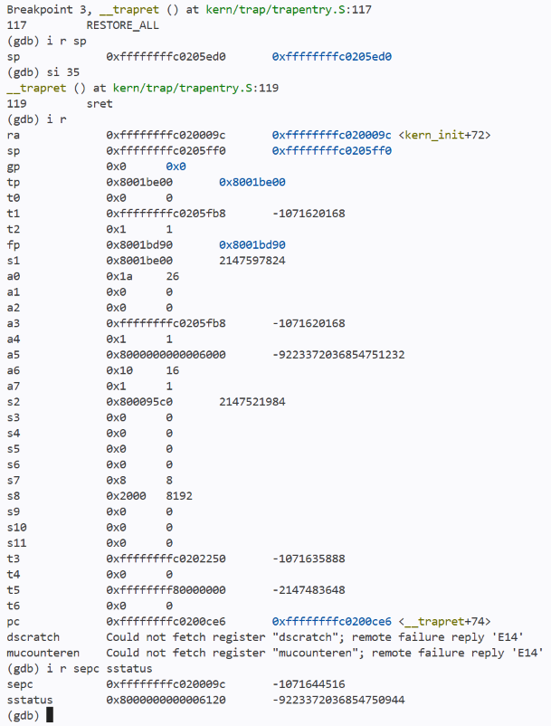

进入 `__trapret` 时，`sp` 仍为 `0xffffffffc0205ed0`，说明 C 函数返回后，栈指针回到了调用前的位置。执行 `RESTORE_ALL` 后，逐项对照两次 `i r` 的输出，显示的 31 个通用寄存器值一致。下面列出其中几项，以及两个用于返回的 CSR。

| 寄存器 | 进入 `__alltraps` 时 | 执行 `RESTORE_ALL` 后 |
|---|---|---|
| `ra` | `0xffffffffc020009c` | `0xffffffffc020009c` |
| `sp` | `0xffffffffc0205ff0` | `0xffffffffc0205ff0` |
| `t1` | `0xffffffffc0205fb8` | `0xffffffffc0205fb8` |
| `fp`（`s0`） | `0x8001bd90` | `0x8001bd90` |
| `s1` | `0x8001be00` | `0x8001be00` |
| `a0` | `0x1a` | `0x1a` |
| `s2` | `0x800095c0` | `0x800095c0` |
| `sepc` | `0xffffffffc020009c` | `0xffffffffc020009c` |
| `sstatus` | `0x8000000000006120` | `0x8000000000006120` |

尤其是 `a0`，调用 `trap()` 时它保存栈帧地址，恢复后又变成了原来的 `0x1a`。借用来恢复 CSR 的 `s1` 和 `s2` 也恢复成了各自原来的值。此时 `pc` 为 `0xffffffffc0200ce6`，对应 `sret`。`sstatus` 和 `sepc` 也与前面一致。

#### 6. 执行 `sret`，检查实际返回位置

```gdb
si
i r pc sp
```

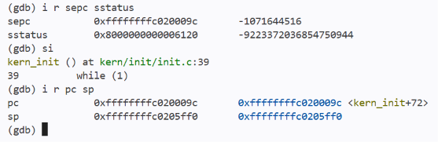

执行后 GDB 显示回到了 `kern_init()` 第 39 行的 `while (1)`。`pc` 为 `0xffffffffc020009c`，等于前面记录的 `sepc`，`sp` 为 `0xffffffffc0205ff0`，等于原来的栈指针。这次时钟中断处理后，程序回到了被打断的位置。

到这里模块一的gdb调试就结束了。

### 总体测试
测试时间：2026 年 11 月 6 日

交叉编译器为 `riscv64-unknown-elf-gcc 10.2.0`，运行环境为 QEMU 4.1.1 的 RISC-V `virt` 机器，使用 OpenSBI 启动内核。

以下命令均在源码目录执行：

```bash
cd /home/oslab/Lab/lab3/code
```

### 5.1 完整编译验证

**测试命令：**

```bash
make clean
make
```

**测试目的：** 检查 Lab2 物理内存管理代码、模块一汇编入口和模块二中断与异常处理代码能否共同编译、链接。

**实际结果：** 各源文件编译完成，链接生成 `bin/kernel`，并通过 `objcopy` 生成 `bin/ucore.img`。构建退出码为 `0`，未出现编译或链接错误，说明整合后的接口和符号引用能够通过构建检查。

**测试截图：**

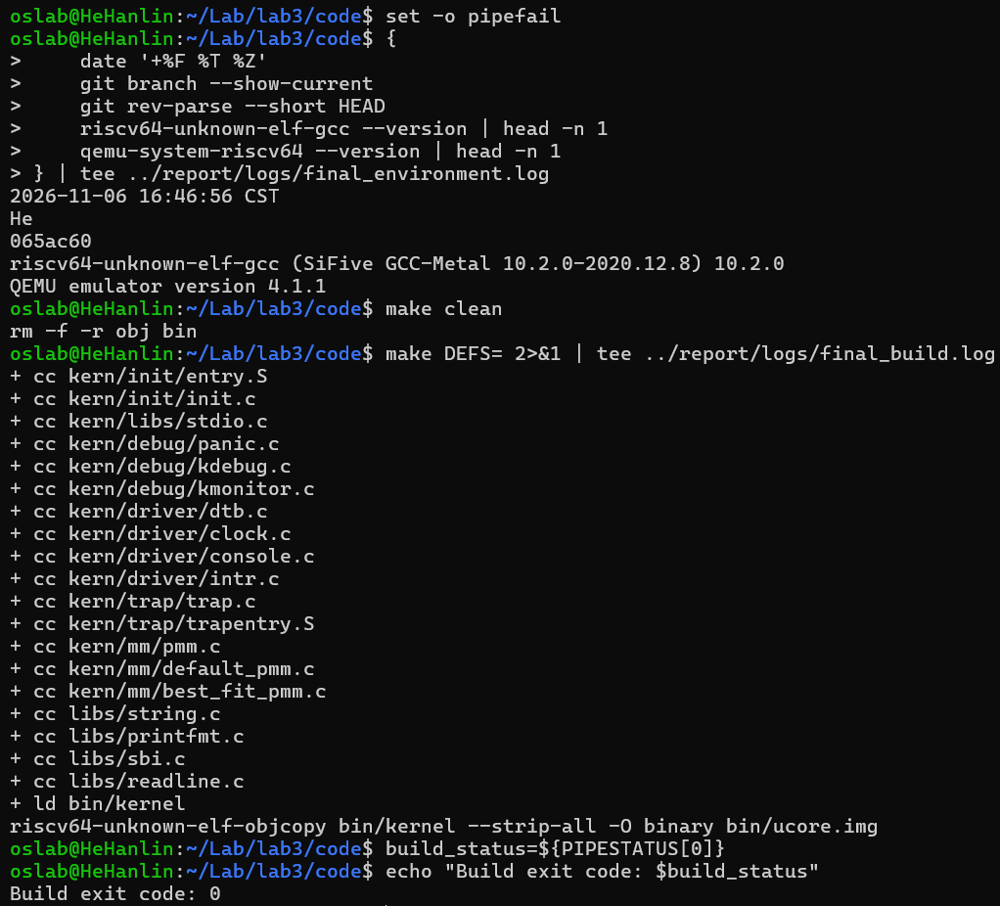

### 5.2 内核启动、持续时钟与关机验证

**测试命令：**

```bash
make qemu
```

**测试目的：** 验证内核能够启动、物理内存管理初始化正常，以及两个 Trap 模块协作后能持续处理时钟中断并在达到设定条件时关机。

**实际结果：**

1. OpenSBI 启动后进入内核，DTB 探测到 128 MiB 物理内存。内核选用 `best_fit_pmm_manager`，输出 `check_alloc_page() succeeded!`，表明物理内存分配器自检通过。
2. 输出 `++ setup timer interrupts` 后，连续输出 10 行 `100 ticks`，说明时钟事件能够持续触发，且处理完成后可以返回原执行流。
3. 当前 `TICK_NUM = 100`、`SHUTDOWN_AFTER = 10`，因此每累计 100 次时钟中断输出一次，第十次输出对应累计 1000 次时钟中断。第十次输出后系统自动关机并返回终端，运行退出码为 `0`，没有因外部超时而终止。

这里的 10 次输出是本组采用的关机阈值约定。该测试验证了普通启动路径中的持续时钟、周期输出和正常关机；断点与非法指令的返回由下一项评分测试验证。

**测试截图：**

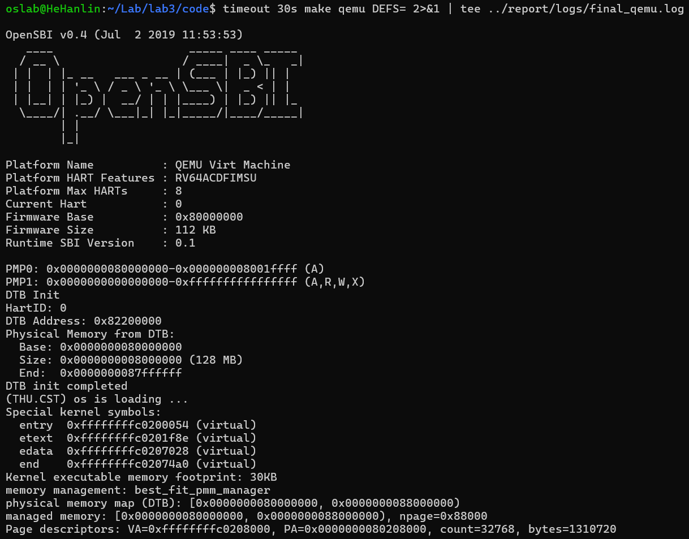

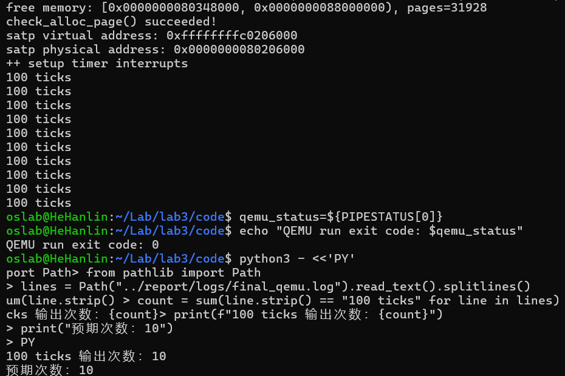

### 5.3 评分验证

**测试命令：**

```bash
make grade
```

**测试目的：** 使用实验框架提供的三个测试组，检查 Trap 入口、上下文恢复、异常返回及持续时钟处理的整合结果。

**实际结果：** 三个测试组全部通过，总分为 `100/100`。

| 测试组 | 验证内容 | 实际结果 |
|------|------|------|
| Trap entry, register restore, and breakpoint EPC | 经由断点触发 Trap，检查入口与返回流程、测试设置的寄存器值恢复以及断点处理输出 | PASS，35/35 |
| Illegal instruction EPC advance and return | 检查非法指令处理后能够继续执行，并检查 S 态软件中断、未知中断及其他异常的诊断输出 | PASS，25/25 |
| Re-armed supervisor timer and repeated trap return | 检查时钟重复触发、反复返回及计数达到 `ticks=200`，并检查 `100 ticks` 输出 | PASS，40/40 |
| **总分** | **三个测试组全部通过** | **100/100** |

下面两张截图来自同一次 `make grade` 运行，分别展示第一项测试通过，以及后两项测试通过和最终总分。

**测试截图：**

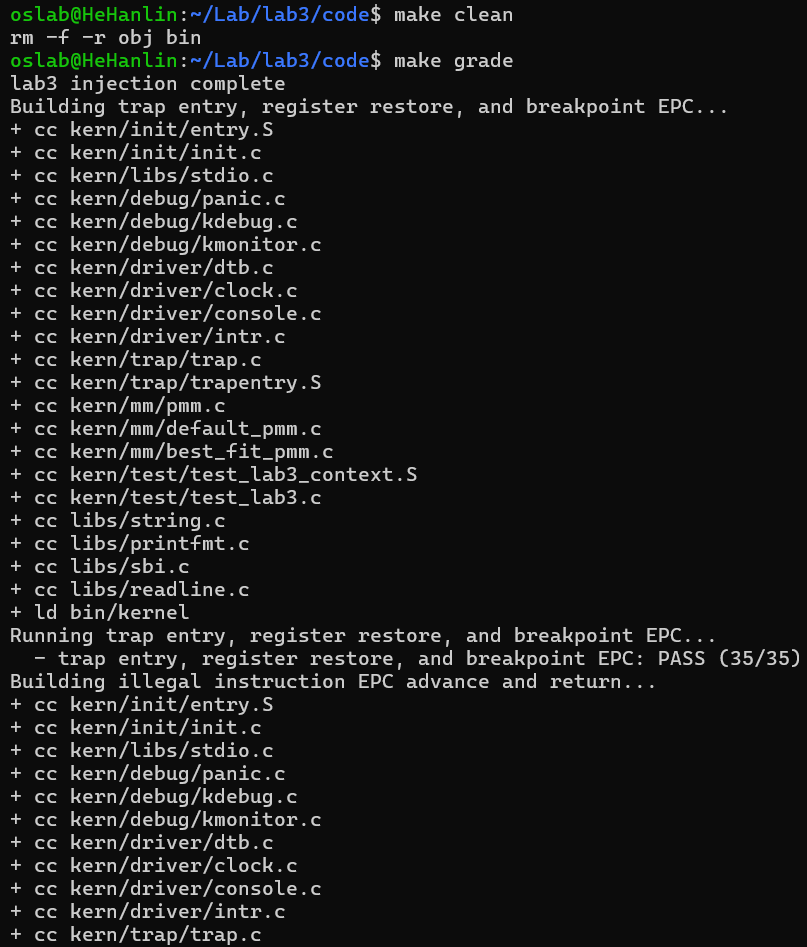

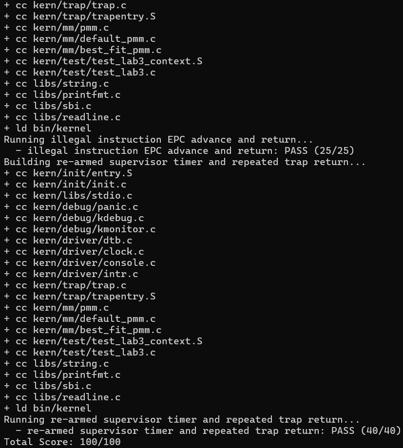

### 5.4 验证结论

完整编译、普通启动和官方评分均通过。模块一能够将保存的现场传给 C 语言处理函数，并在处理后恢复寄存器及返回状态；模块二能够与该流程衔接，完成评分覆盖的异常处理、持续时钟计数及诊断输出。普通运行还验证了第十次时钟统计输出后的正常关机。

---

## 六、实验总结与收获

### 对操作系统的理解

本实验的重要知识点及其与 OS 原理的对应关系如下。

| 实验知识点 | 对应的 OS 原理 | 含义、关系与差异 |
|------|------|------|
| 中断与异常的分类 | 异步外部事件与同步执行异常 | 二者都可通过 Trap 转交内核，但触发原因不同。实验通过 `scause` 统一入口后分类处理，将抽象的事件响应机制落实到具体原因码和分发函数。 |
| Trap frame 与上下文恢复 | 保护现场与恢复现场 | `SAVE_ALL` 将寄存器状态保存为栈上的结构，恢复路径再据此重建现场。这里主要返回同一执行流，不等同于调度器切换到另一个进程。 |
| 汇编入口、C 调用与 `sret` | 体系结构与内核的软件接口 | 普通 C 调用约定解决参数与函数调用问题，Trap 还需要保存被打断代码的现场及特权状态。仅遵守普通函数调用约定不足以实现完整 Trap 返回。 |
| `tf->epc` 的调整 | 异常恢复与指令执行语义 | 时钟中断一般保留返回位置；本实验要求的断点和非法指令需要跳过相应指令。推进长度由实际指令编码决定，不能推广为所有异常一律跳过。 |
| 持续时钟与计数 | 定时事件、时间片和抢占的基础 | OpenSBI 提供单次定时事件，软件反复设置后才形成持续时钟。本实验使用它进行计数、输出和关机，尚未实现时间片调度。 |
| 保存并恢复中断使能状态 | 临界区与互斥 | `local_intr_save()` / `local_intr_restore()` 在物理内存管理操作期间屏蔽本核中断，并按原状态恢复；不能简单地在退出时无条件开中断，也不能据此保证多核互斥。 |
| Trap frame 诊断输出 | 故障定位与错误处理 | 打印原因码、返回地址和寄存器有助于定位问题，但不会自动修复故障；兜底打印与可恢复的异常处理是不同能力。 |

本章对 `local_intr_save` 宏中的 `do { ... } while (0)` 的思考也有助于理解底层接口：它将宏体包装为一条语句，使其在 `if/else` 等上下文中可以安全使用，不表示运行时反复循环。另需区分 `volatile` 与原子性：`ticks` 的 `volatile` 修饰约束编译器对访问的优化，并不自动保证复合操作的互斥或原子性。

OS 原理中仍有若干重要内容未在本次实验中完整实现：

1. **进程与线程调度。** 时钟可以成为抢占调度的触发来源，但本实验没有实现就绪队列、时间片分配及不同进程间的上下文切换。
2. **用户态隔离与系统调用。** 当前重点是内核中的 Trap 处理，尚未形成完整的用户进程、用户栈与内核栈切换及系统调用服务流程。
3. **虚拟内存与缺页恢复。** Trap 机制为缺页处理提供入口，但本实验不实现按需分页、页面置换和缺页后的映射修复。
4. **多核同步与复杂中断管理。** 本核关中断不足以处理其他 CPU 的并发访问，本实验也未完整实现多核锁、复杂嵌套中断和中断优先级管理。
5. **设备 I/O 与持久化。** 本实验对部分中断仅进行识别和提示，尚未实现完整外设驱动、阻塞 I/O 唤醒、文件系统及持久化管理。

### AI 协作开发的经验

提示词应以工程中的真实定义为依据。本次核对发现手册提到的 `SHUTDOWN_AFTER` 在初始代码中尚无定义，说明依赖信息需要逐项核实，不能将文档中出现的名称直接视为可用接口。对汇编与 C 协作的模块，Trap frame 布局、原始栈指针和返回地址尤其需要明确约束。

四段式提示词可以分别承担任务范围、可信依赖、交付接口和行为规格的职责。spec 应说明执行前后的状态及不同事件下的行为，而不是只要求“补全函数”或机械指定指令序列。按两个完整功能模块组织提示词，有利于保持保存、处理、恢复之间的接口一致性。

后续生成代码时，应将编译错误、运行现象及原因分析反馈到具体规格中，并保留真实迭代记录。

**刘泽民：** 我觉得这次写提示词时，先把已有代码看懂比较重要。我先按 `SAVE_ALL` 把保存位置看清楚，再把从哪里取寄存器、什么时候恢复 `sp` 写到 spec 里。生成代码以后也按同一份布局检查，最后看反汇编里 `sp` 是不是从偏移 16 读回来的。

---
