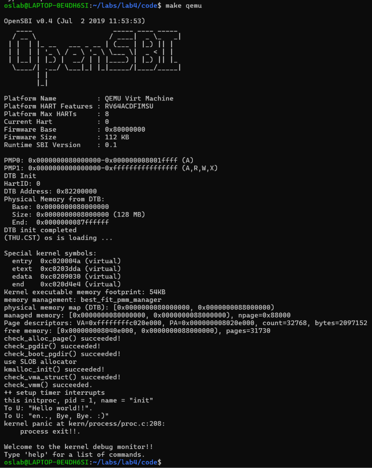
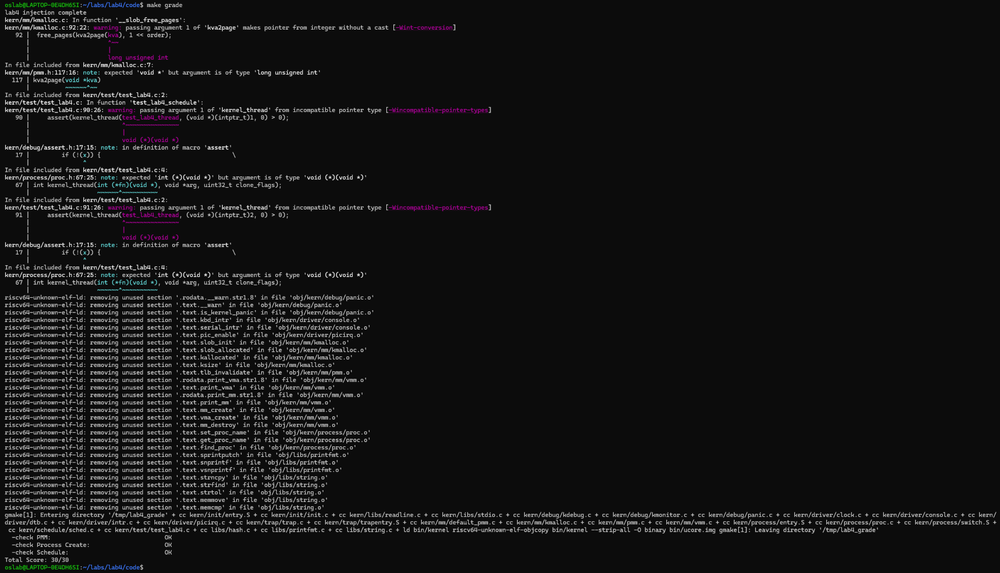

# 操作系统实验报告

## 实验基本信息

| 项目 | 内容 |
|------|------|
| **实验名称** | lab4: 进程管理 |
| **小组成员** | 2412591-贺翰林、2412604-刘泽民、2414034-丁欣怡 |
| **完成日期** | 2026-11-20 |

### 小组分工

练习如何分工？

| 成员 | 负责的练习/模块 |
|------|----------------|
| 2412604-刘泽民 | 功能模块一：虚拟内存页操作功能，Challenge 2 |
| 2414034-丁欣怡 | 功能模块二：进程创建及初始化功能 |
| 2412591-贺翰林 | 功能模块三：进程调度，Challenge 1 |

实验报告如何分工？

各自完成所负责的模块部分的报告，贺翰林负责最终整合报告。

---

## 一、实验目的

本实验的主要目的是：

1. 了解虚拟内存管理的基本结构，掌握虚拟内存的组织与管理方式
2. 了解内核线程创建/执行的管理过程
3. 了解内核线程的切换和基本调度过程

---

## 二、实验环境

你们使用的 AI 工具

| 成员 | AI 编程工具 | 底层模型 | 备注 |
|------|------------|---------|------|
| 2412604-刘泽民 | Claude Code（VS Code 插件）| DeepSeek-V4.1-Flash | |
| 2414034-丁欣怡 | | | |
| 2412591-贺翰林 | DeepSeek Harness | DeepSeek-V4.1-Flash | |

---

## 三、实验整体逻辑分析

### 3.1 本章节的逻辑主线

本章围绕“进程管理”展开，核心问题是：内核已经具备物理内存管理和基础页表能力之后，如何让多个执行实体（内核线程）轮流使用 CPU。

整个实验沿着“地址空间 → 执行实体 → 调度切换”三层逐步推进：

1. **地址空间层**：引入虚拟内存描述结构，管理线程/进程的虚拟地址空间，并补齐页表映射的建立与撤销（`page_insert`/`page_remove`），让“地址”真正可用；
2. **执行实体层**：设计进程控制块 `proc_struct`，把当前执行现场包装成第 0 个内核线程 `idleproc`，再通过 `kernel_thread/do_fork/copy_thread` 创建第 1 个内核线程 `initproc`，为每个线程准备独立的内核栈、trapframe 和首次运行上下文；
3. **调度切换层**：用 `schedule` 从就绪队列中选择下一个线程，用 `proc_run` 更新 `current` 和页表，用 `switch_to` 完成寄存器现场的保存与恢复；`cpu_idle` 作为调度点，让 `idleproc` 主动把 CPU 交给 `initproc`。

整条启动链可以概括为：

```text
kern_init → pmm_init → vmm_init → proc_init → cpu_idle
          → schedule → proc_run → switch_to → initproc 首次运行
```

其中前半段（`pmm_init/vmm_init`）负责把地址空间准备好，中间（`proc_init`）负责把线程对象准备好，后半段（`cpu_idle/schedule/proc_run/switch_to`）负责让第一个可运行线程真正跑起来。三者缺一不可：没有页表就无法切换地址空间，没有 PCB 就没有调度对象，没有调度器则线程只能停留在“已创建”状态。

### 3.2 功能的逐步实现

本章按以下顺序实现，顺序由依赖关系决定：

1. **先实现功能模块一：虚拟内存页操作**（`page_insert/page_remove`）。
   原因：`pmm_init` 内部的 `check_pgdir()`/`check_boot_pgdir()` 会立即调用这两个函数，页表测试过不了，内核连初始化都无法完成；同时它们也是后续线程地址空间和 `vmm` 的基础。关键是把“页表项内容、物理页引用计数、TLB 状态”三者保持同步。

2. **接着实现功能模块二：进程创建及初始化**（`alloc_proc/proc_init/kernel_thread/do_fork/copy_thread/copy_mm`）。
   原因：调度的对象是 PCB。`proc_init` 把当前执行现场包装成 `idleproc`，再创建 `initproc`；`kernel_thread/copy_thread` 负责把函数入口、参数、内核栈和 trapframe 组织成“第一次被切换时能正确运行”的现场。没有这一层，`schedule` 没有东西可选。

3. **最后实现功能模块三：进程调度**（`cpu_idle/schedule/proc_run/switch_to`）。
   原因：它依赖前两层提供的页表、PCB、内核栈和 `context`。`cpu_idle` 是 `kern_init` 的最后一个调用，只有前面全部就绪，`idleproc` 才能通过 `schedule → proc_run → switch_to` 把 CPU 交给 `initproc`。`switch_to` 只做寄存器保存/恢复，`proc_run` 负责 `current` 与 `satp`，`schedule` 负责选择策略，三者分工明确。

4. **最后完成 Challenge 的思考题**（开关中断与分页模式）。
   原因：这些内容是对上述实现的原理性总结；例如 `local_intr_save/restore` 正是 `schedule/proc_run` 临界区的实现基础，放在代码完成之后分析更具体。

---

## 四、实验内容与实现

### 功能模块一：虚拟内存页操作

**负责人：** 2412604-刘泽民

**负责人：** 2412604-刘泽民

#### 模块功能描述

**需要实现的函数**

```c
int page_insert(pde_t *pgdir, struct Page *page, uintptr_t la, uint32_t perm);
void page_remove(pde_t *pgdir, uintptr_t la);
```

两个函数都在 `kern/mm/pmm.c` 中实现。`get_pte()` 用来定位 `la` 所在虚拟页的页表项，`page_insert()` 和 `page_remove()` 在此基础上建立、更新和删除映射。页表项中记录物理页号和权限，`struct Page` 中的 `ref` 用来记录物理页的引用情况。比如同一物理页映射到两个虚拟页时，删除其中一个映射，另一个还可以继续访问这个物理页。

#### 核心函数实现思路

##### 1. `page_insert()`

先保存根页表中对应项的原值，再通过 `get_pte(pgdir, la, 1)` 找到要写的页表项。分配页表页失败时，撤销本次已经挂上的页表页，然后返回 `-E_NO_MEM`。拿到页表项后，根据 `PTE_V` 和原项指向的物理页判断怎么处理引用计数。

| 原来的映射             | 引用计数的处理                                  |
| ---------------------- | ----------------------------------------------- |
| 未建立映射             | 目标物理页的引用计数加 1                        |
| 已经映射到同一物理页   | 只更新权限，引用计数保持原值                    |
| 已经映射到另一个物理页 | 新页的引用计数加 1，旧页减 1，旧页减到 0 时释放 |

最后用 `pte_create(page2ppn(page), perm)` 写入页表项。这个函数会加上 `PTE_V`，新权限由 `perm` 决定。例如原来有写权限，这次只传入 `PTE_R`，写入后就只保留读权限。写完再调用 `tlb_invalidate(pgdir, la)` 让这个虚拟页的旧地址转换和权限失效，然后返回 0。

##### 2. `page_remove()`

用 `get_pte(pgdir, la, 0)` 查找现有页表。返回 `NULL` 或页表项的 `PTE_V` 为 0 时直接返回。找到有效映射后，先通过 `pte2page()` 得到原来的物理页，再将页表项清零，对原物理页的引用计数减 1，减到 0 时调用 `free_page()`，最后调用 `tlb_invalidate()`。删除后中间级页表仍然可以用于同一范围内其他虚拟页的映射。

#### 规格和提示词的写法

我先看了 `get_pte()` 的 `create` 参数和源码里的测试。`page_insert()` 需要考虑原来没有映射、映射到同一页、映射到另一页以及建表失败这四种情况。`page_remove()` 只需要按有没有有效映射来处理。规格里对每种情况都写清楚了页表项怎么变、引用计数怎么增减以及什么时候调用 `tlb_invalidate()`。分配失败时也要检查分配前后的状态，因为 `get_pte()` 可能已经挂上了一级页表页才返回 `NULL`。

`[PROMPT]` 指明要修改的文件和代码位置，`[RELY]` 列出已有接口和需要注意的分配失败情况，`[GUARANTEE]` 给出两个函数的签名，`[SPECIFICATION]` 按前置条件、后置条件和各个分支写出具体要求。

#### 最终提示词

````markdown
[PROMPT]

**任务**：修改 `kern/mm/pmm.c`，实现虚拟内存页操作功能，包括建立、更新和撤销虚拟地址到物理页的映射，保证页表项、物理页引用计数和 TLB 状态一致。

**操作要求**：必须修改项目实际文件，在 `//LAB4 function1 YOUR CODE` 处补全功能，保留其他现有代码及测试。复用已有接口，不引入无关功能。

**输出要求**：根据以下规格完成实现。代码应逻辑清晰、结构简洁，避免重复逻辑、不必要的辅助函数和冗余注释，同时完整处理异常情况。完成后编译并验证相关测试，说明实际结果。

[RELY]

现有工程提供以下数据结构、宏和接口：

- **数据结构**：`pde_t`、`pte_t`、`struct Page`（`ref` 为引用计数）、`pages`、`boot_pgdir_va`。
- **页表操作**：`get_pte(pgdir, la, create)` 定位页表项，`create=1` 时按需分配中间级页表页，失败返回 `NULL`；`pte_create(ppn, perm)` 构造包含 `PTE_V` 的页表项；`pte2page()`、`pde2page()`、`page2ppn()` 用于物理页转换。
- **物理页管理**：`page_ref()`、`page_ref_inc()`、`page_ref_dec()`、`set_page_ref()`、`alloc_page()`、`free_page()`。
- **地址与权限**：`PDX1()`、`PDX0()`、`PTX()`、`PDE_ADDR()`、`KADDR()`、`PGSIZE`、`PTE_V`、`PTE_U`、`PTE_W`、`PTE_R`、`PTE_X`。
- **TLB 操作**：`tlb_invalidate()`、`flush_tlb()`。
- **错误码**：`E_NO_MEM`。

注意：现有 `get_pte()` 可能在成功挂接第一级页表页后，因下一级分配失败而返回 `NULL`，此时已创建的页表页不会自动回收。

[GUARANTEE]

在 `kern/mm/pmm.c` 中实现：

```
int page_insert(pde_t *pgdir, struct Page *page, uintptr_t la, uint32_t perm);(kern/mm/pmm.c)
void page_remove(pde_t *pgdir, uintptr_t la);(kern/mm/pmm.c)
```

保持函数签名不变。必要时可添加模块内部的 `static` 辅助函数，不修改公开接口。

[SPECIFICATION]

### 1. page_insert()

**Pre-Condition**

- `pgdir` 和 `page` 均有效，`la` 不要求页对齐。
- 目标虚拟地址可能未映射，也可能已映射到相同或不同的物理页。

**Post-Condition**

- 成功返回 `0`，目标页表项映射到 `page`，包含 `PTE_V` 和 `perm` 指定的权限。
- 物理页引用计数与映射关系一致，映射或权限变化后对应 TLB 项失效。
- 页表分配失败返回 `-E_NO_MEM`，原有映射与引用计数不变，不留下半完成映射或资源泄漏。

**Case 1：原地址未映射**

按需建立中间级页表，创建目标映射，目标物理页引用计数增加一次。

**Case 2：原地址已映射到同一物理页**

更新权限，保持引用计数和空闲物理页数量不变，不得释放该物理页。

**Case 3：原地址已映射到其他物理页**

替换旧映射，新物理页引用计数增加一次，旧物理页引用计数减少一次；旧页引用计数归零时释放。

**Case 4：页表分配失败**

返回 `-E_NO_MEM`。若本次调用已创建部分中间级页表页，应撤销新增的页表项并释放对应页表页，不影响原有页表结构和映射，原来的页表项应保持一致。

**Requirements**

- 判断有效映射时通过页表项指针和`PTE_V`判断。
- 同页重复插入不得重复增加引用计数或错误释放物理页。
- 新权限以 `perm` 为准，不保留旧权限；映射或权限更新后使对应 TLB 项失效。

### 2. page_remove()

**Pre-Condition**

- `pgdir` 有效，`la` 不要求页对齐，目标地址可能存在或不存在映射。

**Post-Condition**

- 有效映射被撤销后，页表项清零，物理页引用计数正确减少，对应 TLB 项失效。
- 无有效映射时直接返回，不改变页表和引用计数。

**Case 1：存在有效映射**

清除页表项，原物理页引用计数减少一次，归零时释放物理页，并使对应 TLB 项失效。

**Case 2：不存在有效映射**

直接返回，不分配页表页、不修改引用计数，也不释放物理页。重复删除应保持相同结果。

**Requirements**

- 查找页表项时不得创建缺失的中间级页表。
- 仅对有效映射使用 `pte2page()`。
- 不回收中间级页表页，避免破坏其他映射及现有测试依赖的页表结构。

### 3. 验证要求

不得修改测试代码
````

#### 实现迭代过程

本模块经历了两次迭代。

##### 第一次迭代

**遇到的问题**

第一次生成的 `page_insert()` 在第二次页表页分配失败时，会释放已经分配的页表页，并把根页表中的那一项直接写成 0。比如用 `0x100` ，它的 `PTE_V` 为 0，但原来的值是 `0x100`。如果分配失败后写成 0，原页表项里的内容就变了。

**问题解决策略**

我接着把这个例子发给 AI，说明失败时要恢复调用 `get_pte()` 前的整项内容。原来有效的页表项和这次刚挂上的页表项，可以用调用前后的 `PTE_V` 区分。

##### 第二次迭代

**最终结果**

AI 把原来只记录有效位的写法改成先用 `pde1_old` 保存整个页表项。若 `get_pte()` 返回 `NULL`，且该项的 `PTE_V` 从 0 变成了 1，就先用当前页表项找到新分配的页表页，再把 `pde1_old` 写回去，最后释放新分配的页表页。此时叶子页表项还没写入，目标物理页的引用计数也还没开始修改。

### 功能模块二：进程创建及初始化

**负责人：** 2414034-丁欣怡

#### 模块功能描述

**需要实现/修改的函数：**

```c
static struct proc_struct *alloc_proc(void);
static int copy_mm(uint32_t clone_flags, struct proc_struct *proc);
static void copy_thread(struct proc_struct *proc, uintptr_t esp, struct trapframe *tf);
int do_fork(uint32_t clone_flags, uintptr_t stack, struct trapframe *tf);
int kernel_thread(int (*fn)(void *), void *arg, uint32_t clone_flags);
void proc_init(void);
```

**功能说明：** alloc_proc 建立安全空白 PCB；copy_mm 保留共享内核空间的约束；copy_thread 在独立内核栈中复制现场并初始化 PCB 内嵌 context；kernel_thread 将函数和参数放进启动现场；do_fork 完成分配、登记和唤醒；proc_init 包装当前执行流为 idle，再创建 init。

规格详见 [模块二 spec](spec-module2.md)。spec 围绕资源所有权、状态转换和首次恢复约定编写，避免只列函数名称。prompt 提供实际 RV64 字段和已有接口，明确页表使用物理地址、临时现场必须复制、失败逆序释放资源，并把 A/C 的修改区域排除在外。

#### 最终提示词

以下为当前实现采用的提示词版本，完整运行验收仍待 A/C 模块整合；同步记录于 prompt.md。

````markdown
[PROMPT]

**任务**：实现 lab4/code/kern/process/proc.c 中 function2 的六个函数，创建共享内核地址空间的 idle/init 内核线程。

**操作要求**：修改实际文件，仅补全 function2，标记改为 2414034；保留 function3 和既有函数、评分代码。使用独立分支。同步记录规格和真实验证结果。

**输出要求**：按工程真实 RV64 接口实现，禁止套用 x86/TSS/CR3 或旧字段；不扩展用户地址空间复制、退出回收、抢占调度。不把未运行写成测试通过。

[RELY]

proc.h 定义 PCB，含 state/pid/runs/kstack/need_resched/parent/mm/context/tf/pgdir/flags/name/list_link/hash_link。context 是 PCB 内嵌的 ra、sp、s0-s11，tf 指向内核栈上的 trapframe。页表物理地址使用 boot_pgdir_pa。依赖 kmalloc/kfree、setup_kstack/put_kstack、get_pid/hash_proc/find_proc、wakeup_proc、list_init/list_add、local_intr_save/restore、bootstack、KSTACKSIZE、CLONE_VM、MAX_PROCESS 和已有错误码。

forkret 调用 forkrets(current->tf)，后者进入 __trapret；kernel_thread_entry 从 s1 取参数到 a0，通过 s0 调用函数。set_proc_name 固定复制 PROC_NAME_LEN 字节，传入补零的固定长度名称数组。

[GUARANTEE]

```c
static struct proc_struct *alloc_proc(void);
static int copy_mm(uint32_t clone_flags, struct proc_struct *proc);
static void copy_thread(struct proc_struct *proc, uintptr_t esp, struct trapframe *tf);
int do_fork(uint32_t clone_flags, uintptr_t stack, struct trapframe *tf);
int kernel_thread(int (*fn)(void *), void *arg, uint32_t clone_flags);
void proc_init(void);
```

不得更改公开接口；内部辅助函数应保持 static。

[SPECIFICATION]

1. alloc_proc：内存失败返回 NULL；成功清零 PCB，设置 UNINIT、pid=-1、pgdir=boot_pgdir_pa 并初始化链表节点，不登记、不唤醒。
2. copy_mm：前提 current 有效且 mm=NULL，断言该约束，子线程 mm=NULL，返回零；不取得用户地址空间资源。
3. copy_thread：前提子线程已分配内核栈且 tf 有效；在 kstack+KSTACKSIZE-sizeof(trapframe) 放置现场副本，禁止保存局部模板的指针；a0=0；恢复 sp 使用非零 esp，否则为 tf 地址；context.ra=forkret，context.sp=tf。
4. do_fork：前提 current/tf 有效；检查进程上限，依次分配 PCB、设置 parent、分配栈、copy_mm、copy_thread；登记临界区保存并恢复原中断状态，复查上限，分配唯一 PID，挂入哈希与链表，增加计数，最后唤醒。成功返回 PID；上限返回 -E_NO_FREE_PROC，内存不足返回 -E_NO_MEM；失败逆序释放已占用资源，不留下全局登记。
5. kernel_thread：清零临时 tf，s0=fn、s1=arg、epc=kernel_thread_entry；status 基于当前 sstatus 设置 SPP/SPIE，清除 SIE；调用 do_fork(clone_flags|CLONE_VM,0,&tf)，传播返回值。
6. proc_init：启动时只调用一次；初始化全局链表和哈希表。idle 使用 bootstack、PID0、RUNNABLE、need_resched=1，parent/mm/tf=NULL，runs/flags/context 初值为零；设 current=idle 并计数，但 idle 不加入普通链表和哈希。通过 kernel_thread(init_main,"Hello world!!",0) 创建 PID1，find_proc 后命名 init；创建失败 panic。

验收应分清模块编译和整机运行；整合后使用原测试验证 Process Create，并与 C 检查完整首次恢复链，不修改测试判据。
````

#### 实现迭代过程

##### 第一次迭代

**实现内容：** 完成六函数、登记临界区和失败回滚；在登记时再次检查进程数上限，恢复调用者原中断状态。发现已有 set_proc_name 固定复制 PROC_NAME_LEN 字节，因此使用补零的固定大小名称数组，避免从短字符串越界读取；未修改既有辅助函数。

**验证结果（2026-11-16）：** 使用 WSL RISC-V 工具链编译 proc.o 成功。全工程 make 到达链接阶段，但缺少 page_insert、page_remove、cpu_idle 等 A/C 接口而失败。构建还出现短暂文件时间偏差警告；后续独立强制重编译用于复核模块对象。

**问题解决策略：** 保留原有测试和成员边界；待 A/C 交付后整合，再运行 Process Create 和完整评分，不用空实现绕过缺失接口。

**当前状态：** 模块二代码与规格已完成；尚未取得 QEMU 运行、Process Create 10/10 或整机 30/30 的结果。分配失败路径已进行代码审查，尚未进行故障注入验证。首次运行需与 C 沿 switch_to → forkret → forkrets → __trapret → kernel_thread_entry 联调。

---

### 功能模块三：进程调度

**负责人：** 2412591-贺翰林

#### 模块功能描述

**需要实现/修改的函数：**

```c
// kern/process/switch.S
void switch_to(struct context *from, struct context *to);

// kern/process/proc.c
void proc_run(struct proc_struct *proc);
void cpu_idle(void) __attribute__((noreturn));

// kern/schedule/sched.c
void schedule(void);
```

**功能说明：**

功能模块三负责把前两个模块准备好的“线程对象”真正交给 CPU 执行，是 Lab4 从“能创建线程”走到“能并发运行线程”的最后一步。它包含四个层次：

1. `switch_to`：最底层的上下文切换，只负责把当前线程的 `ra/sp/s0-s11` 保存到 `from->context`，再从 `to->context` 恢复同一组寄存器并 `ret`。它不参与调度决策，也不修改 `current`。
2. `proc_run`：一次具体切换的执行者。它更新 `current`，把 `satp` 指向目标线程的页表根物理地址并刷新 TLB，然后调用 `switch_to`；整个过程在关中断临界区内完成。
3. `schedule`：调度决策者。它清掉 `current->need_resched`，在 `proc_list` 中按轮转规则找到一个 `PROC_RUNNABLE` 的线程；找不到时回退 `idleproc`；最后通过 `proc_run` 完成切换。
4. `cpu_idle`：空闲线程的执行主体。启动阶段 `proc_init` 把 `idleproc->need_resched` 置 1，`cpu_idle` 检测到后调用 `schedule`，把 CPU 第一次交给 `initproc`；之后它持续作为“没有就绪线程时的保底执行流”。

模块的主要场景包括：

- **启动时的第一次切换**：`idleproc` → `initproc`。这是本实验最关键的场景：`initproc` 的 `context.ra` 由模块二设为 `forkret`，`context.sp` 指向它自己的 trapframe；`switch_to` 恢复后经 `forkret → forkrets → __trapret → sret → kernel_thread_entry` 首次运行 `init_main`。
- **运行中的轮转**：测试线程和 `initproc` 反复把 `need_resched` 置 1 并调用 `schedule`，验证轮转选择能回到每个可运行线程。
- **无就绪线程**：一圈扫描不到 `PROC_RUNNABLE` 时回到 `idleproc`，保证 CPU 不会因为找不到线程而崩溃。

与其他模块的交互：

- 依赖模块一维护的页表：`satp` 写入的是页表根**物理地址**，内核线程共享 `boot_pgdir_pa`；
- 依赖模块二准备好的 PCB、内核栈、`context`、`tf` 和 `PROC_RUNNABLE` 状态；
- 依赖 `sync.h` 的 `local_intr_save/local_intr_restore` 保证“改 `current` + 换页表 + 切换现场”的原子性；
- 依赖 `trapentry.S` 的 `forkrets/__trapret` 完成新线程的首次运行。

#### 最终提示词

以下是经过迭代优化后，最终成功实现该功能的提示词：

````markdown
[PROMPT]
**任务**：修改 kern/process/switch.S、kern/process/proc.c、kern/schedule/sched.c，
实现 Lab4 功能模块三“进程调度”：switch_to、proc_run、schedule、cpu_idle。
switch.S 只放 switch_to 汇编；proc.c 在 `//LAB4 function3 YOUR CODE` 处补
proc_run 与 cpu_idle；sched.c 在同名标记处补 schedule。

**操作要求**：必须在项目中修改真实文件，不要只输出代码片段；保留现有代码、
注释和 `//LAB4 function3` 标记，只在标记处补全；不要改动功能模块一/二的函数
（page_insert/page_remove/alloc_proc/proc_init/kernel_thread/do_fork/
copy_thread/copy_mm），也不要改 Makefile、trap.c、pmm.c。
禁止使用 libs/riscv.h 中的 lsatp()（它是 Sv32 遗留，MODE=1，在 Sv39 下会出错）。

**输出要求**：直接改文件；以 [RELY] 中的工程真实定义为准；不要引入无关功能、
日志或测试钩子。

[RELY]
// struct context（kern/process/proc.h）
struct context {
    uintptr_t ra, sp, s0, s1, s2, s3, s4, s5, s6, s7, s8, s9, s10, s11;
};  // 偏移依次为 0,8,16,...,104

// struct proc_struct 关键字段：state/pid/runs/kstack/need_resched/
// context/tf/pgdir(页表根物理地址)
// 全局：proc_list、idleproc、initproc、current；状态 PROC_RUNNABLE
// list.h：list_entry_t、list_next、le2proc
// sync.h：local_intr_save(x)/local_intr_restore(x)，x 为 bool，
//         保存调用前的 sstatus.SIE，必要时关中断
// riscv.h：read_csr/write_csr、SATP_MODE_SV39=8、RISCV_PGSHIFT=12
// pmm.c enable_paging() 的正确写法：
//   write_csr(satp, 0x8000000000000000 | (boot_pgdir_pa >> RISCV_PGSHIFT));
// pmm.h：boot_pgdir_pa、flush_tlb()（sfence.vma）
// 首次运行链：copy_thread 置 context.ra=forkret、context.sp=tf；
//   forkret → forkrets(a0=tf) → __trapret → sret → kernel_thread_entry

[GUARANTEE]
void switch_to(struct context *from, struct context *to);  // switch.S
void proc_run(struct proc_struct *proc);                   // proc.c
void schedule(void);                                       // sched.c
void cpu_idle(void);                                       // proc.c, noreturn

[SPECIFICATION]
## switch_to
**Pre-Condition**：from/to 指向有效 context；a0=from，a1=to；调用者已关中断。
**Post-Condition**：from 的 ra/sp/s0-s11 被写入；从 to 恢复同组寄存器；
ret 后目标现场继续执行。
**Case 1**：正常切换，14 个字段一一对应，不保存 a/t 寄存器。
**Requirements**：先集中 sd 到 from，再集中 ld 从 to，最后 ret。

## proc_run
**Pre-Condition**：proc 非空；proc->pgdir 是 Sv39 根页表物理地址
（内核线程为 boot_pgdir_pa）。
**Post-Condition**：current==proc；satp=SV39|PPN(pgdir)；TLB 已刷新；
switch_to 完成切换；本函数回到原线程时按保存值恢复中断。
**Case 1**：proc==current，直接返回，不做任何切换。
**Case 2**：关中断→记录 prev→current=proc→写 satp→flush_tlb→
switch_to(&prev->context,&proc->context)→恢复中断。
**Requirements**：整个过程在关中断临界区；satp 常量必须用 64 位。

## schedule
**Pre-Condition**：current 非空；可在任意内核上下文调用，中断状态任意。
**Post-Condition**：current->need_resched=0；选出 next；next->runs++；
next!=current 时 proc_run(next)。
**Case 1**：current==idleproc，从 proc_list 头开始环形查找。
**Case 2**：current!=idleproc，从 current->list_link 之后环形查找。
**Case 3**：一圈都没有 PROC_RUNNABLE，next=idleproc 保底。
**Requirements**：选择与切换在关中断临界区；只选 PROC_RUNNABLE；
循环必须能终止；idleproc 只作保底，若它被链入 proc_list 则跳过它作普通候选。

## cpu_idle
**Pre-Condition**：current==idleproc，且 idleproc->need_resched=1。
**Post-Condition**：永不返回；need_resched 为真时调用 schedule，否则空转。
**Requirements**：函数不得返回；不要每次循环无条件重设 need_resched。
````

#### 实现迭代过程

本模块的实现经历了 3 次迭代，过程如下：

##### 第一次迭代

**目标：** 用四段式提示词让 AI 在三个文件的标记处补全四个函数。

**遇到的问题：**

- 问题 1：`satp` 的写法没有在初版提示词中固定。RISC-V 的 `satp` 在 Sv39 下 MODE 字段是 4 位，若照抄 `libs/riscv.h` 的 `lsatp()`（它写的是 Sv32 的 `SATP32_MODE`，MODE=1），在 RV64 上会写入保留模式；若写成 `SATP_MODE_SV39 << 60`，`SATP_MODE_SV39` 是 `int`，左移 60 位属于未定义行为，`-O2` 下可能得到 0。两种情况都会让第一次切换后取指/访存 page fault。
- 问题 2：`switch.S` 只描述“保存/恢复上下文”，没有给字段偏移。`struct context` 的顺序是 `ra, sp, s0…s11`，不是按寄存器编号排列；若按编号顺序保存，`sp/ra` 会错位，切换后直接崩溃。

**问题解决策略：**

- 在 `[RELY]` 中直接给出 `struct context` 的字段顺序与偏移（0,8,…,104），并给出 `pmm.c::enable_paging()` 的正确写法作为唯一参照，明确写出“禁止使用 `lsatp()`”；
- 在 `[SPECIFICATION]` 的 `Requirements` 中规定 `switch_to` 必须“先集中 `sd` 到 from，再集中 `ld` 从 to，最后 `ret`”，`proc_run` 的 satp 常量必须用 64 位；
- 生成后用 `riscv64-unknown-elf-objdump -d obj/kern/process/switch.o` 核对，确认 14 条 `sd` + 14 条 `ld` 的偏移正好是 0…104。

**最终结果：** `switch.S`、`proc_run` 编译通过，反汇编偏移与 `struct context` 完全对应。

---

##### 第二次迭代

**遇到的问题：**

- 问题 1：`schedule` 的经典写法会把 `idleproc` 当成普通 `PROC_RUNNABLE` 候选。若模块二的 `proc_init` 把 `idleproc` 链入 `proc_list`，轮转一圈后会选中它；而 `idleproc` 的 `need_resched` 早在第一次让出 CPU 时就被清 0，它回到 `cpu_idle` 后会一直空转、不再让出 CPU。`test_lab4_schedule` 由 `initproc` 连续调用 8 次 `schedule`，一旦 CPU 被 `idleproc` 占住，测试就永远走不到 `assert`，Schedule 项超时。
- 问题 2：`proc_run` 默认 `proc->pgdir` 一定是有效物理地址；如果模块二的 `alloc_proc` 漏设（0）或误设成虚拟地址，`satp` 会指向错误页表。

**问题解决策略：**

- 在 `schedule` 的扫描条件中加入 `next != idleproc`，让 `idleproc` 只作为“一圈都找不到可运行线程”时的兜底；
- 在 `proc_run` 中对 `next->pgdir == 0` 回退 `boot_pgdir_pa`（内核线程共享启动页表），并在注释中说明 `pgdir` 必须是物理地址；
- 为了验证第一种情况，专门在临时测试副本里把 `idleproc` 加入 `proc_list` 做压力测试，`make grade` 仍然 30/30，说明该防御有效。

**最终结果：** 无论模块二是否把 `idleproc` 链入进程表，调度都不会死锁；`pgdir` 为 0 时也不会把 satp 写成非法值。

---

##### 第三次迭代

**遇到的问题：**

- 模块一/二尚未合入真实工程，直接 `make` 会在 `page_insert/page_remove/proc_init` 处链接失败，无法直接跑 `make grade`。

**问题解决策略：**

- 先分别编译本模块的三个目标文件：`make obj/kern/process/switch.o obj/kern/process/proc.o obj/kern/schedule/sched.o`，确认语法、汇编、头文件引用无误；
- 再在一个临时副本中按练习页的接口约定补上模块一/二的参考实现，运行 `make grade`，得到 `check PMM: OK`、`check Process Create: OK`、`check Schedule: OK`、`Total Score: 30/30`；启动输出也出现 `this initproc, pid = 1, name = "init"` 等预期行；
- 最终集成测试等小组把模块一/二合入后，在真实工程中重新执行 `make grade` 并截图（见第五节）。

**最终结果：**

经过 3 次迭代，该模块最终：

- 编译通过（三个目标文件均可单独编译）
- 在模块一/二按接口就绪的测试副本上，三个评分点全部通过（30/30）
- 功能符合预期：`initproc` 能从 `idleproc` 手里接管 CPU，轮转调度可回到每个可运行线程

**关键改进点总结：**

1. 在 `[RELY]` 中固定 `satp` 的 Sv39 写法、`struct context` 布局和字段偏移，消除了“Sv32 模式 / 32 位移位 / 汇编偏移”三类高危错误；
2. 在 `[SPECIFICATION]` 中把“`idleproc` 只作保底”和“`pgdir` 是物理地址”写成明确的系统约束，避免 AI 只按经典算法生成而忽略本实验的测试流程；
3. 验证手段从“编译通过”升级为“反汇编核对 + 压力测试 + `make grade`”，并把跨模块契约（`pgdir`、`tf/context`、`idleproc` 链表）单独列出，降低联调成本。

---

### Challenge 1：local_intr_save/local_intr_restore 如何实现开关中断

**负责人：** 2412591-贺翰林

#### 1. 代码位置

`local_intr_save/local_intr_restore` 定义在 `kern/sync/sync.h`，底层依赖 `kern/driver/intr.c` 的 `intr_enable/intr_disable` 和 `libs/riscv.h` 的 CSR 读写宏：

```c
static inline bool __intr_save(void) {
    if (read_csr(sstatus) & SSTATUS_SIE) {
        intr_disable();
        return 1;
    }
    return 0;
}
static inline void __intr_restore(bool flag) {
    if (flag) intr_enable();
}
#define local_intr_save(x) do { x = __intr_save(); } while (0)
#define local_intr_restore(x) __intr_restore(x);
```

```c
void intr_enable(void)  { set_csr(sstatus, SSTATUS_SIE); }
void intr_disable(void) { clear_csr(sstatus, SSTATUS_SIE); }
```

#### 2. 执行过程

`local_intr_save(flag)` 展开为 `flag = __intr_save()`：

1. `read_csr(sstatus)` 读出当前 hart 的 S 态状态寄存器；
2. 检查 `SSTATUS_SIE`（bit 1）：为 1 说明中断当前是开的；
3. 若开着，调用 `intr_disable()`（`clear_csr` 清 SIE），并返回 1；
4. 若本来就关着，不改变状态，返回 0。

因此 `flag` 记录的不是“是否成功关中断”，而是“**调用前中断是否开着**”。

`local_intr_restore(flag)` 展开为 `__intr_restore(flag)`：只有 `flag == 1` 时才 `intr_enable()`（`set_csr` 置 SIE）；`flag == 0` 时保持关中断。

#### 3. 为什么必须“保存旧状态”，而不是直接关/开

关键是**可嵌套**和**调用上下文无关**。例如：

```c
local_intr_save(f1);        // 原来 SIE=1：f1=1，关中断
    local_intr_save(f2);    // 现在 SIE=0：f2=0，不再关
    /* 内层临界区 */
    local_intr_restore(f2); // f2=0：不开中断
/* 外层临界区 */
local_intr_restore(f1);     // f1=1：才重新开中断
```

如果内层 `restore` 无条件 `intr_enable()`，就会在外层临界区中间把中断打开，破坏外层的原子性。反过来，如果 `save` 不保存旧状态，只是“关中断”，那么在内核已经关中断的上下文（如 trap 处理、早期启动）里调用后，`restore` 会错误地把中断打开。

`save/restore` 的语义是“**把中断状态恢复到调用前的样子**”，因此对调用者是透明的：调用者不需要知道自己进来时中断是开还是关。

#### 4. 与 RISC-V 硬件行为的关系

- 进入 trap 时，硬件自动做 `SPIE ← SIE`、`SIE ← 0`；`sret` 时 `SIE ← SPIE`。因此“保存/恢复 SIE”与 trap 的硬件语义是一致的。
- `read_csr(sstatus)` 和随后的 `clear_csr` 不是一条原子指令，但在单 hart 上仍然是安全的：如果在这两条指令之间来了中断，硬件进入 trap 时已经把 SIE 清 0，随后的 clear 只是再清一次；`flag` 仍正确反映调用前的状态，恢复时也能正确开中断。
- `set_csr/clear_csr` 分别编译为 `csrrs/csrrc`，是单条 CSR 读改写指令；每个 hart 的 `sstatus` 是私有的。

#### 5. 宏写法与局限

- `local_intr_save` 用 `do { ... } while (0)` 包住，保证宏在语法上等价于一条语句，能安全地放在 `if/else` 或无花括号的循环体中，并要求调用者写分号。
- `local_intr_restore(x)` 宏末尾自带分号，正常写 `local_intr_restore(flag);` 会变成两个分号（无害）；但若写成 `if (c) local_intr_restore(x); else ...`，多出的空语句会让 `else` 悬空。当前代码的用法都带花括号，因此没有实际问题。
- 局限：只控制 S 态中断（SIE），不控制 M 态；本实验是单核，没有考虑 SMP 锁和内存屏障；临界区应尽量短。
- 在本实验中，`pmm.c` 的 `alloc_pages/free_pages` 以及模块三的 `schedule/proc_run` 都用这对宏保护临界区，保证“选线程 + 改 `current` + 换 `satp` + `switch_to`”不会被中断打断。

### Challenge 2：深入理解不同分页模式的工作原理

**负责人：** 2412604-刘泽民
#### 问题1：get_pte() 函数中有两段形式类似的代码，结合 sv32、sv39、sv48 的异同，解释这两段代码为什么如此相像。

`get_pte()` 的两段代码相像，是因为 Sv39 有三级页表，从根页表到最后一级需要往下走两次。两次都先按当前级的下标找页表项，检查有效位，必要时分配下一级页表，再根据页表项找到下一张表。第一段用 `PDX1(la)` 取下标，第二段用 `PDX0(la)`。

查找普通 4 KiB 页时，Sv32 有两级页表，往下走一次就能到最后一级。Sv48 有四级页表，需要往下走三次。

##### 虚拟地址和页表项的格式

虚拟地址中的 `VPN` 是虚拟页号，每一级从中取一段作为页表下标。页表项里的 `PPN` 是物理页号。中间级页表项记录下一级页表所在的物理页号，叶子页表项记录映射到的物理页号。这里按基本格式列出 Sv39 和 Sv48 的页表项，将高 10 位写作保留位。

**Sv39 虚拟地址**

| **63-39**      | **38-30** | **29-21** | **20-12** | **11-0** |
| -------------- | --------- | --------- | --------- | -------- |
| 与第 38 位相同 | VPN[2]    | VPN[1]    | VPN[0]    | 页内偏移 |
| 25             | 9         | 9         | 9         | 12       |

**Sv32 虚拟地址**

| **31-22** | **21-12** | **11-0** |
| --------- | --------- | -------- |
| VPN[1]    | VPN[0]    | 页内偏移 |
| 10        | 10        | 12       |

**Sv48 虚拟地址**

| **63-48**      | **47-39** | **38-30** | **29-21** | **20-12** | **11-0** |
| -------------- | --------- | --------- | --------- | --------- | -------- |
| 与第 47 位相同 | VPN[3]    | VPN[2]    | VPN[1]    | VPN[0]    | 页内偏移 |
| 16             | 9         | 9         | 9         | 9         | 12       |

##### 三种分页模式的异同

| 对比内容                        | Sv32                        | Sv39                         | Sv48                         |
| ------------------------------- | --------------------------- | ---------------------------- | ---------------------------- |
| 用于分页的虚拟地址位数          | 32                          | 39                           | 48                           |
| 虚拟地址高位                    | 使用全部 32 位              | 第 63 到 39 位与第 38 位相同 | 第 63 到 48 位与第 47 位相同 |
| 页表级数                        | 2 级                        | 3 级                         | 4 级                         |
| 每级下标位数                    | 10 位                       | 9 位                         | 9 位                         |
| 普通页大小和页内偏移            | 4 KiB，低 12 位             | 一致                         | 一致                         |
| 一张页表的大小                  | 4 KiB                       | 一致                         | 一致                         |
| 页表项大小                      | 4 字节                      | 8 字节                       | 8 字节                       |
| 每张表的项数                    | 1024                        | 512                          | 512                          |
| 页表项低 10 位                  | RSW、D、A、G、U、X、W、R、V | 一致                         | 一致                         |
| 物理页号位数及分段              | 22 位（12 + 10）            | 44 位（26 + 9 + 9）          | 44 位（17 + 9 + 9 + 9）      |
| 查找 4 KiB 页时进入下一级的次数 | 1 次                        | 2 次                         | 3 次                         |

一张页表都占 4 KiB，所以页表项越小，一张表能放的项就越多。Sv32 因此用 10 位下标，Sv39 和 Sv48 用 9 位下标。Sv48 比 Sv39 多一段虚拟页号，也就多查一级页表。

##### `get_pte()` 的实现

```c
pte_t *get_pte(pde_t *pgdir, uintptr_t la, bool create)
{
    pde_t *pdep1 = &pgdir[PDX1(la)];
    if (!(*pdep1 & PTE_V))
    {
        struct Page *page;
        if (!create || (page = alloc_page()) == NULL)
        {
            return NULL;
        }
        set_page_ref(page, 1);
        uintptr_t pa = page2pa(page);
        memset(KADDR(pa), 0, PGSIZE);
        *pdep1 = pte_create(page2ppn(page), PTE_U | PTE_V);
    }
    pde_t *pdep0 = &((pte_t *)KADDR(PDE_ADDR(*pdep1)))[PDX0(la)];
    if (!(*pdep0 & PTE_V))
    {
        struct Page *page;
        if (!create || (page = alloc_page()) == NULL)
        {
            return NULL;
        }
        set_page_ref(page, 1);
        uintptr_t pa = page2pa(page);
        memset(KADDR(pa), 0, PGSIZE);
        *pdep0 = pte_create(page2ppn(page), PTE_U | PTE_V);
    }
    return &((pte_t *)KADDR(PDE_ADDR(*pdep0)))[PTX(la)];
}
```

1. **先在根页表里找 `pdep1`。** `PDX1(la)` 取虚拟地址的第 38 到 30 位，对应表里的 `VPN[2]`。如果 `*pdep1` 的 `PTE_V` 为 0，就根据 `create` 决定是否分配。此时 `create=0` 或分配失败都直接返回 `NULL`。分配成功后，把新页的引用计数设为 1，再把整页清零。最后用 `pte_create()` 把物理页号左移 10 位写进页表项，并设置低位的 `PTE_U` 和 `PTE_V`。
2. **进入下一张表找 `pdep0`。** `PDE_ADDR(*pdep1)` 把低 10 位清掉再左移 2 位，相当于取出物理页号后左移 12 位，得到下一张页表的物理地址。用 `KADDR()` 把它转成内核虚拟地址，再用 `PDX0(la)` 取 `VPN[1]` 作为下标。找到 `pdep0` 后，按第一段同样的方式检查有效位，必要时分配下一张页表。
3. **在最后一级取页表项。** 用 `PDE_ADDR(*pdep0)` 和 `KADDR()` 找到最后一张表，再用 `PTX(la)` 取 `VPN[0]` 作为下标，返回对应页表项的指针。调用方再检查这项的 `PTE_V`，就能知道这个虚拟页有没有映射。

---

#### 问题2：目前 get_pte() 函数将页表项查找和页表页分配合并在一个函数里，你认为这种写法好吗？有没有必要把两个功能拆开？

我觉得本实验把页表项查找和页表页分配合并在 `get_pte()` 里比较合适。

##### 分开写的方式

```text
lookup_pte(根页表, 虚拟地址)
    从根页表开始，依次用 PDX1、PDX0 取两级页表项
        如果当前项无效，返回空
        沿当前项进入下一级页表
    返回 PTX 对应的末级页表项地址

prepare_page_tables(根页表, 虚拟地址)
    从根页表开始，依次用 PDX1、PDX0 取两级页表项
        如果当前项无效
            申请一页，申请失败就返回失败
            把引用计数设为 1，再把这一页清零
            把新页表的物理页号和有效位写入当前项
        沿当前项进入下一级页表
    返回成功
```

按上面的写法，`get_page()` 和 `page_remove()` 直接用 `lookup_pte()` 取页表项。`page_insert()` 先用 `prepare_page_tables()` 补齐中间级页表，成功后再用 `lookup_pte()` 取末级页表项的地址。

或者按照页表层级分开查找逻辑，分三级，根、中间、叶，页表页分配只申请清零并返回页表页。

##### 两种写法的优缺点

| 写法                | 优点                                                         | 缺点                                                         |
| ------------------- | ------------------------------------------------------------ | ------------------------------------------------------------ |
| 合在 `get_pte()` 里 | 只查和按需建表共用逐级查表的代码，减少了查表代码的重复。<br />查表遇到中间页表为空，直接分配中间页，只要不是页表不存在还是内存分配失败，就可以得到页表项，不用像拆开调用建表会再查一次表 | 返回 `NULL` 的原因无法直接知道是页表不存在还是内存分配失败，还要根据`create` 才知道。<br />并发加锁难以划分：只读需要读锁或者没有锁，页表页分配需要写锁，合并在一起对加锁造成困难<br />不支持大页，默认L2和L1是页表页。 |
| 拆开                | `lookup_pte()` 只读页表，页表页的申请、清零和挂接都由 `prepare_page_tables()` 负责。<br />便于支持大页等，分级拆开来实现可以便于支持大页<br />支持并发方便<br />返回 `NULL` 的原因可以直接知道是页表不存在还是内存分配失败 | 重复查表，如果缺少中间页表，补齐页表后还要从根页表再查一次。 |

如果以后页表相关的功能多了，还是得拆开对外提供只查找的 `lookup_pte()` 和允许建表的 `ensure_pte()`。两个接口底下共用一段逐级查表的代码。

**选择理由**

`get_page()` 和 `page_remove()` 只查，`page_insert()` 在缺表时补齐。对这几处调用来说，一个 `create` 参数就够了。找到 `pdep1` 或 `pdep0` 之后，当前项已经拿到了，分配页表页后就能接着往下查，最后用 `PTX` 取得末级项。所以我觉得这个实验 `get_pte()` 页表项查找和页表页分配合并可以。

---

## 五、测试与验证

### 5.1 QEMU 启动验证

在 WSL2 的 `oslab` 环境中进入 `lab4/code`，执行 `make qemu`。启动日志显示 `check_alloc_page()`、`check_pgdir()` 和 `check_boot_pgdir()` 均通过，`check_vma_struct()` 和 `check_vmm()` 也输出成功。随后，`initproc` 打印 `this initproc, pid = 1, name = "init"` 和问候语，说明内核已从 `idleproc` 切换到 `initproc`，并执行了线程入口函数。

`init_main()` 返回后，线程入口调用 Lab4 框架中的 `do_exit()` 占位实现。控制台输出 `process exit!!` 并进入内核调试监视器，此时启动自检和首次线程切换已经完成。



### 5.2 自动评分

在同一目录执行 `make grade`，三个评分项均通过。

| 评分项 | 检查内容 | 结果 | 得分 |
|---|---|---|---|
| PMM | 页表映射的建立、替换和删除，以及权限位和引用计数 | OK | 10/10 |
| Process Create | `idleproc` 与 `initproc` 的初始化状态和执行上下文 | OK | 10/10 |
| Schedule | 两个测试线程均获得 CPU 时间 | OK | 10/10 |
| **总分** | | | **30/30** |

编译输出中的三条类型警告来自框架的 `kmalloc.c` 和评分测试的线程回调声明，评分过程顺利完成。



---

## 六、实验总结与收获

### 对操作系统的理解

#### 1. 本实验知识点与 OS 原理的对应

| 本实验知识点 | 对应 OS 原理 | 含义、关系与差异 |
|---|---|---|
| 多级页表         | 虚拟页号分成几个下标，由根页表逐级查到叶子页表项。多级页表可以按实际使用的地址范围分配。 | `get_pte()` 用 `PDX1`、`PDX0`、`PTX` 取出三级下标，在插入映射用到某张页表时才分配它。 |
| 页表权限         | 页表项还决定能不能读、写、执行，以及用户态能否访问。         | `page_insert()` 用 `perm` 重新设置叶子页表项的权限。同一个虚拟页可以继续指向原来的物理页，只修改它的访问权限。 |
| 物理页的引用计数 | 一页物理内存可以被多处映射，最后一处引用解除后才能回收。     | `struct Page` 用 `ref` 记录引用情况。替换映射会同时改新旧两页的计数，删除时减到 0 才把物理页还给分配器。 |
| TLB              | CPU 可以缓存查页表得到的地址转换和权限，减少重复查页表的开销。 | 修改页表项后用 `tlb_invalidate()` 执行 `sfence.vma`，使相应虚拟页的旧转换失效。 |
| `proc_struct` 进程控制块 | PCB / TCB | 本实验用同一个结构描述内核线程，只保留状态、pid、内核栈、上下文、页表等必要字段；真实 OS 的 PCB 还要管理文件、信号、凭证、地址空间等，进程与线程的描述也常分开。 |
| `context` + `switch_to` | 上下文切换 | 本实验只保存 `ra/sp/s0-s11` 等被调用者保存寄存器，调用者保存寄存器交给编译器处理；OS 的切换还要处理浮点/SIMD、TLS、页表等，开销更大。 |
| `schedule` + `proc_list` | 调度器 / 就绪队列 | 本实验是单核、FIFO/轮转，且只在 `cpu_idle` 或显式调用时调度；OS 通常由时钟中断驱动抢占，还要处理优先级、时间片和多核负载均衡。 |
| `idleproc` + `cpu_idle` | 空闲进程 / idle task | 本实验用一个 `idleproc` 作为无就绪线程时的保底执行流；Linux 则是每个 CPU 一个 idle 任务，并与 cpuidle 节能策略配合。 |
| `local_intr_save/restore` | 临界区 / 关中断 | 本实验通过保存 `sstatus.SIE` 支持嵌套关中断，单核即可；OS 还要配合自旋锁、信号量、抢占计数和内存屏障。 |
| `satp` + Sv39 页表 | 页表基址 / 地址空间切换 | 本实验的内核线程共享 `boot_pgdir_pa`，切换 satp 实际仍指向同一页表；OS 中每个进程有独立页表，切换 satp 才真正切换地址空间。 |
| `trapframe` + `forkret/forkrets` | 陷阱帧 / 首次返回 | 本实验用 `sret` 回到 S 态的 `kernel_thread_entry`；用户进程则需要构造 U 态现场，从系统调用或异常返回用户态。 |

#### 2. OS 原理中重要、但本实验未覆盖的知识点

- **抢占式调度**：本实验没有时钟驱动的 `need_resched`，调度点是显式的，未涉及时间片、优先级和实时调度。
- **SMP 与并发同步**：实验是单核、只靠关中断保护临界区，没有自旋锁、原子操作、内存屏障和 per-CPU 数据。
- **用户态/内核态隔离与系统调用**：本实验全部是共享内核地址空间的内核线程，用户进程和系统调用要到后续实验才涉及。
- **进程退出与资源回收**：`do_exit` 仍是 `panic`，没有僵尸态、父进程等待和资源回收的完整闭环。
- **缺页异常、按需分页与页面置换/swap**：实验只建立了静态映射，没有真正的缺页处理和换入换出。
- **文件系统、IPC、信号**：这些进程资源与管理机制在本实验中尚未出现。

### AI 协作开发的经验


- 模块一：这次把插入和删除分别按几种情况写出来后，比较容易逐项检查代码。比如重复插入同一页时，我可以直接看 AI 有没有改动引用计数，以及有没有用新的权限重写页表项等。给 AI 具体指出失败发生在哪一级、调用前的值是什么，修改的位置就很清楚了。
- 提示词要带**真实上下文**：结构体布局、宏定义、已有函数和调用链必须从工程里抄，不能让 AI 凭记忆写；否则很容易生成 x86/旧版 uCore 风格的代码（如 `lsatp()`、32 位的 `SATP_MODE_SV39 << 60`）。
- 用 `[SPECIFICATION]` 把**边界和禁止项**写清楚，例如“`idleproc` 只作保底”“`pgdir` 是物理地址”“只改标记处”，比“实现调度功能”这类笼统描述有效得多。
- 生成结果必须**人工审查并验证**：编译、`objdump` 核对 `switch_to` 偏移、gdb 断点、`make grade`。AI 生成的代码“看起来对”不等于能跑，跨模块契约（`pgdir`、`tf/context`、`idleproc` 链表）尤其要人来判断。
- 把每次失败的**现象、根因、提示词改动**记录下来，既能快速定位问题，也直接成为报告的“实现迭代过程”素材；与组员提前对齐接口，比事后联调省时间。

---